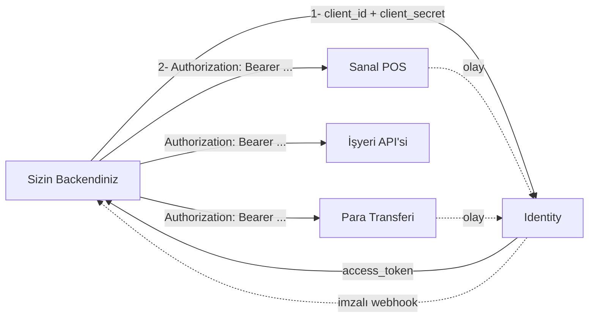
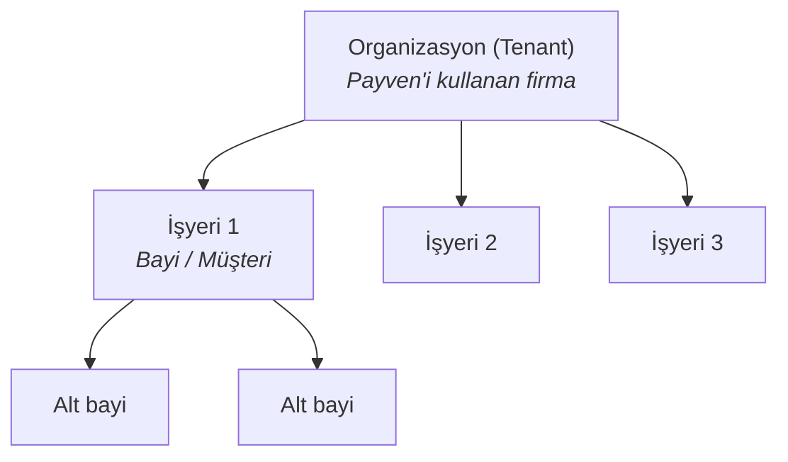
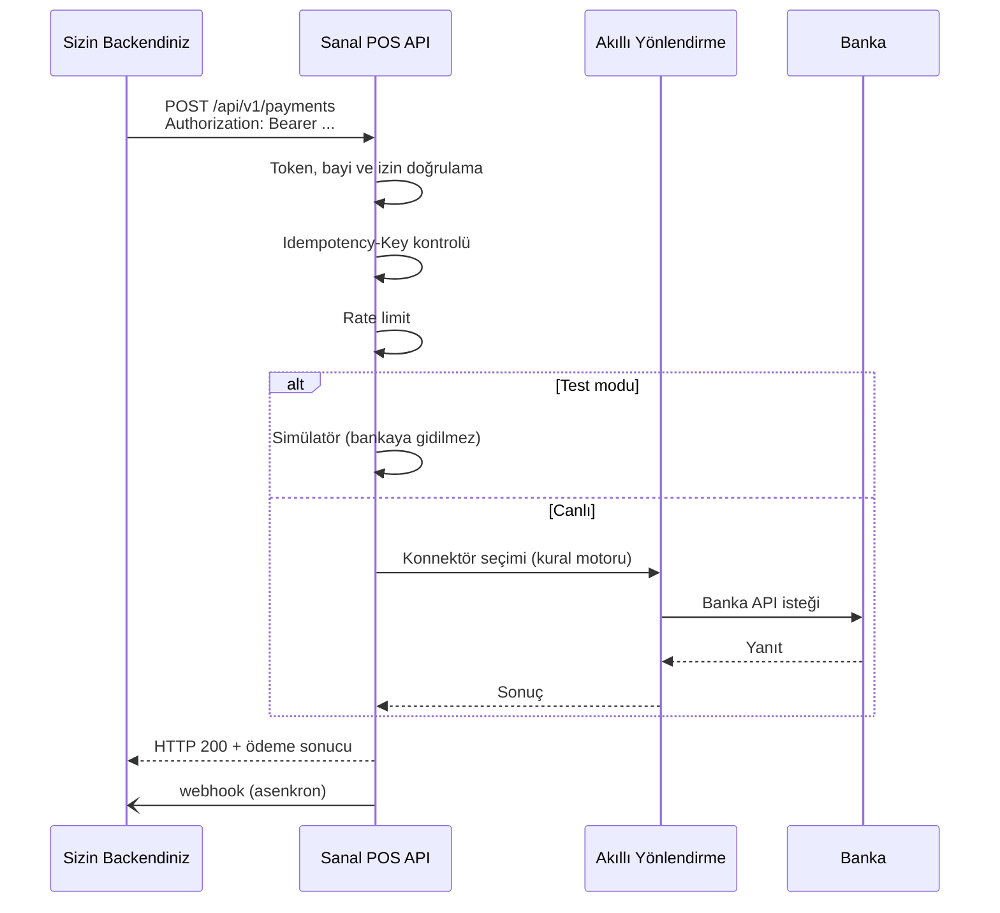

Payven, ortak bir kimlik servisi etrafında düzenlenmiş bağımsız ürün servislerinden oluşur. **Tek bir access token ile** anahtarınızın kapsadığı tüm ürünleri çağırırsınız.

## Servis topolojisi

İlk adımda Identity'den `client_credentials` akışıyla access token alırsınız; sonraki istekleri ürün servislerine `Authorization: Bearer <access_token>` header'ı ile yaparsınız. Token, API anahtarının **seçili ürünleri** için geçerlidir.

| Servis | Sorumluluk |
|---|---|
| **Identity** | Organizasyon, işyeri (bayi) ve kullanıcı yönetimi, rol ve izinler, API anahtarı yaşam döngüsü, OAuth 2.0 token üretimi, **webhook uçları ve olay merkezi** |
| **Sanal POS** | Kart ödemeleri, 3D Secure, Hosted Checkout, ödeme linki, akıllı yönlendirme, iade/iptal, mutabakat |
| **Para Transferi** | Havale, EFT ve FAST; toplu ve tekrarlı transferler |
| **Cüzdan** | Bayi bakiyesi, hakediş, komisyon ve çekim |
| **Fatura Ödeme, Kredi Kartı Borç Ödeme, e-Fatura** | Kurum tahsilatı, kart borcu ödeme, e-Fatura / e-Arşiv kesimi |
| **Fraud** | Ödeme akışlarında çalışan risk kural motoru (satılabilir modül) |
| **İşyeri API'si** | İşyeri panelinin gateway'i; bayi kartı, hesaba aktarım, entegrasyon durumu. Webhook ve olay uçlarını Identity'ye iletir |

Hangi ürünlerin kurulu olduğu ortama göre değişir. Kurulu olmayan bir ürünün olayları ve uçları sunulmaz; organizasyonunuzda kapalı bir ürüne giden istek `403 feature_not_available` alır.

## Organizasyon ve işyeri modeli

- **Organizasyon (Tenant):** Payven'i kullanan firma. Banka konfigürasyonları, yönlendirme ve ödeme politikaları bu seviyede yönetilir.
- **İşyeri (Bayi):** Organizasyona bağlı müşteri. Her ödeme bir işyeri adına gerçekleştirilir; işyerinin ortamı (`sandbox` / `live`) işlemin gerçek olup olmadığını belirler.
- **Alt bayi:** İsteğe bağlı olarak marketplace satıcıları.

Detay: [Hesap Yapısı](/documentation/account-model).

## İstek yaşam döngüsü

Aşağıda kart ödeme isteğinin Sanal POS'tan geçişi gösterilmiştir; diğer ürünlerde de ortak adımlar aynıdır.

Her yanıt `X-Correlation-Id` header'ı taşır; destek talebinde bu değeri paylaşın.

## Ortam adresleri

Her servis kendi alt alan adı üzerinden hizmet verir; alan adı kurulumunuza bağlıdır. Tüm yollar `/api/v1` ile başlar.

| Servis | Alt alan adı |
|---|---|
| **Identity** | `identity.<alan-adı>` |
| **Sanal POS** | `vpos.<alan-adı>` |
| **Para Transferi** | `transfer.<alan-adı>` |
| **Cüzdan** | `wallet.<alan-adı>` |
| **Fatura Ödeme** | `invoice.<alan-adı>` |
| **e-Fatura** | `efatura.<alan-adı>` |
| **İşyeri API'si** | `merchant.<alan-adı>` |

**Test ve canlı için ayrı adres yoktur.** Aynı adreste, kullandığınız API anahtarının ortamı (`test` / `live`) ve işyerinin ortamı işlemin modunu belirler. Kendi adreslerinizi İşyeri paneli › Ayarlar › Entegrasyon ekranında görürsünüz. Canlıya geçmeden önce [Production Geçiş Kontrol Listesi](/documentation/security/go-live-checklist)'ni tamamlayın.
