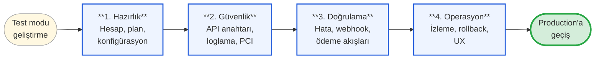
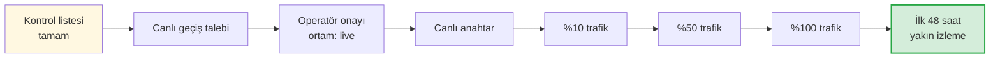

Bu sayfa, **canlıya geçmeden önce** entegrasyonunuzda kontrol etmeniz gereken her şeyi tek bir yerde toplar. Tüm maddeleri işaretledikten sonra İşyeri panelinden **canlıya geçiş talebi** açarsınız; geçiş operatör onayıyla gerçekleşir (bkz. [aşağıda](#productiona-gecis)).

## Geçiş yolculuğu

Her faz aşağıda ayrı bir bölümde detaylandırılır.

<CardGroup cols={4}>
  <Card title="1. Hazırlık" icon="folder-gear">
    Hesap, plan, merchant ve banka konfigürasyonları
  </Card>
  <Card title="2. Güvenlik" icon="shield-keyhole">
    API anahtarı yönetimi, loglama, PCI-DSS uyumu
  </Card>
  <Card title="3. Doğrulama" icon="circle-check">
    Hata yönetimi, webhook, ödeme akışları, mutabakat
  </Card>
  <Card title="4. Operasyon" icon="chart-line">
    24/7 izleme, rollback planı, müşteri deneyimi
  </Card>
</CardGroup>

---

## Faz 1 — Hazırlık

### 🏢 Hesap ve yapılandırma

<Checkbox> Production konsoluna giriş yapabilen en az **iki yetkili kullanıcı** vardır. </Checkbox>
<Checkbox> Organizasyonunuzun **plan ve kotaları** beklenen işlem hacmini karşılıyor. </Checkbox>
<Checkbox> Canlı işyeri tanımı (vergi bilgileri, iletişim, banka profilleri) eksiksizdir; bayi **aktif** ve **onaylı**dır (pasif ya da onaysız bayi işlem yapamaz). </Checkbox>
<Checkbox> Banka konfigürasyonları (credential, endpoint, store key) canlı değerleriyle girilmiştir. </Checkbox>
<Checkbox> Akıllı yönlendirme kurallarınız canlı konfigürasyonlarla gözden geçirilmiştir. </Checkbox>
<Checkbox> Non-3D kullanacaksanız bayinin banka profilinde Non-3D izni açıktır (aksi halde `422 PV_NON_3D_NOT_ALLOWED`). </Checkbox>

---

## Faz 2 — Güvenlik ve uyumluluk

### 🔑 API anahtarı güvenliği

<Checkbox> Production API anahtarı **secret manager'da** saklanır, kaynak kodda **yoktur**. </Checkbox>
<Checkbox> **İzinli IP listesi** tanımlanmıştır: yalnızca canlı sunucularınızdan istek atılabilir. </Checkbox>
<Checkbox> Geliştiriciler production anahtarına **doğrudan erişemez** — sadece servis hesabı kullanılır. </Checkbox>
<Checkbox> Test ve canlı anahtarlar **ayrı secret store'larda** saklanır; canlı anahtarın ortamı `live`'dır. </Checkbox>
<Checkbox> Anahtar rotasyon prosedürü ([kesintisiz rotasyon](/documentation/security/api-key-best-practices#rotasyon-proseduru)) dokümante edilmiş, sorumlular belirlenmiştir. </Checkbox>

### 📋 Loglama ve gözlem

<Checkbox> İstek/yanıt loglarında **kart numarası, CVV, API secret görünmüyor**. </Checkbox>
<Checkbox> Tüm Payven çağrıları için **correlation ID** ile izleme yapılabiliyor. </Checkbox>
<Checkbox> Hata oranı ve latency için **alarm** kurulmuştur (örn. 5xx oranı %1'i geçerse uyarı). </Checkbox>
<Checkbox> Log saklama süresi yasal gereksinimlerinizi karşılıyor (genelde minimum 1 yıl). </Checkbox>

### 🛡️ PCI-DSS ve uyumluluk

<Checkbox> Kart bilgileri sunucularınızda **saklanmıyor**. </Checkbox>
<Checkbox> Hangi PCI-DSS SAQ formuna tabi olduğunuzu biliyorsunuz. </Checkbox>
<Checkbox> Loglarda kart numarası veya CVV görünmediği **otomatik test ile** doğrulanmıştır. </Checkbox>
<Checkbox> KVKK yükümlülükleriniz değerlendirilmiştir. </Checkbox>

---

## Faz 3 — Doğrulama ve test

### ⚠️ Hata yönetimi

<Checkbox> İstemci tarafı kodu **HTTP 4xx ve 5xx**'i farklı yönetiyor. </Checkbox>
<Checkbox> `5xx` ve timeout durumlarında **idempotency-key ile retry** uygulanıyor. </Checkbox>
<Checkbox> `429 Rate Limit` durumunda `Retry-After` başlığına uyuluyor. </Checkbox>
<Checkbox> Bilinmeyen hata kodları **default fallback** ile yönetiliyor (uygulama crash etmiyor). </Checkbox>
<Checkbox> Müşteriye gösterilen hata mesajları **anlaşılır** ve teknik detay sızdırmıyor. </Checkbox>

### 🔔 Webhook

<Checkbox> Webhook endpoint'iniz **HTTPS** üzerinde çalışıyor. </Checkbox>
<Checkbox> İmza doğrulaması (`X-Payven-Signature`) uygulanıyor. </Checkbox>
<Checkbox> Endpoint **15 saniyelik delivery timeout'undan çok önce** (hedef: 5sn altı) yanıt veriyor; ağır iş kuyruğa atılıyor. </Checkbox>
<Checkbox> Aynı `X-Payven-Event-Id` ile gelen olaylar **idempotent** işleniyor (aynı olay tekrar teslim edilebilir). </Checkbox>
<Checkbox> Webhook teslim hataları izleniyor; `GET /webhook-endpoints/{id}/deliveries` ile teslim kayıtları düzenli kontrol ediliyor. </Checkbox>
<Checkbox> Webhook ucu 3 gün boyunca hiç başarılı teslim alamazsa Payven tarafından kapatılır; `merchant.webhook_endpoint.disabled` bildirimi izleniyor ve ucun durumu (`GET /webhook-endpoints`) periyodik kontrol ediliyor. </Checkbox>

### 💳 Ödeme akışları

<Checkbox> Kullandığınız ödeme akışı (**Hosted Checkout**, **3D Secure** ya da Non-3D) test modunda başarılı ve başarısız senaryolarla denenmiştir. </Checkbox>
<Checkbox> **3D Secure** akışında dönüş (`success_url` / `cancel_url`) ve hata senaryoları test edilmiştir. </Checkbox>
<Checkbox> **İade** ve **iptal** akışları test edilmiştir. </Checkbox>
<Checkbox> **Taksit** seçenekleri için BIN bazlı doğrulama yapılmaktadır. </Checkbox>
<Checkbox> **Hosted Checkout** kullanıyorsanız, `success_url` ve `cancel_url` HTTPS'tir. </Checkbox>
<Checkbox> Ödeme **timeout** durumunda kullanıcıya doğru mesaj gösteriliyor. </Checkbox>

### 📊 Mutabakat ve raporlama

<Checkbox> **Mutabakat** akışı test edilmiş, sonuçlar muhasebe sürecine entegre edilmiştir. </Checkbox>
<Checkbox> Gün sonu / dönem sonu raporları otomatik üretiliyor. </Checkbox>
<Checkbox> Eksik/hatalı kayıt durumlarında **uyarı mekanizması** vardır. </Checkbox>

---

## Faz 4 — Operasyon hazırlığı

### 🚨 Operasyonel kontrol

<Checkbox> **24/7 izleme** ve **on-call** süreciniz tanımlıdır. </Checkbox>
<Checkbox> Sorun durumunda Payven destek ekibine ulaşılacak iletişim kanalları biliniyor. </Checkbox>
<Checkbox> **Rollback planı** yazılıdır — production'da sorun çıkarsa nasıl geri dönüleceği bellidir. </Checkbox>
<Checkbox> İlk gün için **gradual rollout** stratejisi vardır (örn. trafiğin %10'u, sonra %50, sonra %100). </Checkbox>

### 👤 Müşteri deneyimi

<Checkbox> Ödeme formu mobilde test edilmiştir. </Checkbox>
<Checkbox> Kart numarası alanında **inline format** (4'lü gruplama, BIN bazlı kart birliği logosu) vardır. </Checkbox>
<Checkbox> 3D Secure yönlendirmesi sonrası **dönüş URL'si** doğru çalışıyor. </Checkbox>
<Checkbox> Hata durumunda kullanıcı **bir sonraki adıma yönlendiriliyor** (sepete dönüş, başka kart deneme). </Checkbox>

---

## Production'a geçiş

Test modundaki bayi canlıya kendiliğinden geçmez; geçiş talep ve onayla ilerler:

<Steps>
  <Step title="Entegrasyon kontrol listesini tamamlayın">
    İşyeri paneli › **Ayarlar › Entegrasyon** (`GET /settings/integration`) test modundaki gerçek kayıtlardan türetilir. Zorunlu maddeler: başarılı test ödemesi, başarısız ödeme senaryosu ve iade testi. Webhook doğrulaması isteğe bağlıdır ama önerilir.
  </Step>
  <Step title="Canlıya geçiş talep edin">
    İşletme yöneticisi **Canlıya geçiş talep et** der (`POST /settings/integration/live-requests`). Zorunlu maddeler tamamlanmadan talep açılamaz. Talep bayiyi canlıya almaz; operatör incelemesine düşer.
  </Step>
  <Step title="Operatör onayı">
    Onayda bayinin ortamı `live` olur. Organizasyonun kuruluş (lisanslı kurum) onayı politikası varsa, bayinin kuruluş onayından geçmiş olması ya da operatörün gerekçeli muafiyet vermesi gerekir. Bu adımdan sonra istekler canlıdır; test kayıtları canlı listelerde görünmez.
  </Step>
  <Step title="Canlı anahtar oluşturun">
    `environment: "live"` anahtarı oluşturup secret'ı secret manager'a yazın; izinli IP listesini tanımlayın. Test anahtarını canlı ortamdan kaldırın.
  </Step>
  <Step title="Gradual rollout">
    İlk saatlerde trafiğin küçük bir bölümünü (örn. %10) canlıya yönlendirin; hata oranı, başarı oranı ve webhook teslimini izleyin. Sorun yoksa %50, sonra %100.
  </Step>
  <Step title="İlk 48 saat yakın izleme">
    Hata oranı, başarı oranı, gecikme ve webhook teslim metriklerini sürekli takip edin. Anomali görürseniz rollback planınızı uygulayın.
  </Step>
</Steps>

<Tip>
İlk canlı işleminizi gerçek bir kartla düşük tutarlı (örn. 1,00 ₺) bir ödeme olarak yapıp hemen iade edin. Uçtan uca akışın çalıştığını teyit eder. Test modunda ürettiğiniz verileri İşyeri panelindeki **Tüm test verilerini sil** ile temizleyebilirsiniz; canlı veri silinmez.
</Tip>
