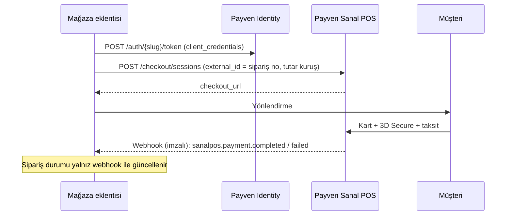

Payven eklentileri, mağazanıza **kod yazmadan** Payven Sanal POS ile ödeme almanızı sağlar. Hepsi aynı **hosted checkout** akışını kullanır: müşteri kart bilgisini Payven'in barındırdığı sayfada (3D Secure ve taksit dahil) girer, kart verisi mağaza sunucunuza hiç dokunmaz (PCI-DSS **SAQ-A**). Ödeme sonucu imzalı webhook ile siparişe işlenir.

## Platformlar

| Platform | Gereksinim | Not |
|---|---|---|
| WooCommerce (WordPress) | WordPress 6.0+, WooCommerce 7.0+, PHP 7.4+ | Block checkout dahil |
| OpenCart 3 | OpenCart 3.0.x, PHP 7.4+ | `.ocmod.zip` |
| OpenCart 4 | OpenCart 4.0.2.0+, PHP 8.0+ | `.ocmod.zip` |
| PrestaShop | PrestaShop 1.7.6+ / 8.x, PHP 7.4+ | |
| Magento 2 | Magento 2.4.x, PHP 7.4+ | |
| nopCommerce | nopCommerce 4.60 / 4.70 | C# / .NET |
| Shopify | Node 18+ | Payments App (offsite); canlıya geçiş Shopify ödeme sağlayıcı onayı gerektirir |
| PHP SDK | PHP 7.4+ | Kendi PHP uygulamanız için [Payven PHP SDK](/eklentiler/php-sdk) |

Her eklenti kendi sürüm numarasını taşır ve bağımsız yayınlanır.

## Akış

<Warning>
Sipariş sonucu için müşterinin **dönüş (return) sayfasına güvenmeyin**; tarayıcı kapanabilir ya da adres değiştirilebilir. Eklentiler siparişi yalnız imzası doğrulanmış webhook ile günceller.
</Warning>

## Webhook ve imza

Eklenti ayarlarını kaydettiğinizde, ucu İşyeri API'sinde (`POST /api/v1/webhook-endpoints`, `payload_format: "flat"`) kendisi kurar ve dönen `whsec_...` sırrını saklar. Abone olunan olaylar:

`sanalpos.payment.completed`, `sanalpos.payment.failed`, `sanalpos.payment.not_completed`, `sanalpos.refund.completed`, `sanalpos.refund.failed`, `sanalpos.void.completed`.

İmza: `X-Payven-Signature: sha256=<hex>` = `HMAC_SHA256("{X-Payven-Timestamp}.{ham_gövde}", secret)`, ±5 dakika tolerans. Sır yenileme geçişinde virgülle iki imza gelir; biri tutarsa geçerlidir. Ayrıntı: [İmza Doğrulama](/sanal-pos/webhooks/signature). Siparişle eşleme webhook gövdesindeki `external_id` (= mağaza sipariş numarası) ile yapılır.

Tutarlar kuruş cinsindendir (`150,00 TL` → `15000`); eklenti dönüşümü kendisi yapar.

## İade

Mağaza panelindeki standart iade butonu Payven iadesini tetikler (tam ya da kısmi). Bayinin bakiyesi yetersizse iade reddedilmez, **kuyruğa alınır** ve bakiye oluşunca otomatik işlenir; bu durumda mağazada iade kaydı açılmaz ve "kuyruğa alındı, para henüz iade edilmedi" notu düşer. İade gerçekleşince siparişe "iade tamamlandı" notu eklenir. Ayrıntı: [Kurulum ve Ayarlar](/eklentiler/setup).
