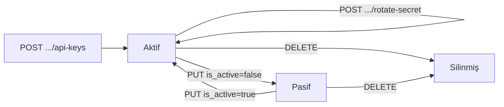

Payven'de "API anahtarı", **OAuth 2.0 Client Credentials çiftidir**. Anahtar oluşturduğunuzda Identity yeni bir OAuth client kaydeder ve size `client_id` + `client_secret` verir. Bu çiftle [`POST /auth/{slug}/token`](/documentation/concepts/authentication) üzerinden access token alır, ürün servislerine `Authorization: Bearer ...` ile çağrı yaparsınız.

<Note>
`client_id` + `client_secret` **uzun ömürlü** kimlik bilgisidir ve API çağrılarında doğrudan kullanılmaz. İstek başına gönderilen, bunlarla üretilen **kısa ömürlü (5 dk) access token**'dır.
</Note>

## Anahtar yapısı

| Bileşen | Açıklama | Örnek |
|---|---|---|
| `client_id` | Public tanımlayıcı. `pvk-{tenant-adı}-{ortam}-{rastgele}` biçimindedir; yalnız `pvk-` öneki anlam taşır, gerisi görüntü içindir. API'de `keycloak_client_id` alanında döner | `pvk-payven-test-a1b2c3d4` |
| `client_secret` | Gizli. Yanıtta `secret` alanıdır | 40 karakter |
| `environment` | `test` veya `live`. **Oluşturulurken seçilir, sonradan değişmez** | `test` |
| `access_level` | `full` (varsayılan) veya `read_only` | `full` |
| `features` | Anahtarın erişebileceği API'ler (kapsam) | `["sanalpos", "para-transferi"]` |

### Test ve canlı ortam

Ortam, anahtarla yapılan **her isteğin modunu** belirler (token'daki `environment` claim'i): `test` anahtarla yapılan istekler test verisini görür ve bankaya / kuruma gitmez; `live` anahtar gerçek işlem üretir. Ortamı değiştirmek mümkün değildir (`422 api_key_environment_immutable`); diğer ortam için yeni anahtar üretin.

- Test modundaki (`sandbox`) bayiye **canlı anahtar verilemez** (`422 api_key_live_requires_live_merchant`). Bayi canlıya geçince mevcut test anahtarları test olarak kalır.
- **Test anahtarının secret'ı sonradan yeniden okunabilir** (`GET .../{id}/secret`); eklenti kurulumu için kolaylıktır. **Canlı anahtarın secret'ı yalnız oluşturma / rotasyon yanıtında bir kez** gösterilir (`422 api_key_secret_not_revealable`).

### Erişim düzeyi

`access_level: "read_only"` anahtar yalnız okur; durum değiştiren her istek `403 credential_read_only` alır. Düzey sonradan değiştirilebilir; değişince mevcut oturumlar düşürülür ve entegrasyon yeni token alır. Raporlama / izleme entegrasyonları için salt okunur anahtar kullanın.

### Yapay zekâ asistanı anahtarı (`kind: "agent"`)

`kind: "agent"` anahtar yapay zekâ asistanı (MCP) bağlantısı içindir: daima salt okunurdur, izinleri `agent_scopes` ile belirlenir ve tek parça (`pvak_...`) anahtar olarak `agent_key` alanında bir kez gösterilir. Tür sonradan değişmez (`422 api_key_kind_immutable`).

## İki yüzey

| Yüzey | Route | Kim çağırır | Kapsam |
|---|---|---|---|
| Tenant | `/api/v1/tenants/me/api-keys` | `tenant-admin` (yazma), `tenant-admin` / `tenant-user` (okuma) | Tenant'ın tüm anahtarları; bayi bağlanabilir (`merchant_id`) |
| Bayi | `/api/v1/merchants/me/api-keys` | `merchant-admin` (yazma), `merchant-admin` / `merchant-user` (okuma) | Yalnız **çağıranın kendi bayisi** |

Bayi yüzeyinde `merchant_id` istekten alınmaz, token'dan yazılır (gövdedeki değer ezilir); plan ve limit override'ları bayi tarafından yazılamaz. Başka bayinin anahtarı `404` döner. Bayi yüzeyinde liste **sayfasız düz dizidir** ve ek olarak [`GET /merchants/me/api-keys/assignable-scopes`](/identity/api-keys/create) vardır.

```http
GET    /api/v1/tenants/me/api-keys                    # Liste (sayfalı)
GET    /api/v1/tenants/me/api-keys/{id}               # Tek anahtar
POST   /api/v1/tenants/me/api-keys                    # Yeni anahtar
PUT    /api/v1/tenants/me/api-keys/{id}               # Güncelleme (tam değiştirme)
DELETE /api/v1/tenants/me/api-keys/{id}               # Kalıcı silme
POST   /api/v1/tenants/me/api-keys/{id}/rotate-secret # Secret rotasyonu
GET    /api/v1/tenants/me/api-keys/{id}/secret        # Test anahtarının secret'ı
```

Bayi yüzeyinde aynı yedi uç `/api/v1/merchants/me/api-keys` altında bulunur.

## Liste

```bash
curl "https://identity.payven.com.tr/api/v1/tenants/me/api-keys?environment=live&include_inactive=false" \
  -H "Authorization: Bearer $PAYVEN_TOKEN"
```

| Query | Açıklama |
|---|---|
| `page`, `page_size` | Sayfalama (varsayılan `1` / `50`) |
| `search_term` | Ad / `client_id` araması |
| `include_inactive` | Pasif anahtarları da getir |
| `environment` | `test` veya `live`. Verilirse yalnız o ortamın sunucu anahtarları döner |

```json
{
  "items": [
    {
      "id":                      "8e3f5c12-...",
      "tenant_id":               "1a2b3c4d-...",
      "keycloak_client_id":      "pvk-payven-live-a1b2c3d4",
      "display_name":            "Production — Ödeme Servisi",
      "contact_email":           "ops@example.com",
      "merchant_id":             "M-IST-001",
      "environment":             "live",
      "access_level":            "full",
      "kind":                    "standard",
      "agent_scopes":            null,
      "features":                ["sanalpos", "para-transferi"],
      "is_managed":              true,
      "client_type":             "server",
      "plan_id":                 "abc-...",
      "plan_code":               "standard",
      "plan_name":               "Standart Plan",
      "daily_limit_override":    null,
      "monthly_limit_override":  null,
      "rate_limit_override":     null,
      "effective_daily_limit":   100000,
      "effective_monthly_limit": 3000000,
      "effective_rate_limit":    200,
      "allowed_ips":             "52.18.42.10,52.18.42.0/24",
      "expires_at":              null,
      "is_active":               true,
      "allow_offline_access":    false,
      "created":                 "2026-01-15T10:00:00.000+03:00"
    }
  ],
  "page": 1, "total_pages": 1, "total_count": 1,
  "has_previous_page": false, "has_next_page": false
}
```

| Alan | Açıklama |
|---|---|
| `id` | Anahtarın UUID'si; route'larda `{id}` olarak kullanılır |
| `keycloak_client_id` | Token alırken `client_id` olarak gönderilen değer |
| `merchant_id` | Anahtarın bağlı olduğu bayi (external id). Boş = tenant geneli. Token'a yansır |
| `*_override` / `effective_*` | Plan limitini ezen değerler / nihai limit. Limitler token claim'lerine basılır |
| `allowed_ips` | Virgülle ayrılmış IP / CIDR listesi. Boş = kısıtsız |
| `expires_at` | Anahtarın son kullanma anı; geçince token verilmez (`401 api_key_expired`) |
| `is_managed` | `false` = sistem client'ı (salt okunur gösterilir, değiştirilemez) |
| `allow_offline_access` | Uzun ömürlü (offline) refresh token izni |

<Note>
`client_secret` listede ve detayda **hiç dönmez**. Yalnız oluşturma ve rotasyon yanıtında (ve test anahtarı için `.../secret` ucunda) bulunur.
</Note>

## Yaşam döngüsü



## En iyi uygulamalar

<Check>**Ortam başına ayrı anahtar** — test ve canlıyı aynı anahtarla karıştırmayın; ortam zaten değişmez.</Check>
<Check>**Servis başına ayrı anahtar, dar kapsam** — yalnız ihtiyaç duyulan `features` seçilsin; sızıntıda etki alanı küçük kalır.</Check>
<Check>**Raporlama için `read_only`** — yazma gerektirmeyen entegrasyonlara salt okunur anahtar verin.</Check>
<Check>**Canlı anahtarda `allowed_ips` doldurun** — bkz. [IP Whitelist](/documentation/concepts/ip-whitelist).</Check>
<Check>**Düzenli rotasyon** — secret'ı yenileyin; eski secret anında geçersiz olur, dağıtımı buna göre planlayın.</Check>

Detay: [API Anahtarı En İyi Uygulamaları](/documentation/security/api-key-best-practices).

## Sıradaki adımlar

<CardGroup cols={2}>
  <Card title="Yeni anahtar oluştur" icon="plus" href="/identity/api-keys/create">
    Alanlar, API kapsamı ve secret saklama.
  </Card>
  <Card title="Secret rotasyonu" icon="arrows-rotate" href="/identity/api-keys/rotate">
    Yeni secret üretme ve geçiş.
  </Card>
  <Card title="Pasife alma / silme" icon="trash" href="/identity/api-keys/revoke">
    Anahtarı devre dışı bırakma veya kalıcı silme.
  </Card>
  <Card title="Token alma akışı" icon="key" href="/documentation/concepts/authentication">
    `client_id` + `client_secret` ile token.
  </Card>
</CardGroup>
