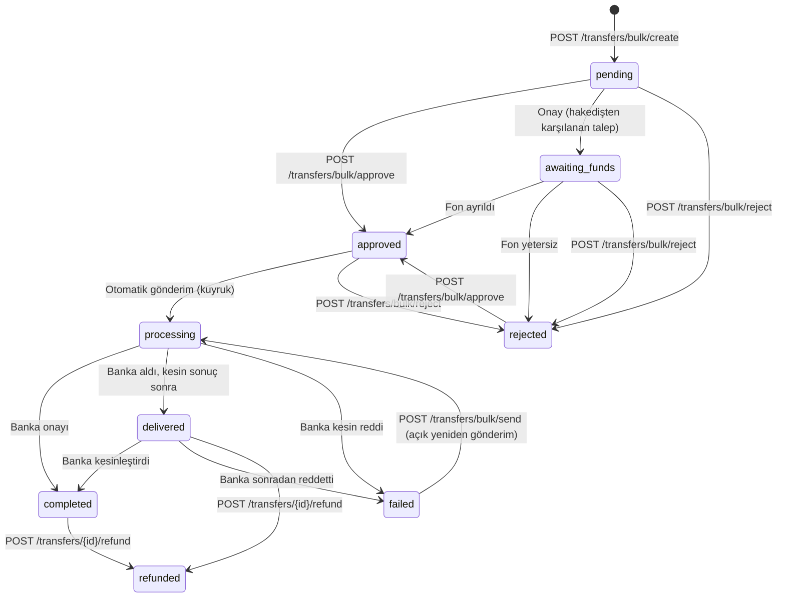

Payven Para Transferi modülü; lisanslı ödeme kuruluşları ve büyük platformlar için **çoklu banka transfer altyapısı** sunar. EFT, FAST ve havale işlemlerini tek API üzerinden yürütür; 4-göz onay, toplu transfer paketleri, tekrarlayan transferler, belirsiz banka sonuçlarının kesinleştirilmesi, dekont ve transfer iadesi içerir.

## Temel özellikler

<CardGroup cols={2}>
  <Card title="Çoklu Banka" icon="building-columns">
    Banka bağlantıları ihtiyacınıza göre özel olarak geliştirilir ve entegratör yapılandırması üzerinden sizin tarafınızdan yönetilir; sizin payload'unuz tüm bankalarda aynıdır.
  </Card>
  <Card title="EFT + FAST + Havale" icon="arrow-right-arrow-left">
    Tek API ile üç transfer tipi ve karta para gönderme.
  </Card>
  <Card title="Toplu İşlem" icon="layer-group">
    Tek istekte birden çok transfer (`bulk/create`) ya da 5.000 satıra kadar onaylı transfer paketi (`/bulk-transfers`).
  </Card>
  <Card title="Belirsiz Sonuç Güvenliği" icon="arrows-rotate">
    Banka yanıt vermezse transfer `processing`'te kalır ve yeniden gönderilmez; sonuç bankayla eşitlenerek kesinleşir.
  </Card>
  <Card title="Webhook" icon="bell">
    Transfer durum değişimleri imzalı webhook ile teslim edilir.
  </Card>
  <Card title="Tenant İzolasyonu" icon="shield-keyhole">
    Her organizasyonun verisi diğer organizasyonlardan tamamen yalıtılmıştır; bayi kapsamı istek başlığından gelir.
  </Card>
</CardGroup>

## Base URL

| Ortam | URL |
|---|---|
| Production | `https://transfer.payven.com.tr` |

Test modunda çalışan hesaplar için bkz. [Test Modu ve Test Alıcıları](/para-transferi/sandbox).

## Transfer yaşam döngüsü



| Durum | Anlam |
|---|---|
| `pending` | Transfer oluşturuldu, onay bekliyor (4-göz) |
| `awaiting_funds` | Onaylandı; bayinin talebi hakedişinden karşılanacak, fon bekleniyor |
| `approved` | Onaylandı, gönderim kuyruğunda — **ayrıca gönderim çağrısı gerekmez**. Banka oturumu alınamadığı için bankaya hiç gidemeyen transfer de burada bekler ve onaydan itibaren 2 saat boyunca otomatik yeniden denenir |
| `processing` | Bankaya gönderildi, kesin sonuç henüz yok. Banka yanıt vermediyse (zaman aşımı) transfer **burada kalır, `failed` olmaz** ve yeniden gönderilmemelidir; sonuç banka sorgusu / banka bildirimiyle ya da operatör kararıyla kesinleşir |
| `delivered` | Banka aldı, kesin sonuç bekleniyor (EFT valörü, kart transferi); sonradan `completed` ya da `failed` olabilir |
| `completed` | Banka transferi gerçekleştirdi |
| `failed` | Bankanın kesin reddi ya da transfer 2 saatlik otomatik deneme süresi içinde bankaya gönderilemedi. Yalnız sizin açık kararınızla `POST /transfers/bulk/send` ile yeniden gönderilebilir |
| `rejected` | Gönderilmeden reddedildi; para hareket etmedi. `bulk/approve` ile yeniden onaylanabilir |
| `refunded` | `completed` / `delivered` transfer iade edildi (defter düzeltmesi; bankada geri hareket oluşmaz) |

Önerilen akış ve yeniden gönderim kuralları: [Önerilen Entegrasyon Akışı](/para-transferi/integration-guide).

## Endpoint kategorileri

| Kategori | Endpoint'ler |
|---|---|
| Transfer yaşam döngüsü | `POST /transfers/bulk/create`, `/bulk/approve`, `/bulk/reject`, `/bulk/send` |
| Belirsiz sonuç ve iade | `POST /transfers/{id}/sync`, `/transfers/{id}/resolve`, `/transfers/{id}/refund` — bkz. [Belirsiz Sonuç ve İade](/para-transferi/transfers/outcome-resolution) |
| Toplu transfer paketi | `/bulk-transfers` (önizleme, oluşturma, onay, iptal) — bkz. [Toplu Transfer Paketi](/para-transferi/transfers/bulk-batches) |
| Tekrarlayan | `/recurring-transfers` |
| Sorgulama | `GET /transfers` (`external_id`, `request_id` ile birebir), `GET /transfers/{id}`, `/transfers/{id}/history`, `/transfers/stats`, `/transfers/export` |
| Dekont | `GET /transfers/{id}/receipt/download`, `/receipt/base64`; Payven makbuzu `GET /receipts/transfer/{id}` |
| Gönderici hesaplar | `GET /connector-accounts` (`source_account_id` değerleri) |
| Banka hesapları | `GET /accounts`, `GET /accounts/transactions` |
| Alıcılar | `/recipients`, `/receiver-accounts` |
| IBAN doğrulama | `POST /validation/iban` (Identity API'si) |
| Test | `/test-receiver-accounts` |

## Hızlı başlangıç

```bash
# 1. Toplu transfer oluştur (4-göz: önce oluştur)
curl -X POST https://transfer.payven.com.tr/api/v1/transfers/bulk/create \
  -H "Authorization: Bearer $PAYVEN_TOKEN" \
  -H "X-Request-Id: PAYROLL-2026-05" \
  -H "Idempotency-Key: payroll-2026-05-01" \
  -H "Content-Type: application/json" \
  -d '{
    "items": [
      {
        "source_account_id": "550e8400-e29b-41d4-a716-446655440000",
        "external_id":       "PAYROLL-001",
        "description":       "Mayıs maaş ödemesi",
        "transfer_type":     "fast",
        "amount":            { "value": 1500000, "currency_code": "TRY" },
        "recipient": {
          "holder_name": "Ahmet Yılmaz",
          "iban":        "TR330006100519786457841326"
        }
      }
    ]
  }'

# 2. Onayla (4-göz açıksa oluşturandan farklı bir kimlikle) — onaylanan transfer otomatik bankaya gönderilir
curl -X POST https://transfer.payven.com.tr/api/v1/transfers/bulk/approve \
  -H "Authorization: Bearer $PAYVEN_TOKEN" \
  -H "Content-Type: application/json" \
  -d '{ "transfers": [ { "transfer_id": "8e3f5c12-..." } ] }'

# 3. Sonucu webhook ile alın; webhook gelmezse kendi paket numaranızla sorgulayın
curl "https://transfer.payven.com.tr/api/v1/transfers?request_id=PAYROLL-2026-05" \
  -H "Authorization: Bearer $PAYVEN_TOKEN"
```

`POST /transfers/bulk/send` normal akışta gerekmez; yalnız `failed` transferi bilinçli olarak yeniden
göndermek için kullanılır.

## Transfer tipleri

| `transfer_type` | Açıklama |
|---|---|
| `fast` | FAST — 7×24 anlık; tutar üst limiti vardır |
| `eft` | EFT — iş saatleri ve valör kurallarına tabidir |
| `remittance` | Havale — alıcı aynı bankadaysa |
| `credit_card` | Karta para gönderme (yalnız `bulk/create`; toplu transfer paketlerinde ve tekrarlayan transferde yoktur) |

<Note>
İstek payload'unuz tüm bankalarda aynıdır. Paranın hangi bankadan çıkacağını `source_account_id`
(gönderici hesap) belirler; hesaplar [`GET /connector-accounts`](/para-transferi/reporting/accounts) ile listelenir.
</Note>

## Webhook olayları

| Olay | Tetikleyici |
|---|---|
| `para-transferi.transfer.created` | Transfer oluşturuldu, onay bekliyor |
| `para-transferi.transfer.approved` | Transfer onaylandı, gönderim kuyruğunda |
| `para-transferi.transfer.outcome_unknown` | Banka yanıt vermedi; transfer `processing`'te kalır, **yeniden gönderilmemeli** — kesin sonuç sonra `completed` / `failed` olarak gelir |
| `para-transferi.transfer.delivered` | Banka aldı; kesin sonuç sonra bildirilir |
| `para-transferi.transfer.completed` | Banka transferi gerçekleştirdi |
| `para-transferi.transfer.failed` | Bankanın kesin reddi ya da gönderilemedi (`delivered`'dan sonra da gelebilir) |
| `para-transferi.transfer.rejected` | Transfer gönderilmeden reddedildi; para hareket etmedi |
| `para-transferi.transfer.refunded` | Gönderilmiş transfer iade edildi (defter düzeltmesi) |
| `para-transferi.bulk_transfer.completed` | Toplu transfer paketinin tüm kalemleri sonuçlandı (paket başına bir kez) |
| `para-transferi.recurring_execution.succeeded` / `.failed` | Tekrarlayan transferin günlük çekilimi başarılı / başarısız |
| `para-transferi.recurring_transfer.suspended` | Tekrarlayan transfer ardışık hatalarla askıya alındı |

Webhook uçları İşyeri API'sinde (`/api/v1/webhook-endpoints`) yönetilir; tek uç tüm ürünlerin
olaylarını alabilir. Teslim: HMAC-SHA256 imzalı, 10 deneme / ~2,5 gün (±%20 sapma), 15 sn zaman
aşımı; tükenen teslim panelden ya da API ile yeniden gönderilir. Detay:
[Webhook'lar](/documentation/concepts/webhooks).

## Sorumlu kullanım

<Warning>
Para transferi modülü **iyi yapılandırılmış AML/KYC süreçlerinizle birlikte**
çalışır. [IBAN doğrulama](/para-transferi/validation/iban) ve alıcı kara listesi
(`POST /recipients/{id}/blacklist`) ile birlikte sahte transfer riskini düşürün.
</Warning>

API referansı için: [Para Transferi OpenAPI](/api-reference/transfer).
