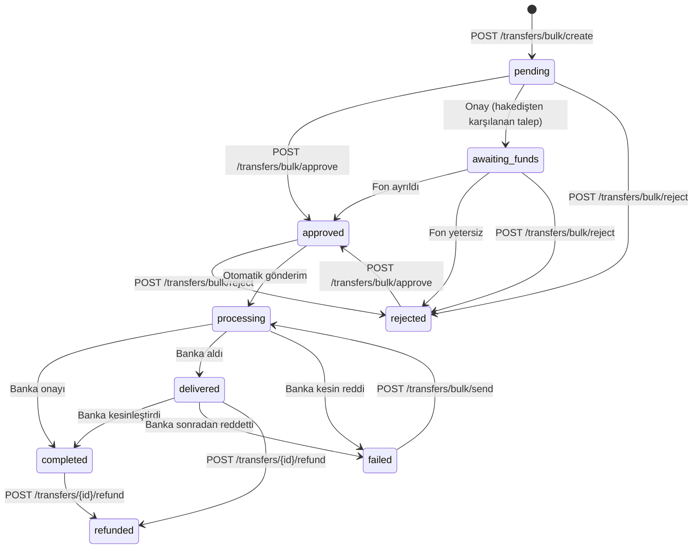

Transfer objesi bir transferin **mevcut durumunu**, kaynak ve hedef hesap bilgilerini, tutarı ve banka tarafından dönen detayları taşır. Tüm tutarlar kuruş cinsindendir (`long`); tarihler `+03:00` offset'li ISO 8601 formatındadır; enum değerleri snake_case string'dir.

`GET /transfers` ve `GET /transfers/{id}` aynı şemayı döner; `events`, `webhook_deliveries`, `channel_suggestions` ve `split_group` alanları yalnız detay yanıtında (ve `group_splits=true` listesinde `split_group`) dolar.

## Yanıt örneği

```http
HTTP/1.1 200 OK
Content-Type: application/json
```

```json
{
  "id":                        "8e3f5c12-9a7b-4c8d-bc4e-2c963f66afa6",
  "merchant_id":               "3fa85f64-5717-4562-b3fc-2c963f66afa6",
  "external_merchant_id":      "MRCH-001",
  "external_id":               "PAYROLL-001",
  "request_id":                "PAYROLL-2026-05",
  "description":               "Mayıs maaş ödemesi",
  "receipt_no":                "TRF-20260503-0001",

  "receiver_account_id":       "11111111-2222-3333-4444-555555555555",
  "funding_source":            "merchant_account",
  "request_sender_account_id": "66666666-7777-8888-9999-aaaaaaaaaaaa",
  "success_sender_account_id": "66666666-7777-8888-9999-aaaaaaaaaaaa",

  "amount":                    1500000,
  "currency":                  "try",
  "fee_amount":                350,

  "request_transfer_type":     "fast",
  "success_transfer_type":     "fast",

  "scheduled_date":            "2026-05-03T12:00:00.000+03:00",
  "validate_date":             "2026-05-03T12:34:55.000+03:00",
  "sent_date":                 "2026-05-03T12:34:58.000+03:00",
  "processed_date":            "2026-05-03T12:35:00.000+03:00",

  "status":                    "completed",
  "receipt_available":         true,
  "retry_count":               0,
  "message":                   "Transfer başarılı",
  "error_code":                null,
  "provider_error_code":       null,
  "status_checked_at":         null,
  "status_check_count":        0,

  "bulk_transfer_batch_id":    null,
  "source_row_index":          null,
  "split_group_id":            null,
  "split_index":               null,
  "split_total":               null,
  "metadata":                  { "payroll_run": "2026-05" },

  "receiver_account": {
    "id":           "11111111-2222-3333-4444-555555555555",
    "bank_id":      "5e0b0f2a-0000-0000-0000-000000000001",
    "recipient_id": null,
    "holder_name":  "Ahmet Yılmaz",
    "iban":         "TR330006100519786457841326",
    "bank_name":    "Akbank",
    "bank_code":    "00046"
  },
  "request_sender_connector_account": { "id": "66666666-7777-8888-9999-aaaaaaaaaaaa", "holder_name": "Örnek A.Ş.", "iban": "TR860006400000000000000123", "bank_code": null },
  "success_sender_connector_account": { "id": "66666666-7777-8888-9999-aaaaaaaaaaaa", "holder_name": "Örnek A.Ş.", "iban": "TR860006400000000000000123", "bank_code": null }
}
```

## Alan referansı

### Kimlik alanları

| Alan | Tip | Açıklama |
|---|---|---|
| `id` | UUID | Payven tarafından atanan benzersiz transfer kimliği. Sorgulama / aksiyon endpoint'lerinde URL parametresi olarak kullanılır. |
| `merchant_id` | UUID \| null | Transferin bayi kimliği; bayi seçilmeden açılan tenant transferinde `null` |
| `external_merchant_id` | string \| null | Bayinin sizin sisteminizdeki kimliği |
| `external_id` | string | Sizin sisteminizdeki transfer kimliği (istek gövdesinden gelir). Aynı bayide tekildir; `GET /transfers?external_id=` ile birebir sorgulanır. Parçalı ödemede `-{n}` eki alır |
| `request_id` | string | Oluşturma isteğindeki `X-Request-Id` başlığı (paket numaranız); başlık verilmediyse sunucunun ürettiği değer. `GET /transfers?request_id=` ile birebir sorgulanır |
| `bulk_transfer_batch_id` | UUID \| null | Transfer bir toplu transfer paketinden (`/bulk-transfers`) geldiyse paket kimliği |
| `source_row_index` | int \| null | Paketteki Excel satırı (1 tabanlı) |
| `description` | string \| null | Transfer açıklaması (banka ekstresine yansıyabilir) |
| `receipt_no` | string \| null | Banka makbuz / işlem numarası (banka bildirdiğinde dolar) |
| `receipt_available` | bool | Dekont / makbuz alınabilir mi. Karar sunucudadır (`delivered`, `completed`, `refunded`); durum listesi kendi tarafınızda tutmayın |
| `metadata` | object | Serbest anahtar-değer çiftleri; anahtarlar yazdığınız biçimde döner. `PATCH /transfers/{id}` ile güncellenir |

### Hesap alanları

| Alan | Tip | Açıklama |
|---|---|---|
| `receiver_account_id` | UUID \| null | Alıcı hesap kaydının kimliği (her transfer için oluşturma sırasında bir alıcı hesap kaydı açılır) |
| `receiver_account` | object \| null | Alıcı hesap: `holder_name`, `iban`, `masked_card_no`, `account_number`, `bank_id`, `bank_name`, `bank_code` (5 haneli TCMB kodu), `recipient_id` |
| `request_sender_account_id` | UUID \| null | İstekte / onayda bağlanan gönderici hesap. Hesapsız açılan **talep**te onaya kadar `null` |
| `success_sender_account_id` | UUID \| null | Gönderimin gerçekten yapıldığı gönderici hesap |
| `request_sender_connector_account`, `success_sender_connector_account` | object \| null | Gönderici hesap özeti: `id`, `holder_name`, `iban`, `account_number`, `bank_name`, `bank_code`, `connector_configuration_name` |
| `funding_source` | enum \| null | `merchant_account`: para bayinin kendi hesabından çıkar. `tenant_account`: para organizasyonun hesabından çıkar. `null`: hesap henüz seçilmemiş **talep**. Bkz. [1. Adım — Oluştur](/para-transferi/transfers/bulk-create#hesapsız-talep) |

### Tutar alanları

| Alan | Tip | Açıklama |
|---|---|---|
| `amount` | long (kuruş) | Transfer tutarı — kuruş cinsinden 64-bit tam sayı (1.500.000 = 15.000,00 TL) |
| `currency` | enum | `"try"` (yanıtlarda küçük harf; isteklerde `"TRY"` kabul edilir). Şu an yalnız TRY işlem görür |
| `fee_amount` | long (kuruş) | Banka komisyonu — banka bildirdiğinde dolar |

Tutar formatı detayı: [Tutarlar ve Para Birimleri](/documentation/concepts/amounts).

### Transfer tipi

| Alan | Tip | Açıklama |
|---|---|---|
| `request_transfer_type` | enum | İstek anında belirlenen tip (`eft`, `fast`, `remittance`, `credit_card`) |
| `success_transfer_type` | enum \| null | Banka tarafında gerçekleşen tip; banka kanal bildirmezse istekteki tipin kendisidir |

### Zaman damgaları

| Alan | Tip | Açıklama |
|---|---|---|
| `scheduled_date` | datetime | Transferin oluşturulma anı |
| `validate_date` | datetime \| null | Transferin onaylandığı zaman |
| `sent_date` | datetime \| null | Transferin bankaya gönderildiği zaman |
| `processed_date` | datetime \| null | Son durum değişikliği (banka sonucu, onay, red, iade) |

### Durum alanları

| Alan | Tip | Açıklama |
|---|---|---|
| `status` | enum | Transferin mevcut durumu — bkz. [Status değerleri](#status-degerleri) |
| `retry_count` | int | Banka oturumu alınamadığı için bankaya gönderilemeyip otomatik yeniden denenen sayısı |
| `message` | string \| null | Bankanın / servisin son mesajı (başarısızlıkta hata sebebi; `rejected`'da red gerekçesi) |
| `error_code` | string \| null | Terminal hatanın kanonik Payven kodu (`PV_*`); kararınızı buna dayandırın. Katalogda eşi olmayan banka redlerinde `null` olabilir |
| `provider_error_code` | string \| null | Bankanın ham hata kodu (destek talebinde paylaşın). Belirsiz sonuçta `PV_CONNECTOR_NO_RESPONSE` |
| `status_checked_at` | datetime \| null | Takip işinin transferi bankaya en son sorduğu an |
| `status_check_count` | int | Takip işinin bankaya kaç kez sorduğu |

### Parçalı ödeme alanları

`split_count` ile bölünmüş bir ödemenin parçaları ayrı transferlerdir ve ortak `split_group_id`'yi taşır.

| Alan | Tip | Açıklama |
|---|---|---|
| `split_group_id` | UUID \| null | Aynı ödemenin parçalarını bağlayan kimlik |
| `split_index`, `split_total` | int \| null | Parça sırası (1..N) ve toplam parça sayısı |
| `split_group` | object \| null | Grubun tamamı: `part_count`, `total_amount`, `parts[]` (`id`, `split_index`, `amount`, `status`, `external_id`, `description`, `scheduled_date`, `processed_date`, `message`). Listede yalnız `group_splits=true` iken, detayda her zaman dolar |

### Yalnız detay yanıtındaki alanlar

| Alan | Açıklama |
|---|---|
| `events[]` | Durum geçişleri (yeni → eski): `id`, `status`, `event_type`, `created_at` |
| `webhook_deliveries[]` | Bu transfer için yapılan webhook teslim denemeleri (yeni → eski): `url`, `event`, `status` (`pending` / `delivered` / `failed`), `attempt_count`, `response_code`, `next_retry_at` |
| `channel_suggestions[]` | FAST ile gönderilip başarısız olan transfer için kanal önerileri: `kind`, `transfer_type`, `split_count`, `max_part_amount`, `fast_limit` |

İşlem geçmişi (kullanıcı eylemleri + banka olayları) ayrı uçtan alınır: `GET /transfers/{id}/history`.

## Status değerleri

| `status` | Anlam | Sonraki adım |
|---|---|---|
| `pending` | Transfer oluşturuldu, **onay bekliyor** (4-göz) | `POST /transfers/bulk/approve` veya `/reject` |
| `awaiting_funds` | Onaylandı; bayinin talebi hakedişinden karşılanacak, fon bekleniyor | Bekleyin — fon ayrılınca `approved`, yetersizse `rejected` |
| `approved` | Onaylandı, gönderim kuyruğunda | Bekleyin — **otomatik** bankaya gönderilir, ayrıca `send` çağrısı gerekmez. Banka oturumu alınamazsa transfer burada kalır, 2 saat boyunca otomatik denenir |
| `processing` | Bankaya gönderildi, kesin sonuç henüz yok. Banka yanıt vermediyse (zaman aşımı) transfer `failed` olmaz, **burada kalır** (`provider_error_code: "PV_CONNECTOR_NO_RESPONSE"`) | **Yeniden göndermeyin.** Sonuç banka sorgusu / banka bildirimiyle ya da operatör kararıyla kesinleşir; webhook ile takip edin veya [`/sync`](/para-transferi/transfers/outcome-resolution) çağırın |
| `delivered` | Banka aldı, kesin sonuç bekleniyor (EFT valörü, kart transferi) | Bekleyin — `completed` ya da `failed` olur |
| `completed` | Banka transferi gerçekleştirdi | — (iade edilirse `refunded`) |
| `failed` | Bankanın kesin reddi ya da transfer 2 saatlik otomatik deneme süresinde bankaya gönderilemedi | `error_code` / `provider_error_code` inceleyin; isterseniz `POST /transfers/bulk/send` ile **açıkça** yeniden gönderin |
| `rejected` | Gönderilmeden reddedildi; para hareket etmedi | `bulk/approve` ile yeniden onaylanabilir ya da yeni transfer oluşturulur |
| `refunded` | `completed` / `delivered` transfer iade edildi (defter düzeltmesi) | — |

## Yaşam döngüsü diyagramı



Akış önerisi ve yeniden gönderim kuralları: [Önerilen Entegrasyon Akışı](/para-transferi/integration-guide).

## Transfer tipleri

| Tip | Açıklama |
|---|---|
| `fast` | FAST — **anlık** havale (7×24); tutar üst limiti vardır. Banka kabul ederse `delivered`/`completed`. |
| `eft` | EFT — iş saatleri ve valör kurallarına tabi, yüksek tutarlar için. |
| `remittance` | Havale — gönderici ve alıcı aynı bankadaysa. |
| `credit_card` | Karta para gönderme — kart numarası / kart token'ı ile transfer. |

Oluşturma isteğinde `transfer_type` belirtirsiniz; `success_transfer_type` bankanın bildirdiği gerçekleşen kanaldır.

## Hata response'ları

İstek reddi veya iş kuralı ihlali durumunda Payven [RFC 9457 problem+json](/documentation/concepts/errors) yanıtı döner:

```json
{
  "type":           "https://docs.payven.com.tr/errors/PV_TRANSFER_INVALID_STATE",
  "title":          "Conflict",
  "status":         409,
  "code":           "PV_TRANSFER_INVALID_STATE",
  "message":        "Transfer bu durumda bu işleme uygun değil.",
  "detail":         "Transfer bu durumda bu işleme uygun değil.",
  "category":       "invalid_request_error",
  "instance":       "/api/v1/transfers/8e3f5c12-.../sync",
  "correlation_id": "9f1c8e76-..."
}
```

`failed` durumundaki bir transferin sebebi `GET /api/v1/transfers/{id}` yanıtındaki `message`,
`error_code` ve `provider_error_code` alanlarında taşınır. Toplu işlemlerde (`bulk/approve`,
`bulk/reject`, `bulk/send`) kalem bazlı sonuç HTTP `200` yanıtın `results[]` dizisindedir.

Tam hata kodu listesi: [Hata Kodları](/para-transferi/errors/overview).
