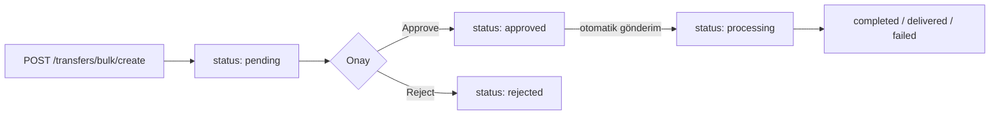

Para Transferi 4-göz (çift onay) prensibiyle çalışır: bir transfer önce **oluşturulur**, sonra
**onaylanır**; onaylanan transfer otomatik olarak bankaya gönderilir. Bu sayfa **birinci adım** olan
oluşturmayı anlatır. Uçtan uca akış: [Önerilen Entegrasyon Akışı](/para-transferi/integration-guide).

## Endpoint

```http
POST /api/v1/transfers/bulk/create
```

**Yetki:** `CanCreateTransfers`. Pasif ya da onaysız bayi için uç `422 merchant_inactive` / `merchant_not_approved` döner.

## Akış



Oluşturulan transfer **`pending`** durumunda kaydedilir; onaylanana kadar bankaya gönderilmez.

## Başlıklar

| Başlık | Zorunluluk | Açıklama |
|---|---|---|
| `X-Request-Id` | Önerilir | Sizin **paket numaranız** (en fazla 200 karakter). Pakette oluşan her transfere `request_id` olarak yazılır; `GET /transfers?request_id=` ile paketin tamamını sorgularsınız. Aynı değer **ikinci kez kullanılamaz** (`409 PV_DUPLICATE_REQUEST`). Verilmezse Payven bir değer atar |
| `Idempotency-Key` | Önerilir | Yanıtı kopan isteği **aynı anahtar + aynı gövdeyle** tekrarlarsanız ilk yanıt döner, yeni transfer açılmaz. Transfer uçlarında 24 saat saklanır. |
| `X-Merchant-Id` / `X-External-Merchant-Id` | Bayi seçimi gerekiyorsa | Transfer bu bayi adına açılır. Organizasyon (`tenant-*`) kullanıcısı bayi seçmeden yalnız **organizasyonun kendi hesabından** kendi transferini açabilir |

## İstek

Tek bir istek içinde **bir veya daha fazla** transfer kalemi gönderilir:

```bash
curl -X POST https://transfer.payven.com.tr/api/v1/transfers/bulk/create \
  -H "Authorization: Bearer $PAYVEN_TOKEN" \
  -H "X-Request-Id: PAYROLL-2026-05" \
  -H "Idempotency-Key: payroll-2026-05-01" \
  -H "Content-Type: application/json" \
  -d '{
    "items": [
      {
        "source_account_id": "550e8400-e29b-41d4-a716-446655440000",
        "external_id":       "PAYROLL-001",
        "description":       "Mayıs maaş ödemesi",
        "transfer_type":     "fast",
        "amount":            { "value": 1500000, "currency_code": "TRY" },
        "recipient": {
          "holder_name": "Ahmet Yılmaz",
          "iban":        "TR330006100519786457841326"
        },
        "metadata":          { "payroll_run": "2026-05" }
      },
      {
        "source_account_id": "550e8400-e29b-41d4-a716-446655440000",
        "external_id":       "PAYROLL-002",
        "transfer_type":     "eft",
        "amount":            { "value": 2000000, "currency_code": "TRY" },
        "recipient": {
          "recipient_id": "abc12345-0000-0000-0000-000000000000",
          "holder_name":  "Ayşe Demir",
          "iban":         "TR640001500158007294327198"
        }
      }
    ]
  }'
```

### İstek alanları

| Alan | Tip | Zorunluluk | Açıklama |
|---|---|---|---|
| `items[]` | array | Zorunlu | Bir veya daha fazla transfer kalemi |
| `items[].source_account_id` | UUID | Önerilir | Paranın çıkacağı gönderici hesap (kalem başına; `GET /connector-accounts`). Boş bırakılırsa transfer bir **talep** olarak açılır — bkz. [Hesapsız talep](#hesapsız-talep) |
| `items[].external_id` | string | Önerilir | Sizin sisteminizdeki tekil referans (en fazla 250 karakter, `payout:` ile başlayamaz). **Aynı bayide tekildir** — aşağıya bakın. Verilmezse Payven bir GUID atar |
| `items[].description` | string | Opsiyonel | Transfer açıklaması (en fazla 500 karakter) |
| `items[].transfer_type` | enum | Zorunlu | `fast`, `eft`, `remittance` veya `credit_card` |
| `items[].amount.value` | long (kuruş) | Zorunlu | Tutar — kuruş cinsinden, sıfırdan büyük (en fazla 100.000.000.000 kuruş) |
| `items[].amount.currency_code` | string | Zorunlu | Şu an yalnız `"TRY"` |
| `items[].recipient` | object | Zorunlu | Alıcı bilgisi (aşağıya bakın); `holder_name` her modda zorunlu |
| `items[].split_count` | int | Opsiyonel | Ödemeyi parçalara böler (1–100 arası; boş ya da 1 = tek transfer). Bkz. [Parçalı ödeme](#parçalı-ödeme) |
| `items[].metadata` | object | Opsiyonel | Serbest anahtar-değer (en fazla 50 anahtar; anahtar 40, değer 500 karakter). Webhook gövdesinde ve transfer yanıtında aynen geri döner |

### `external_id` tekilliği

- Aynı bayide daha önce kullanılmış bir `external_id` gelirse **istek bütünüyle** reddedilir:
  `409 PV_TRANSFER_EXTERNAL_ID_DUPLICATE`. **Hiçbir transfer oluşturulmaz** (geçerli kalemler dahil).
- Aynı `external_id`'nin **istek içinde** tekrarlanması da aynı hatayı verir.
- Bu kural, yanıtını kaybeden bir isteğin tekrarının ikinci bir havale açmasını engeller. 409 aldığınızda
  önce `GET /transfers?external_id=...` ile mevcut transferi kontrol edin.

### Alıcı bilgisi

Alıcı hesap bilgisi **her transferde istekle birlikte verilir**: `iban` (ya da kartlı transferde `card_details`) zorunludur. `recipient_id` yalnız kaydı kayıtlı bir alıcıya ([Alıcılar](/para-transferi/recipients/overview)) bağlar; IBAN'ı o kayıttan okumaz.

**Mod 1 — IBAN ile:**

```json
"recipient": {
  "holder_name": "Ahmet Yılmaz",
  "iban":        "TR330006100519786457841326"
}
```

IBAN boşluklu/boşluksuz verilebilir; `TR` öneki yoksa eklenir. IBAN biçimi ve mod-97 sağlaması kontrol edilir
(tenant/bayi ayarıyla kapatılabilir); geçersiz IBAN'lı kalem [aşağıdaki kurala](#geçersiz-kalemler) göre elenir.
Önceden kontrol için [IBAN doğrulama](/para-transferi/validation/iban).

**Mod 2 — Kayıtlı alıcıya bağlı:**

```json
"recipient": {
  "recipient_id": "abc12345-0000-0000-0000-000000000000",
  "holder_name":  "Ayşe Demir",
  "iban":         "TR640001500158007294327198"
}
```

Transfer, alıcı kaydına bağlanır; `GET /receiver-accounts/by-saved-account/{recipient_id}` ile o alıcıya giden hesapları listelersiniz.

**Mod 3 — Karta para gönderme:**

```json
"recipient": {
  "holder_name":  "Ahmet Yılmaz",
  "card_details": {
    "card_number": "4546711234567894"
  }
}
```

`transfer_type: "credit_card"` ile birlikte kullanılır. Kart numarası maskelenerek saklanır; alıcı bankası kartın BIN'inden çözülür. Önceden tokenlanmış kart için `card_details.card_token` verilebilir.

### Hesapsız talep

`source_account_id` vermezseniz transfer bir **talep** olarak açılır: `funding_source` `null`, `request_sender_account_id` boştur. Hesabı onaylayan seçer (`bulk/approve` kaleminde `connector_account_id`):

- Bayi, **kendi** hesabıyla onaylar; para bayinin kendi hesabından çıkar.
- Organizasyon (`tenant-*`) kullanıcısı **organizasyon hesabıyla** onaylar; para organizasyonun hesabından çıkacağı için talep önce bayinin çekilebilir hakedişinden karşılanır (`awaiting_funds`).

Bayi, başka bayinin ya da organizasyonun hesabını kendi transferine bağlayamaz (`422 PV_SENDER_ACCOUNT_NOT_OWNED`).

### Parçalı ödeme

`split_count: N` ile tek ödeme N ayrı banka işlemine bölünür (ör. FAST limitini aşan tutar). Parçalar ortak `split_group_id` taşır; `external_id` değerlerine `-1…-N`, açıklamaya `(i/N)` eklenir; kalan kuruşlar ilk parçalara dağıtılır. Her parça en az 1 kuruş olmalıdır. Yanıtta her parça ayrı bir kalemdir. `payout:` önekli (hakediş çekimi) kimlikler bölünemez.

### Geçersiz kalemler

Doğrulamadan geçmeyen bir kalem (tutar ≤ 0, alıcı adı boş, kaynak hesap bulunamadı, IBAN/kart çözümlenemedi) **sessizce atlanır**; geri kalan kalemler oluşturulur ve yanıtta yalnız oluşan transferler yer alır. Bu yüzden yanıttaki kalem sayısını ve `external_id` değerlerini isteğinizle karşılaştırın; yanıtta olmayan kalem **oluşmamıştır**. Hiçbir kalem geçerli değilse istek `422 PV_NO_VALID_TRANSFER` ile reddedilir ve `message` atlanan kalemleri nedenleriyle sıralar.

## Yanıt

```http
HTTP/1.1 200 OK
Content-Type: application/json
```

Oluşturulan her kalem, gönderdiğiniz alanlarla birlikte Payven'in atadığı `transfer_id` ile döner:

```json
[
  {
    "transfer_id":       "8e3f5c12-9a7b-4c8d-bc4e-2c963f66afa6",
    "source_account_id": "550e8400-e29b-41d4-a716-446655440000",
    "external_id":       "PAYROLL-001",
    "description":       "Mayıs maaş ödemesi",
    "transfer_type":     "fast",
    "amount":            { "value": 1500000, "currency_code": "try" },
    "recipient":         { "holder_name": "Ahmet Yılmaz", "iban": "TR330006100519786457841326" },
    "metadata":          { "payroll_run": "2026-05" }
  }
]
```

Yanıttaki `transfer_id` değerlerini saklayın — onay (`approve`) adımında kullanacaksınız. Transferler
`pending` durumundadır: bankaya hiçbir istek gönderilmedi, hesaplarınızdan para çekilmedi.

İsteğe bağlı olarak `para-transferi.transfer.created` webhook olayına abone olabilirsiniz.

## Hata response'ları

| HTTP | `code` | Anlam |
|---|---|---|
| `409` | `PV_TRANSFER_EXTERNAL_ID_DUPLICATE` | `external_id` bu bayide zaten kullanılmış ya da istek içinde tekrar ediyor — istek bütünüyle reddedildi, transfer oluşmadı |
| `409` | `PV_DUPLICATE_REQUEST` | Bu `X-Request-Id` ile daha önce transfer oluşturulmuş |
| `409` | `idempotency_key_in_use` | Aynı `Idempotency-Key` farklı gövde için kullanılmış |
| `422` | `validation_failed` | Eksik / geçersiz alan — `errors[]` ile detay |
| `422` | `PV_NO_VALID_TRANSFER` | Hiçbir kalem geçerli değil |
| `422` | `PV_SENDER_ACCOUNT_NOT_OWNED` | Gönderici hesap bu bayiye ait değil |
| `422` | `PV_SENDER_ACCOUNT_INACTIVE` | Gönderici hesap ya da bağlantısı pasif |
| `422` | `PV_TEST_CONNECTOR_IN_LIVE_MODE` | Canlı transfer, test modundaki bir bağlantıyla gönderilemez |
| `422` | `PV_TENANT_TRANSFER_REQUIRES_TENANT_ACCOUNT` | Bayi seçmeden açılan transferde organizasyon hesabı zorunlu |
| `422` | `PV_EXTERNAL_ID_RESERVED` | `external_id` ayrılmış önekle (`payout:`) başlıyor |
| `422` | `merchant_inactive` / `merchant_not_approved` | Bayi işlem yapamaz |
| `403` | `forbidden` | Transfer oluşturma izni yok |

Hata yanıtı RFC 9457 problem+json. Detay: [Hata Kodları](/para-transferi/errors/overview).

## Sonraki adım

<CardGroup cols={2}>
  <Card title="2. Adım — Onayla" icon="check" href="/para-transferi/transfers/bulk-approve">
    Yetkili kullanıcı transferleri onaylar; onaylanan transfer otomatik gönderilir.
  </Card>
  <Card title="2. Adım (alternatif) — Reddet" icon="xmark" href="/para-transferi/transfers/bulk-reject">
    Yanlışlıkla oluşturulan transferleri iptal edin.
  </Card>
</CardGroup>
