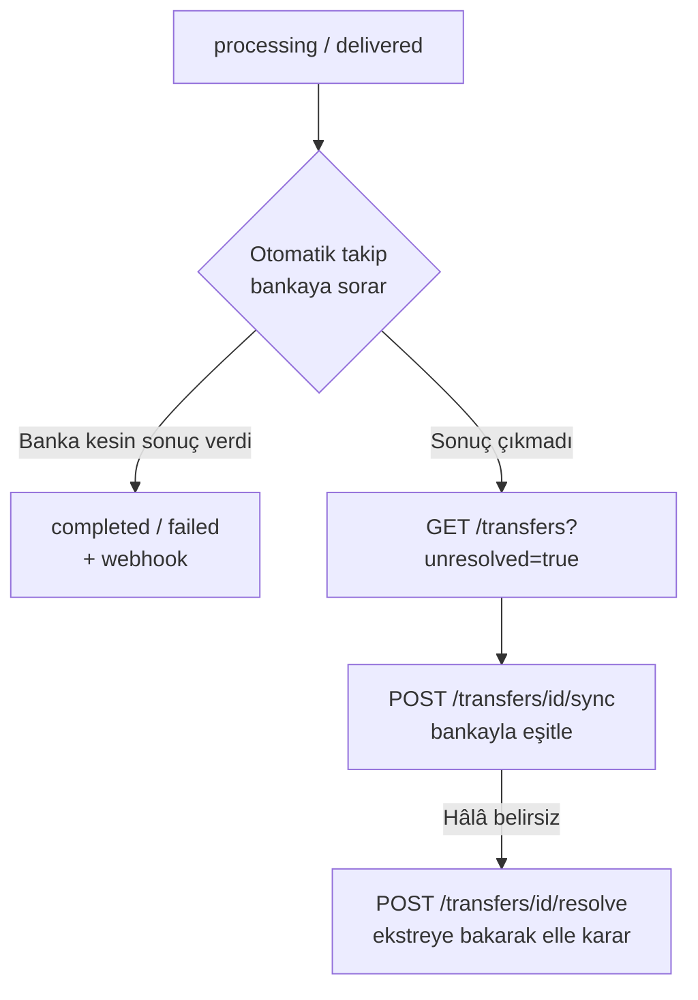

Bir transfer bankaya gönderildikten sonra banka yanıt vermeyebilir ya da kesin sonucu geç bildirebilir. Bu durumda transfer `processing` (yanıt yok) veya `delivered` (banka aldı, kesin sonuç sonra) durumunda kalır ve **asla yeniden gönderilmez.** Bu sayfa belirsizliği kapatan üç uç ile iade ucunu anlatır.



## Bankayla eşitle — `POST /transfers/{id}/sync`

Transferin **bankadaki güncel durumunu** sorar ve kaydı gerekiyorsa günceller.

```bash
curl -X POST https://transfer.payven.com.tr/api/v1/transfers/8e3f5c12-.../sync \
  -H "Authorization: Bearer $PAYVEN_TOKEN"
```

```json
{
  "transfer_id":     "8e3f5c12-9a7b-4c8d-bc4e-2c963f66afa6",
  "previous_status": "processing",
  "current_status":  "completed",
  "changed":         true,
  "message":         "Transfer tamamlandı.",
  "receipt_no":      "TRF-20260503-0001"
}
```

| Alan | Açıklama |
|---|---|
| `previous_status` / `current_status` | Eşitleme öncesi ve sonrası Payven durumu |
| `changed` | Durum değişti mi. `false`: banka aynı şeyi söyledi, yapılacak bir şey yok. `true`: defter ve webhook'lar normal sonuç gibi beslenir |
| `message`, `receipt_no` | Bankanın açıklaması ve dekont / fiş numarası (varsa) |

- **Yetki:** `CanSendTransfers`.
- Yalnız bankaya gönderilmiş ve sonucu kesinleşmemiş transferlerde anlamlıdır: `processing`, `delivered`, `failed`. Diğer durumlarda `409 PV_TRANSFER_INVALID_STATE`. `failed` bilerek dahildir: karar alınamadan düşen bir çağrı transferi başarısız yazmış olabilir, oysa banka işlemiş olabilir.
- Banka durum sorgusunu desteklemiyorsa ya da kayıt dönmezse `422 PV_TRANSFER_SYNC_FAILED` döner ve mevcut durum **korunur** (sorgu cevapsız diye transfer başarısız yazılmaz).
- Payven ayrıca otomatik bir takip işiyle `processing` / `delivered` transferleri bankaya periyodik sorar; çoğu belirsizlik bu yolla kendiliğinden kapanır.

## Belirsiz transferleri bulma

```http
GET /api/v1/transfers?unsettled=true     # 30 dakikadan uzun süredir kesinleşmemiş (processing / delivered)
GET /api/v1/transfers?unresolved=true    # Otomatik takibin kesinleştiremediği: 30 dk'yı aşmış processing, 3 günü aşmış delivered
```

`unresolved` listesi, elle karar gerektiren transferlerin kuyruğudur. Transfer üzerindeki `provider_error_code: "PV_CONNECTOR_NO_RESPONSE"` yanıtsız kalan gönderimi işaretler; `status_checked_at` ve `status_check_count` takip işinin son sorusunu gösterir.

## Elle sonuçlandır — `POST /transfers/{id}/resolve`

Sonucu otomatik kesinleşmeyen transferi (durum sorgusu olmayan banka, gelmeyen bildirim) **banka ekstresine veya banka teyidine dayanarak** sonuçlandırır.

```bash
curl -X POST https://transfer.payven.com.tr/api/v1/transfers/8e3f5c12-.../resolve \
  -H "Authorization: Bearer $PAYVEN_TOKEN" \
  -H "Content-Type: application/json" \
  -d '{
    "status":         "completed",
    "note":           "15.05.2026 ekstresi, satır 42 — alıcı hesaba geçti",
    "bank_reference": "FAST-9f3d2b8e"
  }'
```

| Alan | Tip | Zorunluluk | Açıklama |
|---|---|---|---|
| `status` | enum | Zorunlu | `completed`: bankada gerçekleşti. `failed`: gerçekleşmedi (sonra `bulk/send` ile yeniden gönderilebilir). `rejected`: iptal — işlem kapatılır, bankaya gönderilmedi / gönderilmeyecek |
| `note` | string | Zorunlu | Dayanak (en fazla 500 karakter); zaman çizelgesine yazılır |
| `bank_reference` | string | Opsiyonel | Banka referansı / dekont no (en fazla 100 karakter) |

Yanıt: `{ "transfer_id", "previous_status", "current_status" }`.

- **Yetki:** `CanManageReconciliations` (varsayılan: `tenant-admin`, `merchant-admin`).
- Yalnız `processing` / `delivered` transferde çalışır; diğer durumlarda `409 PV_TRANSFER_RESOLUTION_NOT_ALLOWED`.
- Sonuç normal akışla aynı olayları üretir: ilgili `para-transferi.transfer.*` webhook'u, Cüzdan / hakediş etkisi ve (varsa) toplu transfer paketi sayacı.
- **Dikkat:** `failed` kararı transferi yeniden göndermeye açar. Bankanın işlemi gerçekten yapmadığından emin olmadan `failed` seçmeyin; aksi halde aynı alıcıya ikinci kez para çıkar.

## İade — `POST /transfers/{id}/refund`

`completed` veya `delivered` bir transferi iade edilmiş olarak işaretler.

```bash
curl -X POST https://transfer.payven.com.tr/api/v1/transfers/8e3f5c12-.../refund \
  -H "Authorization: Bearer $PAYVEN_TOKEN" \
  -H "Idempotency-Key: refund-PAYROLL-001" \
  -H "Content-Type: application/json" \
  -d '{ "reason": "Alıcı hesap kapalı, para geri döndü" }'
```

```json
{
  "transfer_id": "8e3f5c12-9a7b-4c8d-bc4e-2c963f66afa6",
  "status":      "refunded",
  "is_success":  true,
  "message":     "Alıcı hesap kapalı, para geri döndü"
}
```

- **Banka tarafında geri hareket başlatmaz.** Banka iade (reversal) API'si olmadığından bu bir **defter düzeltmesidir**: transfer `refunded` olur, `para-transferi.transfer.refunded` webhook'u yayınlanır, hakediş geri alınır ve Cüzdan'a geri yazılır. Paranın alıcıdan gerçekten geri alınması bankayla ayrıca yürütülür.
- Tam iadedir (transfer tutarının tamamı); kısmi iade yoktur.
- `reason` opsiyoneldir (en fazla 1000 karakter); transferin `message` alanına ve olay gövdesine yazılır.
- **Yetki:** `CanSendTransfers`. `completed` / `delivered` dışındaki durumlarda `422 validation_failed` döner.

## Hata response'ları

| HTTP | `code` | Anlam |
|---|---|---|
| `404` | `PV_TRANSFER_NOT_FOUND` | Transfer bulunamadı ya da başka bayiye ait |
| `409` | `PV_TRANSFER_INVALID_STATE` | `sync` bu durumda anlamlı değil |
| `409` | `PV_TRANSFER_RESOLUTION_NOT_ALLOWED` | `resolve` yalnız `processing` / `delivered` transferde çalışır |
| `422` | `PV_TRANSFER_SYNC_FAILED` | Banka sorgusu karar vermedi; durum korundu |
| `422` | `validation_failed` | `resolve`: geçersiz `status` ya da boş `note`; `refund`: iade edilemeyen durum |
| `403` | `forbidden` | Gerekli izin yok |

Kod ayrıntıları: [Hata Kodları](/para-transferi/errors/overview).
