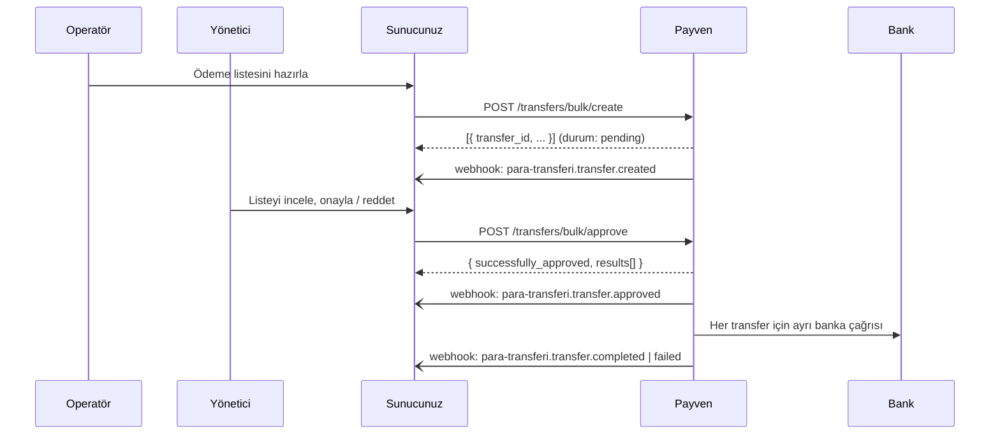

Para Transferi'nde **4-göz (iki onay) ilkesi** bayi ve organizasyon ayarıyla açılır: transferi oluşturan kullanıcı kendi transferini onaylayamaz, ikinci bir kullanıcı onaylar ve onay anında transfer bankaya gönderim kuyruğuna alınır. Bu reçete bir toplu ödemeyi (örn. maaş) uçtan uca gösterir.

## Akış



## 1. Transferleri oluştur

Tek istekte birden fazla transfer oluşturulur; her biri bağımsız bir kayıttır. `X-Request-Id` ile verdiğiniz değer (paket numaranız) tüm transferlere ve webhook'lardaki `request_id` alanına yazılır.

```bash
curl -X POST https://transfer.payven.com.tr/api/v1/transfers/bulk/create \
  -H "Authorization: Bearer $PAYVEN_TOKEN" \
  -H "Idempotency-Key: payroll-2026-10-batch-1" \
  -H "X-Request-Id: PAYROLL-2026-10" \
  -H "Content-Type: application/json" \
  -d '{
    "items": [
      {
        "external_id":     "PR-2026-10-001",
        "description":     "Ekim maaş - Ahmet Yılmaz",
        "transfer_type":   "fast",
        "amount":          { "value": 5000000, "currency_code": "TRY" },
        "recipient": {
          "holder_name": "Ahmet Yılmaz",
          "iban":        "TR330006100519786457841326"
        }
      },
      {
        "external_id":     "PR-2026-10-002",
        "description":     "Ekim maaş - Ayşe Demir",
        "transfer_type":   "eft",
        "amount":          { "value": 4500000, "currency_code": "TRY" },
        "recipient": {
          "holder_name": "Ayşe Demir",
          "iban":        "TR640006400000112345678901"
        }
      }
    ]
  }'
```

| Alan | Açıklama |
|---|---|
| `items[].external_id` | Sizin sisteminizdeki transfer kimliği (olaylarda geri gelir) |
| `items[].transfer_type` | `fast`, `eft`, `remittance` (havale) ya da `credit_card` |
| `items[].amount` | `value` **kuruş** (`5000000` = 50.000,00 ₺), `currency_code` `TRY` |
| `items[].recipient` | Kayıtlı alıcı için `recipient_id`; aksi halde `holder_name` + `iban` (ya da `account_number`, kart transferinde `card_details`) |
| `items[].source_account_id` | Gönderici hesap. Bayi yalnız kendi hesabını seçer; seçilmezse onay sırasında bağlanır |
| `items[].metadata` | Serbest anahtar-değer; olaylarda geri gelir |

<Note>
Alıcı ve hesap kavramları: [Alıcılar](/para-transferi/recipients/overview). Gönderici hesaplar bayi veya organizasyon tarafından tanımlanır.
</Note>

Yanıt, oluşturulan her transfer için `transfer_id` içerir. Transfer `pending` durumunda bekler; para henüz hareket etmemiştir.

## 2. İkinci kullanıcı onaylasın

Onaylayan kullanıcı, transferi **oluşturandan farklı** olmalıdır. Aynı kullanıcı onaylamaya çalışırsa ilgili kalem reddedilir (`results[].is_success: false`); istek bütünüyle `200` döner, başarısızlık **kalem bazında** raporlanır.

```bash
curl -X POST https://transfer.payven.com.tr/api/v1/transfers/bulk/approve \
  -H "Authorization: Bearer $MANAGER_TOKEN" \
  -H "Content-Type: application/json" \
  -d '{
    "transfers": [
      { "transfer_id": "8e3f5c12-9a7b-4c8d-bc4e-2c963f66afa6", "approval_note": "Ekim bordrosu onaylandı" },
      { "transfer_id": "9f3d2b8e-1c4a-4d7b-8e3f-5c129a7b4c8d" }
    ]
  }'
```

```json
{
  "total_requested": 2,
  "successfully_approved": 2,
  "failed": 0,
  "results": [
    { "transfer_id": "8e3f5c12-...", "is_success": true, "message": "Transfer approved successfully." },
    { "transfer_id": "9f3d2b8e-...", "is_success": true, "message": "Transfer approved successfully." }
  ]
}
```

Kalem bazlı hata örnekleri: iki-göz kuralı (`message`: "İki-göz kuralı: Kendi oluşturduğunuz transferi onaylayamazsınız."), yanlış durum (`Transfer cannot be approved. Current status: ...`), gönderici hesabın seçilmemesi (`error_code: PV_TRANSFER_REQUEST_SENDER_ACCOUNT_REQUIRED`). Gönderici hesabı onayda vermek için kalemde `connector_account_id` kullanılır.

### Reddetme

Hata fark edilirse kalemler bankaya gönderilmeden reddedilir; para hiç hareket etmez:

```bash
curl -X POST https://transfer.payven.com.tr/api/v1/transfers/bulk/reject \
  -H "Authorization: Bearer $MANAGER_TOKEN" \
  -H "Content-Type: application/json" \
  -d '{
    "transfers": [
      { "transfer_id": "9f3d2b8e-1c4a-4d7b-8e3f-5c129a7b4c8d", "rejection_reason": "Tutar yanlış: 45.000 değil 55.000" }
    ]
  }'
```

Reddedilen transfer yeniden kullanılamaz; yeni bir transfer oluşturun. Red `para-transferi.transfer.rejected` olayını yayınlar.

## 3. Sonucu webhook ile yakalayın

Onaydan sonra her transfer **bağımsız** olarak bankaya gider; ayrıca bir "gönder" çağrısı gerekmez. Bir kalem başarısız olursa diğerleri etkilenmez.

```json
{
  "id":       "evt_8e3f5c129a7b4c8dbc4e2c963f66afa6",
  "object":   "event",
  "type":     "para-transferi.transfer.completed",
  "created":  "2026-10-16T09:01:23.451+03:00",
  "livemode": true,
  "data": {
    "object": {
      "event_type":   "para-transferi.transfer.completed",
      "transfer_id":  "8e3f5c12-9a7b-4c8d-bc4e-2c963f66afa6",
      "status":       "completed",
      "amount":       5000000,
      "currency":     "try",
      "external_id":  "PR-2026-10-001",
      "receipt_no":   "EFT-REF-789",
      "transfer_type": "fast",
      "request_id":   "PAYROLL-2026-10",
      "occurred_at":  "2026-10-16T09:01:23+03:00"
    }
  }
}
```

<Warning>
`delivered` ve `outcome_unknown` **kesin sonuç değildir.** Ödemeyi yalnız `completed`'da başarılı, `failed`'da başarısız kapatın. `outcome_unknown` alan transferi yeniden göndermeyin; banka ilk isteği işlemiş olabilir. Alan listesi: [Para Transferi Webhook Olayları](/para-transferi/webhooks/events).
</Warning>

Başarısız (`failed`) bir transferi düzeltip yeniden göndermek için `POST /transfers/bulk/send` kullanılır (`transfers[].transfer_id`).

## 4. Durumu sorgula

```bash
curl "https://transfer.payven.com.tr/api/v1/transfers/8e3f5c12-9a7b-4c8d-bc4e-2c963f66afa6" \
  -H "Authorization: Bearer $PAYVEN_TOKEN"

curl "https://transfer.payven.com.tr/api/v1/transfers/8e3f5c12-9a7b-4c8d-bc4e-2c963f66afa6/history" \
  -H "Authorization: Bearer $PAYVEN_TOKEN"
```

Transfer durumları: `pending`, `approved`, `awaiting_funds`, `processing`, `delivered`, `completed`, `failed`, `rejected`, `refunded`. `awaiting_funds`, transferin bayinin hakedişinden karşılandığı ve Cüzdan'ın fon kararını beklediği durumdur.

## Excel / CSV ile paket

Satırları dosyadan yükleyip tek paket olarak onaylatmak isterseniz **paket** uçları kullanılır: `POST /bulk-transfers/preview` (doğrular, kaydetmez), `POST /bulk-transfers` (paketi ve kalemlerini onay bekler durumda açar), `POST /bulk-transfers/{id}/approve`. Paket onayını da oluşturandan farklı kullanıcı yapar (`403 PV_BULK_TRANSFER_SELF_APPROVAL`); paketteki kalemler tek tek onaylanamaz. Ayrıntı: [Toplu Transfer Paketleri](/para-transferi/transfers/bulk-batches).

## Hata senaryoları

| Durum | HTTP / alan | `code` | Çözüm |
|---|---|---|---|
| Kendi paketini onaylamaya çalışmak (paket) | 403 | `PV_BULK_TRANSFER_SELF_APPROVAL` | İkinci kullanıcı onaylamalı |
| Kendi transferini onaylamaya çalışmak | `results[].is_success: false` | n/a (mesaj) | İkinci kullanıcı onaylamalı |
| Gönderici hesap yok | `results[].error_code` | `PV_TRANSFER_REQUEST_SENDER_ACCOUNT_REQUIRED` | `connector_account_id` verin |
| Pasif / onaysız bayi | 422 | `merchant_inactive`, `merchant_not_approved` | Bayinin durumunu düzeltin |
| Doğrulama (IBAN, tutar) | 422 | `validation_failed` | `errors[]` içindeki alanı düzeltin |
| Aynı `Idempotency-Key` farklı gövde | 409 | `idempotency_key_in_use` | Yeni anahtar kullanın |

## Kontrol listesi

<Check>Oluşturan ve onaylayan **farklı kullanıcılar** mı (4-göz ayarı açık mı)?</Check>
<Check>`Idempotency-Key` paket bazlı ve deterministik mi (`payroll-2026-10-batch-1`)?</Check>
<Check>Webhook handler'ınız `para-transferi.transfer.completed` ve `para-transferi.transfer.failed` olaylarını `X-Payven-Event-Id` ile tekilleştirerek işliyor mu?</Check>
<Check>`outcome_unknown` alan transfer yeniden gönderilmiyor mu?</Check>
<Check>Test modunda (test anahtarı) uçtan uca denendi mi? Test modundaki transferler bankaya gitmez, simüle edilir.</Check>

## İlgili sayfalar

- [Para Transferi Genel Bakış](/para-transferi/overview)
- [Toplu Transfer Akışı](/para-transferi/transfers/bulk-create)
- [Webhook Olayları (Transfer)](/para-transferi/webhooks/events)
