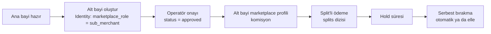

Bu reçete **pazaryeri** senaryosunu kapsar: bir ana bayi (platform) müşteriden tek ödeme alır; tutar, ana bayiye bağlı **alt bayilere** (satıcılara) bölünür, hold süresince emanette tutulur ve serbest bırakılır.

<Note>
Marketplace, Cüzdan modülünün kurulu olduğu ortamlarda çalışır ve `sanalpos.marketplace` alt özelliğinin organizasyon için açık olmasını ister. Ayrıntılı kurallar: [Marketplace — Ödeme Bölme](/sanal-pos/payments/marketplace-splits).
</Note>

## Akış



## 1. Alt bayiyi oluşturun

Alt bayi Identity'de, ana bayiye bağlı ve `marketplace_role: "sub_merchant"` olarak açılır. Ana bayinin işletme yöneticisi yalnız **kendi** bayisinin altında alt bayi açabilir (`parent_id` kendi bayi kimliğidir); organizasyon yöneticisi herhangi bir ana bayinin altında açabilir.

```bash
curl -X POST https://identity.payven.com.tr/api/v1/merchants \
  -H "Authorization: Bearer $PAYVEN_TOKEN" \
  -H "Content-Type: application/json" \
  -d '{
    "name":              "Örnek Satıcı",
    "legal_name":        "Örnek Satıcı Ltd. Şti.",
    "tax_id":            "9876543210",
    "external_id":       "SELLER-0042",
    "email":             "satici@example.com",
    "parent_id":         "3fa85f64-5717-4562-b3fc-2c963f66afa6",
    "marketplace_role":  "sub_merchant",
    "merchant_type":     "corporate",
    "payout_iban":       "TR330006100519786457841326",
    "payout_iban_owner": "Örnek Satıcı Ltd. Şti."
  }'
```

| Alan | Açıklama |
|---|---|
| `parent_id` | Ana bayinin `id` değeri. Alt bayi için **zorunlu** |
| `marketplace_role` | `sub_merchant` |
| `payout_iban` / `payout_iban_owner` | Alt bayinin hakediş hesabı. Alt bayi için **zorunlu**; IBAN geçerli olmalı, hesap sahibi adı eşlik etmeli |
| `merchant_type` | `individual`, `sole_trader` ya da `corporate` |

Alt bayi `status: "pending"` doğar; **onaylanmadan split alamaz.** Açılışı `sanalpos.submerchant.created` olayı ile bildirilir. Marketplace alt bayisi entegrasyon yapmadığı için ona API anahtarı açılmaz; para ana bayinin tahsilatından bölünerek gelir.

## 2. Alt bayiyi onaylayın

Onay operatör (organizasyon yöneticisi) kararıdır; ana bayi kendi alt bayisini onaylayamaz. Güncelleme `PUT /merchants/{id}` **tam değiştirmedir**: mevcut alanları (özellikle `name`) birlikte gönderin.

```bash
curl -X PUT https://identity.payven.com.tr/api/v1/merchants/$SUB_MERCHANT_ID \
  -H "Authorization: Bearer $TENANT_ADMIN_TOKEN" \
  -H "Content-Type: application/json" \
  -d '{
    "name":             "Örnek Satıcı",
    "legal_name":       "Örnek Satıcı Ltd. Şti.",
    "email":            "satici@example.com",
    "parent_id":        "3fa85f64-5717-4562-b3fc-2c963f66afa6",
    "marketplace_role": "sub_merchant",
    "payout_iban":      "TR330006100519786457841326",
    "payout_iban_owner":"Örnek Satıcı Ltd. Şti.",
    "is_active":        true,
    "status":           "approved"
  }'
```

Ödeme sırasında alt bayi şu koşulları sağlamalıdır; aksi halde istek, ödeme başlamadan reddedilir:

| Koşul | Hata |
|---|---|
| Alt bayi bulunmalı | `sub_merchant_not_found` |
| `marketplace_role = sub_merchant` | `not_a_sub_merchant` |
| `parent_id` ödemeyi yapan ana bayi | `parent_mismatch` |
| Aktif | `sub_merchant_inactive` |
| `status = approved` | `sub_merchant_not_approved` |
| Marketplace profili tanımlı | `sub_merchant_profile_missing` |

## 3. Marketplace profillerini tanımlayın

Komisyon **alt bayinin** profilinden gelir; **split'li ödeme için her alt bayinin profili zorunludur** (yoksa `422 sub_merchant_profile_missing`). Bekleme süresi (`settlement_hold_days`) ve otomatik serbest bırakma ise **ana bayinin** profilinden okunur; ana bayinin profili yoksa varsayılan bekleme süresi (7 gün) uygulanır.

```bash
# Alt bayi: komisyon
curl -X PUT https://vpos.payven.com.tr/api/v1/merchants/$SUB_MERCHANT_ID/marketplace-profile   -H "Authorization: Bearer $PAYVEN_TOKEN"   -H "Content-Type: application/json"   -d '{ "commission_rate_pct": 8.5 }'

# Ana bayi: bekleme süresi ve otomatik serbest bırakma
curl -X PUT https://vpos.payven.com.tr/api/v1/merchants/$PARENT_MERCHANT_ID/marketplace-profile   -H "Authorization: Bearer $PAYVEN_TOKEN"   -H "Content-Type: application/json"   -d '{ "settlement_hold_days": 7, "auto_release_enabled": true }'
```

`commission_rate_pct` (yüzde) ile `commission_rate_fixed` (sabit, kuruş) birlikte verilemez.

## 4. Split'li ödeme alın

Ödeme isteğindeki `splits[]` tek tahsilatı böler. Split kayıtları ödeme **başarıyla tamamlandığında** oluşur.

```bash
curl -X POST https://vpos.payven.com.tr/api/v1/checkout/sessions \
  -H "Authorization: Bearer $PAYVEN_TOKEN" \
  -H "Idempotency-Key: ORDER-5521" \
  -H "Content-Type: application/json" \
  -d '{
    "amount":      25000,
    "currency":    "TRY",
    "external_id": "ORDER-5521",
    "success_url": "https://pazaryeri.example/odeme/basarili",
    "cancel_url":  "https://pazaryeri.example/odeme/iptal",
    "splits": [
      { "sub_merchant_id": "6d1c9a52-0e84-4b7f-9c31-a5d8e2f10b47", "amount": 15000 },
      { "sub_merchant_id": "a40b77e1-3c25-4f8a-b6d9-1e7c0a5f2d83", "amount": 10000, "commission_rate_pct": 5 }
    ]
  }'
```

`splits[]` aynı şekilde `POST /payments` ve `POST /payments/3d/init` isteklerinde de kullanılır. Kurallar: `sum(splits[].amount)` ödeme tutarını aşamaz; `commission_rate_pct` ile `commission_fixed` aynı split'te birlikte verilemez; komisyon önceliği istek değeri, sonra profil değeridir.

## 5. Split yaşam döngüsü

Split `pending` doğar, hold süresi dolunca (profilde otomatik serbest bırakma açıksa) alt bayiye serbest bırakılır. Elle yönetim:

| Uç | İş | Varsayılan yetkili |
|---|---|---|
| `POST /marketplace/splits/{id}/approve` | Onayla | organizasyon / işletme yöneticisi |
| `POST /marketplace/splits/{id}/hold` | Emanete al (`note` zorunlu) | organizasyon / işletme yöneticisi |
| `POST /marketplace/splits/{id}/release` | Alt bayiye serbest bırak | yalnız organizasyon yöneticisi |
| `POST /marketplace/splits/{id}/refund` | İade et | organizasyon / işletme yöneticisi |

Her adım webhook yayınlar: `sanalpos.payment_split.created`, `.approved`, `.held`, `.released`, `.refunded`, `.partially_refunded`, `.auto_release_scheduled`. Ödeme tamamlandı ama split'ler yazılamadıysa işlem `GET /marketplace/splits/orphan` listesine düşer ve `POST /marketplace/splits/orphan/{transaction_id}/retry` ile yeniden dağıtılır.

## 6. Test ve canlı

Tüm akış test modunda (test anahtarı / sandbox bayi) denenebilir; test split'leri canlı listelerde görünmez. Canlıya geçişte her bayinin ortamı ayrı ayrı yönetilir: [Hızlı Başlangıç](/documentation/quickstart#7-canliya-gecis).

## Kontrol listesi

<Check>Her alt bayinin marketplace profili (komisyon) tanımlı mı?</Check>
<Check>Alt bayilerde `payout_iban` doğru ve `status = approved` mı?</Check>
<Check>`sum(splits[].amount)` ödeme tutarını aşmıyor mu?</Check>
<Check>`sanalpos.payment_split.*` ve `sanalpos.submerchant.*` olayları için webhook ucu kurulu mu?</Check>
<Check>Yetim split listesi düzenli izleniyor mu?</Check>

## İlgili sayfalar

- [Hesap Yapısı](/documentation/account-model)
- [Marketplace — Ödeme Bölme](/sanal-pos/payments/marketplace-splits)
- [Webhook Olay Referansı](/documentation/concepts/webhook-events)
