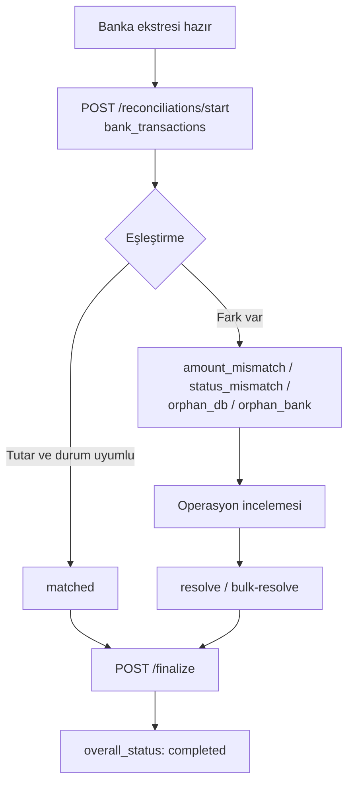

Bu reçete **gün sonu mutabakat** akışını gösterir: bankanın hareket satırlarını Payven'e gönderirsiniz, Payven bunları işlem kayıtlarıyla eşleştirir, tutarsızlıkları listeler ve kararlarınızı işlem kaydına yansıtır.

<Note>
Mutabakat uçları `sanalpos.reconciliation` alt özelliği açık olan organizasyonlarda çalışır; okuma `CanViewReconciliations`, başlatma/çözme/kapatma `CanManageReconciliations` izni ister. Alan ve enum ayrıntıları: [Mutabakat Genel Bakış](/sanal-pos/reconciliation/overview).
</Note>

## Akış



Mutabakat **otomatik başlamaz** ve webhook olayı yayınlamaz: banka ekstresini siz hazırladığınızda başlatır, sonucu yanıttan ve `GET` uçlarından okursunuz.

## 1. Mutabakatı başlat

Banka satırlarını istek gövdesinde `bank_transactions[]` olarak gönderin (en çok 100.000 satır; dosya adresi verilmez). Tarihler `+03:00` ile yazılır.

```bash
curl -X POST https://vpos.payven.com.tr/api/v1/reconciliations/start \
  -H "Authorization: Bearer $PAYVEN_TOKEN" \
  -H "Idempotency-Key: recon-garanti-2026-10-15" \
  -H "Content-Type: application/json" \
  -d '{
    "scope":               "connector",
    "connector_config_id": "5b2e7c10-4f11-4b7a-9d3e-0a8c1f6d2e44",
    "period":              "daily",
    "period_start":        "2026-10-15T00:00:00+03:00",
    "bank_transactions": [
      {
        "bank_transaction_id": "GAR-AUTH-789-001",
        "amount":              15000,
        "status":              "approved",
        "transaction_date":    "2026-10-15T12:34:58+03:00",
        "auth_code":           "123456"
      }
    ]
  }'
```

`201 Created` ile mutabakat özeti ve satırlar döner:

```json
{
  "id":                      "8e3f5c12-9a7b-4c8d-bc4e-2c963f66afa6",
  "scope":                   "connector",
  "period":                  "daily",
  "total_db_transactions":   1247,
  "total_bank_transactions": 1245,
  "matched_count":           1240,
  "amount_mismatch_count":   2,
  "status_mismatch_count":   1,
  "orphan_db_count":         5,
  "orphan_bank_count":       3,
  "overall_status":          "draft"
}
```

Bu özet, bütün alanların kısaltılmış halidir; tam şema genel bakış sayfasındadır. Eşleştirme, banka satırının `bank_transaction_id` alanını sırayla Payven işleminin `provider_transaction_id`, `host_reference`, `id` ve `external_id` değerleriyle, son olarak `auth_code` ile karşılaştırarak yapılır.

## 2. Tutarsızlıkları incele

Yalnız karar bekleyen satırları sayfalı çekin:

```bash
curl "https://vpos.payven.com.tr/api/v1/reconciliations/8e3f5c12-9a7b-4c8d-bc4e-2c963f66afa6/details?only_pending=true&discrepancy=amount_mismatch&page=1&page_size=50" \
  -H "Authorization: Bearer $PAYVEN_TOKEN"
```

```json
{
  "items": [
    {
      "id":                  "9f3d2b8e-1c4a-4e7b-8a52-6d0f93b1c7e2",
      "transaction_id":      "0c6e1a44-52b8-4d0e-a3f7-9b1d82e45c10",
      "bank_transaction_id": "GAR-AUTH-789-001",
      "db_amount":           15000,
      "bank_amount":         14850,
      "db_status":           "completed",
      "bank_status":         "approved",
      "discrepancy":         "amount_mismatch",
      "detail_status":       "pending"
    }
  ],
  "page": 1,
  "total_pages": 1,
  "total_count": 23,
  "has_previous_page": false,
  "has_next_page": false
}
```

| `discrepancy` | Anlam |
|---|---|
| `matched` | İki tarafta var, tutar ve durum uyumlu |
| `amount_mismatch` | İki tarafta var, tutar farklı (komisyon kesintisi olabilir) |
| `status_mismatch` | Tutar aynı, durum farklı (Payven `completed`, banka `voided`) |
| `orphan_db` | Yalnız Payven'de var: banka ekstresinde karşılığı yok |
| `orphan_bank` | Yalnız bankada var: Payven'de karşılığı yok |

## 3. Tutarsızlıkları çöz

Her satır için bir **karar (`action`)** verilir. Tek satır:

```bash
curl -X POST "https://vpos.payven.com.tr/api/v1/reconciliations/8e3f5c12-9a7b-4c8d-bc4e-2c963f66afa6/details/9f3d2b8e-1c4a-4e7b-8a52-6d0f93b1c7e2/resolve" \
  -H "Authorization: Bearer $PAYVEN_TOKEN" \
  -H "Idempotency-Key: resolve-9f3d2b8e" \
  -H "Content-Type: application/json" \
  -d '{ "action": "adjust_amount", "adjusted_amount": 14850, "remarks": "Banka komisyon kesintisi" }'
```

Aynı anda birçok satır (her satır kendi kararını taşır):

```bash
curl -X POST "https://vpos.payven.com.tr/api/v1/reconciliations/8e3f5c12-9a7b-4c8d-bc4e-2c963f66afa6/details/bulk-resolve" \
  -H "Authorization: Bearer $PAYVEN_TOKEN" \
  -H "Idempotency-Key: bulk-resolve-2026-10-15" \
  -H "Content-Type: application/json" \
  -d '{
    "items": [
      { "detail_id": "9f3d2b8e-1c4a-4e7b-8a52-6d0f93b1c7e2", "action": "accept_bank" },
      { "detail_id": "b12a77c0-3d9e-4f68-a0e5-5c7d4e8f9a13", "action": "mark_matched", "remarks": "Elle doğrulandı" }
    ]
  }'
```

| `action` | Etki |
|---|---|
| `accept_bank` | Banka doğru kabul edilir; Payven işleminin tutarı ve durumu banka satırına göre **güncellenir** |
| `accept_db` | Payven doğru kabul edilir; işleme dokunulmaz |
| `mark_matched` | İki kayıt elle eşleşmiş sayılır; işleme dokunulmaz |
| `adjust_amount` | İşlemin net tutarı `adjusted_amount` (kuruş) olur |
| `force_status` | İşlemin durumu `applied_status` olur |
| `ignore` | Satır yok sayılır |

<Warning>
`accept_bank`, `adjust_amount` ve `force_status` Payven işlem kaydını değiştirir ve cüzdan/hakediş tarafına yansıyan olaylar üretebilir. Önce `accept_db` / `mark_matched` ile gözden geçirmeniz önerilir.
</Warning>

## 4. Mutabakatı kapat

```bash
curl -X POST "https://vpos.payven.com.tr/api/v1/reconciliations/8e3f5c12-9a7b-4c8d-bc4e-2c963f66afa6/finalize" \
  -H "Authorization: Bearer $PAYVEN_TOKEN" \
  -H "Content-Type: application/json" \
  -d '{ "notes": "15 Ekim mutabakatı tamamlandı", "force_partial": false }'
```

Bekleyen satır varken `force_partial: false` ile kapatma reddedilir. `force_partial: true` bekleyenleri `ignored` yapar ve mutabakatı `partially_completed` kapatır. Kapatma işlem kayıtlarını değiştirmez; işlemler yalnız çözüm adımlarında değişir. Yanlış başlatılmış bir mutabakat `POST /reconciliations/{id}/cancel` ile iptal edilir; daha önce uygulanmış çözümler geri alınmaz.

Mutabakat ile **hakediş** ayrı süreçlerdir: bayiye ödenecek net tutarlar için [Hakediş Kayıtları](/sanal-pos/reporting/settlements).

## 5. Günlük otomasyon

```javascript
// Her gün 09:00 (TR): bir önceki günün ekstresini yükle
const day = "2026-10-15";
for (const cfg of connectorConfigs) {
  const rows = await fetchBankStatement(cfg, day); // bank_transaction_id, amount (kuruş), status ...
  const res = await fetch("https://vpos.payven.com.tr/api/v1/reconciliations/start", {
    method: "POST",
    headers: {
      Authorization: `Bearer ${await getToken()}`,
      "Idempotency-Key": `recon-${cfg.id}-${day}`,
      "Content-Type": "application/json",
    },
    body: JSON.stringify({
      scope: "connector",
      connector_config_id: cfg.id,
      period: "daily",
      period_start: `${day}T00:00:00+03:00`,
      bank_transactions: rows,
    }),
  });
  const recon = await res.json();
  // recon.overall_status === "draft" ise: orphan/mismatch sayılarına göre alarm üret,
  // küçük farkları otomatik karara bağla, kalanı operasyona düşür.
}
```

`Idempotency-Key` olarak `recon-{konfigürasyon}-{gün}` kullanmak, cron'un iki kez çalışmasında ikinci mutabakat açılmasını önler.

## Kontrol listesi

<Check>Banka ekstresindeki tutarlar **kuruş**, tarihler `+03:00` ofsetli mi?</Check>
<Check>`bank_transaction_id` değeri Payven'in eşleştirme anahtarlarından biriyle (RRN, sağlayıcı işlem kimliği, `external_id` ...) örtüşüyor mu?</Check>
<Check>`orphan_db` / `orphan_bank` sayıları için alarm tanımlı mı?</Check>
<Check>Veri değiştiren kararlar (`accept_bank`, `adjust_amount`, `force_status`) için onay süreci var mı?</Check>

## İlgili sayfalar

- [Mutabakat Genel Bakış](/sanal-pos/reconciliation/overview)
- [Mutabakat Yaşam Döngüsü](/sanal-pos/reconciliation/lifecycle)
- [Hakediş Kayıtları](/sanal-pos/reporting/settlements)
