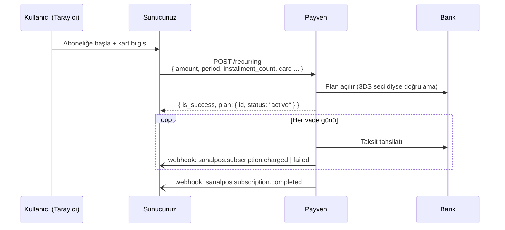

Bu reçete abonelik (örn. aylık SaaS, bağış, sigorta primi) gibi **tekrarlayan tahsilat** senaryosunu gösterir. Plan bir kez oluşturulur; **her vade gününde Payven taksiti kendisi çeker**. Sunucunuzda zamanlayıcı (cron) çalıştırmanız ya da kart token'ı saklamanız gerekmez; sonuçları webhook ile alırsınız.

## Akış



## 1. Planı oluştur

Kart bilgisi yalnız bu istekte gönderilir. Bayiye bağlı bir anahtar kullanıyorsanız bayi header'ı gerekmez; organizasyon geneli anahtarda `X-Merchant-Id` ekleyin.

```bash
curl -X POST https://vpos.payven.com.tr/api/v1/recurring \
  -H "Authorization: Bearer $PAYVEN_TOKEN" \
  -H "Idempotency-Key: sub-1001-create" \
  -H "Content-Type: application/json" \
  -d '{
    "external_id":       "SUB-1001",
    "amount":            { "amount": 9900, "currency": "TRY" },
    "card": {
      "holder_name":  "Test Kullanici",
      "number":       "4111111111111111",
      "expire_month": "12",
      "expire_year":  "2030",
      "cvv":          "123"
    },
    "buyer":             { "id": "cust-001", "email": "user@example.com" },
    "description":       "Aylık üyelik",
    "period":            "monthly",
    "interval":          1,
    "installment_count": 12,
    "start_date":        "2026-11-01T00:00:00+03:00",
    "secure_type":       "three_ds",
    "return_url":        "https://example.com/abonelik/tamam"
  }'
```

| Alan | Açıklama |
|---|---|
| `amount.amount` | **Her taksitin** tutarı (kuruş) |
| `period` / `interval` | `daily`, `weekly`, `monthly`, `yearly` ve çarpan (`monthly` + `1` = ayda bir) |
| `installment_count` | Toplam çekim sayısı |
| `start_date` | İlk çekim tarihi (`+03:00` ile) |
| `secure_type` | `three_ds` ya da `non_three_ds` (varsayılan) |
| `return_url` | 3D Secure sonrası tarayıcının döneceği adres |

**Tüketici akışında `three_ds` kullanın**: sorumluluk bankaya geçer. Bu durumda yanıt `requires_three_d_secure: true` ve base64 kodlu `html_content` taşır; çözüp müşterinin tarayıcısında render edin. Doğrulama tamamlanınca plan aktifleşir.

```json
{
  "is_success": true,
  "requires_three_d_secure": true,
  "html_content": "PGZvcm0gLi4u...",
  "plan": {
    "id": "5c1a7d3e-92b4-4f08-a6c1-8e2d0f4b7a19",
    "external_id": "SUB-1001",
    "period": "monthly",
    "interval": 1,
    "installment_count": 12,
    "amount": 9900,
    "currency": "TRY",
    "secure_type": "three_ds",
    "status": "active",
    "masked_card_number": "411111******1111"
  }
}
```

`plan.id` değerini kendi abonelik kaydınızla birlikte saklayın. Ham kart numarasını saklamayın; plan yaşam döngüsü boyunca Payven kartı sizin yerinize yönetir.

<Warning>
Test modunda (test anahtarı) planın 3D adımı simülatör sayfasıyla ilerler ve bankaya gidilmez. Non-3D plan için bayinin banka konfigürasyonunun tekrarlayan ödemeyi desteklemesi gerekir; desteklemiyorsa `422 PV_RECURRING_NOT_SUPPORTED` döner. Ayrıntılı alan listesi: [Tekrarlayan Ödeme](/sanal-pos/payments/recurring).
</Warning>

## 2. Taksit sonuçlarını webhook ile izle

Her vade gününde bir taksit çekilir ve olay yayınlanır. Olayı `X-Payven-Event-Id` ile tekilleştirin.

```json
{
  "id":       "evt_8e3f5c129a7b4c8dbc4e2c963f66afa6",
  "object":   "event",
  "type":     "sanalpos.subscription.charged",
  "created":  "2026-11-01T06:00:15.211+03:00",
  "livemode": true,
  "data": {
    "object": {
      "event_type":         "sanalpos.subscription.charged",
      "plan_id":            "5c1a7d3e-92b4-4f08-a6c1-8e2d0f4b7a19",
      "external_id":        "SUB-1001",
      "plan_status":        "active",
      "installment_index":  1,
      "installment_status": "completed",
      "amount":             9900,
      "currency":           "TRY",
      "result_code":        "00",
      "masked_card_number": "411111******1111",
      "occurred_at":        "2026-11-01T06:00:15+03:00"
    }
  }
}
```

| Olay | Anlam |
|---|---|
| `sanalpos.subscription.charged` | Taksit çekildi |
| `sanalpos.subscription.failed` | Taksit çekilemedi (plan otomatik iptal olmaz) |
| `sanalpos.subscription.cancelled` | Plan iptal edildi |
| `sanalpos.subscription.completed` | Tüm taksitler tamamlandı |
| `sanalpos.subscription_charge.reversed` | Çekilmiş taksit bankada geri çevrildi |
| `sanalpos.subscription_charge.failed` | Çekilmiş görünen taksit sonradan hata olarak raporlandı |

Her çekim ayrıca bir işlem kaydı oluşturur ve `sanalpos.payment.*` olaylarını yayınlar; işlemin `external_id` değeri `{plan_external_id}-{taksit_sırası}` biçimindedir (örn. `SUB-1001-2`).

Planın ve taksitlerin güncel durumu için:

```bash
curl "https://vpos.payven.com.tr/api/v1/recurring/5c1a7d3e-92b4-4f08-a6c1-8e2d0f4b7a19?force_sync=true" \
  -H "Authorization: Bearer $PAYVEN_TOKEN"
```

Yanıt, plan alanlarına ek olarak `installments[]` (her biri `installment_index`, `due_date`, `amount`, `payment_status`: `pending`, `completed`, `error`, `cancelled`) taşır.

## 3. Başarısız taksitin yönetimi

Banka reddi durumunda taksit `error` olur, `sanalpos.subscription.failed` yayınlanır ve `result_code` / `result_message` sebebi taşır. Önerilen strateji (sunucunuzdaki dunning akışı):

| Banka kodu (`result_code`) | Anlam | Strateji |
|---|---|---|
| `51` | Yetersiz bakiye | Birkaç gün sonra kullanıcıyı bilgilendirin; kartı güncellemesini isteyin |
| `54` | Kart süresi dolmuş | Kart son kullanma tarihini güncelleyin (aşağıda) |
| `62` | Kısıtlı kart | Kullanıcıdan yeni kart isteyin |
| `91` / `96` | Banka sistemi | Geçici arıza; planı `force_sync=true` ile sorgulayıp durumu doğrulayın |

Kartın son kullanma tarihi değiştiyse plan iptal edilmeden güncellenir:

```bash
curl -X POST https://vpos.payven.com.tr/api/v1/recurring/5c1a7d3e-92b4-4f08-a6c1-8e2d0f4b7a19/update-card-expiry \
  -H "Authorization: Bearer $PAYVEN_TOKEN" \
  -H "Content-Type: application/json" \
  -d '{ "expire_month": "03", "expire_year": "2032" }'
```

Bekleyen bir taksitin tutarı `POST /recurring/{id}/installments/{index}/update-amount` (`{ "amount": 12900 }`), tek taksit iptali `POST /recurring/{id}/installments/{index}/cancel` ile yapılır.

## 4. Aboneliği iptal et

```bash
curl -X POST https://vpos.payven.com.tr/api/v1/recurring/5c1a7d3e-92b4-4f08-a6c1-8e2d0f4b7a19/cancel \
  -H "Authorization: Bearer $PAYVEN_TOKEN"
```

Yalnız `active` plan iptal edilir (aksi halde `409 PV_RECURRING_PLAN_NOT_ACTIVE`); bekleyen tüm taksitler çekilmez ve `sanalpos.subscription.cancelled` yayınlanır.

## Kontrol listesi

<Check>Plan **3D Secure** ile açıldı mı (tüketici akışı)?</Check>
<Check>`plan.id` abonelik kaydınıza bağlı saklanıyor, kart numarası saklanmıyor mu?</Check>
<Check>`sanalpos.subscription.failed` olayı dunning akışınıza (kullanıcı bildirimi, kart güncelleme) bağlı mı?</Check>
<Check>Webhook handler'ınız olayları `X-Payven-Event-Id` ile tekilleştiriyor mu?</Check>
<Check>Abonelik iptali `POST /recurring/{id}/cancel` çağrısına bağlı mı?</Check>

## İlgili sayfalar

- [Tekrarlayan Ödeme](/sanal-pos/payments/recurring)
- [3D Secure Ödeme](/sanal-pos/payments/3d-secure)
- [Idempotency](/documentation/concepts/idempotency)
- [Webhook olay kataloğu](/sanal-pos/webhooks/events)
