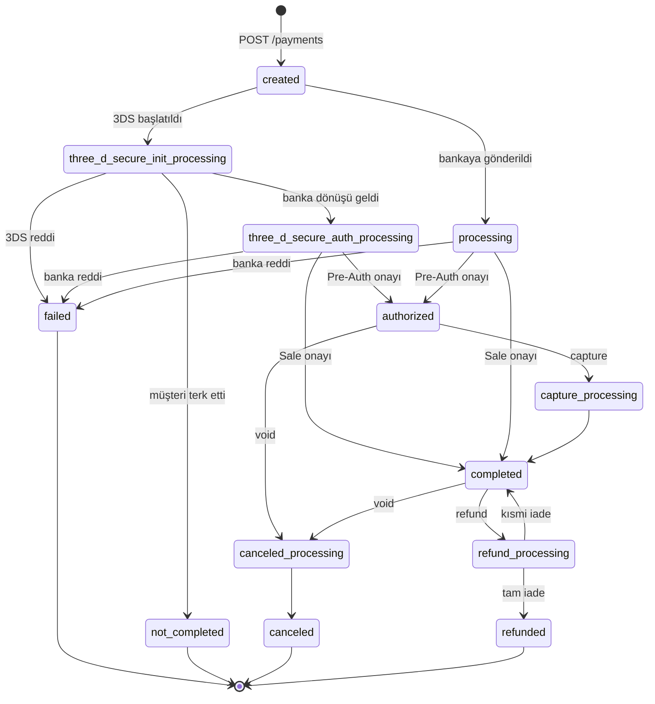

Payven Sanal POS, ödeme kuruluşları ve büyük platformlar için **çoklu banka entegrasyonlu** bir ödeme alma altyapısıdır. Tek bir API ile birden fazla bankaya ödeme yönlendirir, akıllı yönlendirme motoruyla başarı oranını maksimize eder.

## Temel özellikler

<CardGroup cols={2}>
  <Card title="Çoklu Banka" icon="building-columns">
    Tek API üzerinden birden fazla bankaya bağlanın. Banka entegratörleri ihtiyacınıza göre özel olarak geliştirilir; entegratör yapılandırmalarını (kimlik bilgileri, bayi profilleri, öncelik) kendiniz yönetirsiniz. Yeni entegratör anlaşma değil, konfigürasyon meselesidir.
  </Card>
  <Card title="Akıllı Yönlendirme" icon="route" href="/sanal-pos/routing/overview">
    BIN, tutar, taksit, kart birliği ve banka sağlığını dikkate alan bileşik skor motoru ile dinamik yönlendirme.
  </Card>
  <Card title="3D Secure" icon="shield-check" href="/sanal-pos/payments/3d-secure">
    Tüm bankalar için tek tip 3DS akışı. Frictionless ve challenge ayrımı bankaya göre otomatik işlenir.
  </Card>
  <Card title="Smart Retry" icon="arrows-rotate" href="/sanal-pos/routing/smart-retry">
    Geçici banka hatasında işlem alternatif konnektöre yönlendirilir; kullanıcı yeniden ödeme yapmaz.
  </Card>
  <Card title="Hosted Checkout" icon="window-maximize" href="/sanal-pos/payments/hosted-checkout">
    Kart girişi Payven'in barındırdığı sayfada yapılır; siz sadece yönlendirme URL'si alırsınız. PCI-DSS yükünü minimize eder.
  </Card>
  <Card title="Tek Mutabakat" icon="scale-balanced" href="/sanal-pos/reconciliation/overview">
    Banka hareketleri ile Payven kayıtları tek bir mutabakat akışında karşılaştırılır.
  </Card>
  <Card title="Tekrarlayan Ödeme" icon="repeat" href="/sanal-pos/payments/recurring">
    Plan oluşturun; taksitler vadesinde otomatik tahsil edilir.
  </Card>
  <Card title="Kayıtlı Kart" icon="credit-card" href="/sanal-pos/payments/saved-cards">
    Kartı bir kez kaydedin, sonraki ödemelerde kart bilgisini yeniden almayın.
  </Card>
  <Card title="İade ve İptal Talepleri" icon="user-check" href="/sanal-pos/payments/refund-requests">
    Talebi açan ile onaylayanın ayrı olduğu (4 göz) iade ve iptal akışı.
  </Card>
  <Card title="Ürünler ve Ödeme Linki" icon="box" href="/sanal-pos/payments/products">
    Ürün kataloğu, indirim kodu ve ürünlü ödeme bağlantısı.
  </Card>
  <Card title="Pazaryeri (Split)" icon="diagram-project" href="/sanal-pos/payments/marketplace-splits">
    Tek ödemeyi alt bayiler arasında paylaştırın.
  </Card>
  <Card title="Makbuz" icon="receipt" href="/sanal-pos/payments/receipts">
    İşlem makbuzunu JSON veya HTML olarak alın, müşteriye gönderin.
  </Card>
</CardGroup>

## Base URL

| Ortam | URL |
|---|---|
| Production | `https://vpos.payven.com.tr` |

Test modu URL'den değil **kimlikten** gelir: test API anahtarıyla veya test modundaki bayiyle yapılan her istek simüle edilir — bkz. [Sandbox](/sanal-pos/test/sandbox).

## Hangi entegrasyonu seçmeliyim?

<Tabs>
  <Tab title="Hosted Checkout (önerilir)">
    **Sizin akış:**
    1. Sunucunuz `POST /api/v1/checkout/sessions` ile bir oturum oluşturur.
    2. Müşteriyi dönen `checkout_url`'e yönlendirirsiniz.
    3. Müşteri kart bilgilerini Payven sayfasında girer.
    4. Sonuç webhook ile size iletilir.

    **Avantajlar:** En düşük PCI-DSS yükü (SAQ-A), 3DS otomatik, taksit seçimi sayfada.

    **Uygunsa:** Çoğu B2C entegrasyonu için tercih bu olmalı.

    [Detay →](/sanal-pos/payments/hosted-checkout) · [Checkout oturumu referansı →](/sanal-pos/payments/checkout-sessions)
  </Tab>
  <Tab title="Pay-by-Link">
    **Sizin akış:**
    1. Sunucunuz `POST /api/v1/payments/order-link` ile banka barındırmalı ödeme linki üretir (kalıcı, ürünlü bağlantılar için `POST /api/v1/payment-links`).
    2. SMS, e-posta veya WhatsApp ile müşteriye gönderirsiniz.
    3. Müşteri linkten ödemeyi yapar.

    **Avantajlar:** Sıfır frontend geliştirme, çağrı merkezi senaryoları için ideal.

    [Detay →](/sanal-pos/payments/pay-by-link)
  </Tab>
  <Tab title="Direct API">
    **Sizin akış:**
    1. Kart bilgilerini kendi formunuzdan toplarsınız.
    2. Non-3D için `POST /api/v1/payments`, 3D Secure için `POST /api/v1/payments/3d/init` çağırırsınız.
    3. 3DS gerekiyorsa müşteriyi yanıttaki yönlendirmeye gönderirsiniz.
    4. Banka dönüşü Payven'e gelir, sonuç webhook ile size iletilir.

    **Avantajlar:** UI üzerinde tam kontrol.

    **Maliyet:** PCI-DSS denetim kapsamı yüksek (SAQ-D veya ROC). Yalnızca sertifikalı organizasyonlar kullanmalı.

    [Non-3D →](/sanal-pos/payments/non-3d) · [3D Secure →](/sanal-pos/payments/3d-secure)
  </Tab>
</Tabs>

Her yazma isteğinde `external_id` (sipariş kimliği) zorunludur ve çift çekimi önleyen anahtar olarak çalışır; ayrıca `Idempotency-Key` başlığı gönderin — bkz. [Kimlik Doğrulama](/sanal-pos/authentication#idempotency-key).

## Endpoint kategorileri

Tüm path'ler `/api/v1/` ön ekiyle başlar. Tam liste için: [API Referansı](/api-reference/sanal-pos). Tüm uçlar Bearer token ister.

| Kategori | Endpoint örnekleri | Sayfa |
|---|---|---|
| Ödeme oluşturma | `POST /payments`, `POST /payments/3d/init`, `POST /payments/order-link`, `POST /checkout/sessions`, `POST /payment-links` | [Non-3D](/sanal-pos/payments/non-3d), [3DS](/sanal-pos/payments/3d-secure), [Checkout](/sanal-pos/payments/checkout-sessions) |
| Ödeme aksiyonları | `POST /payments/{id}/capture`, `/refund`, `/void`, `/reconcile`, `/point-inquiry`, `/dcc/confirm`; `POST /payments/3d/complete` | [Pre-Auth](/sanal-pos/payments/pre-auth-capture), [İade](/sanal-pos/payments/refund), [İptal](/sanal-pos/payments/void) |
| Sorgulama | `GET /payments/{id}`, `GET /payments/{id}/query`, `GET /payments/{id}/history`, `GET /transactions`, `GET /transactions/{id}`, `GET /transactions/export` | [Sorgulama](/sanal-pos/inquiries/payment-detail) |
| Taksit ve BIN | `POST /installments/quote`, `POST /bins/check`, `GET /bins/{bin}` | [Taksit](/sanal-pos/payments/installment) |
| Tekrarlayan ödeme | `POST /recurring`, `GET /recurring`, `POST /recurring/{id}/cancel`, `.../installments/{index}/cancel`, `.../installments/{index}/update-amount`, `POST /recurring/{id}/update-card-expiry` | [Recurring](/sanal-pos/payments/recurring) |
| Kayıtlı kart | `GET /cards`, `GET /cards/{id}`, `DELETE /cards/{id}` | [Kayıtlı Kart](/sanal-pos/payments/saved-cards) |
| İade listesi | `GET /refunds`, `GET /refunds/{id}` | [İade](/sanal-pos/payments/refund) |
| İade / iptal talepleri | `POST /refund-requests`, `POST /refund-requests/{id}/approve\|reject`; `POST /cancellation-requests`, `.../approve\|reject` | [İade Talepleri](/sanal-pos/payments/refund-requests), [İptal Talepleri](/sanal-pos/payments/cancellation-requests) |
| Ürün ve indirim | `/products`, `/discount-codes` | [Ürünler](/sanal-pos/payments/products) |
| Pazaryeri | `GET /marketplace/splits`, `POST /marketplace/splits/{id}/approve\|hold\|release\|refund` | [Split](/sanal-pos/payments/marketplace-splits) |
| Makbuz | `GET /receipts/{source}/{id}`, `.../html`, `.../send` | [Makbuz](/sanal-pos/payments/receipts) |
| Ters ibraz | `GET /chargebacks`, `POST /chargebacks`, `PUT /chargebacks/{id}/status` | [Chargeback](/sanal-pos/reporting/chargebacks) |
| Mutabakat | `POST /reconciliations/start`, `POST /reconciliations/{id}/finalize`, `POST /reconciliations/{id}/cancel` | [Mutabakat](/sanal-pos/reconciliation/overview) |
| Belirsiz banka işlemleri | `GET /unresolved-bank-operations`, `POST /unresolved-bank-operations/{id}/resolve` | [Mutabakat yaşam döngüsü](/sanal-pos/reconciliation/lifecycle) |
| Yönlendirme kuralları | `/routing-rules`, `POST /routing-rules/resolve`, `/simple-routing-rules` | [Routing](/sanal-pos/routing/overview) |
| Konnektör | `GET /connectors`, `GET /connectors/{id}/health`, `GET /connectors/types/{code}/schema` | [Routing](/sanal-pos/routing/circuit-breaker) |
| Test kartları | `GET /test-cards`, `POST /test-cards`, `POST /test-cards/generate` | [Test Kartları](/sanal-pos/test/test-cards) |
| Webhook yönetimi | Sanal POS API'sinde değil **İşyeri API'sinde**: `POST /webhook-endpoints`, `POST /webhook-endpoints/{id}/rotate-secret`, `GET /webhook-endpoints/{id}/deliveries` | [Webhook'lar](/sanal-pos/webhooks/overview) |

Gün sonu hakediş ve çekim (payout) uçları Cüzdan servisindedir; bkz. [Raporlama](/sanal-pos/reporting/settlements).

## İşlem yaşam döngüsü

İşlem durumu `status` alanında, `TransactionStatus` değerlerinin snake_case karşılığı olarak döner. Kısmi iade, üst işlemin durumunu değiştirmez (`completed` kalır); iade ayrı iade kaydı olarak yazılır.

Tam durum tablosu ve anlamları: [Payment Objesi → Status](/sanal-pos/payment-object#status-degerleri). Her durum geçişinde oluşan webhook olayları: [Webhook Olayları](/sanal-pos/webhooks/events).

## Sıradaki adım

<CardGroup cols={2}>
  <Card title="Kimlik Doğrulama" icon="key" href="/sanal-pos/authentication">
    Token, bayi başlıkları, Idempotency-Key ve limitler.
  </Card>
  <Card title="Payment Objesi" icon="cube" href="/sanal-pos/payment-object">
    Tüm ödeme yanıtlarında dönen alanların referansı.
  </Card>
  <Card title="Sandbox" icon="flask" href="/sanal-pos/test/sandbox">
    Gerçek para ve banka olmadan test modu.
  </Card>
  <Card title="İlk Non-3D Ödeme" icon="credit-card" href="/sanal-pos/payments/non-3d">
    En basit ödeme akışıyla başlayın.
  </Card>
</CardGroup>
