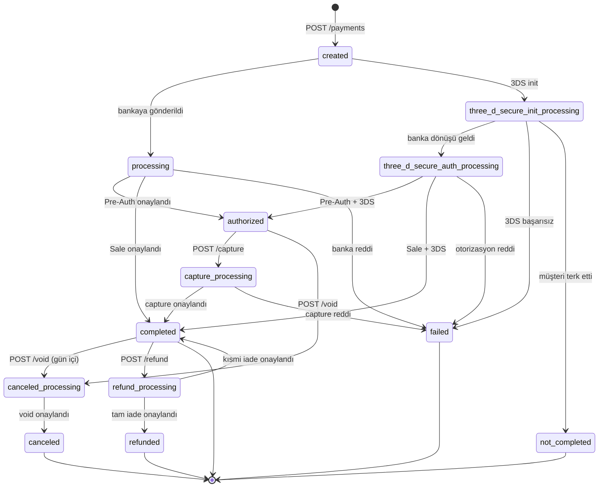

Payment objesi, bir ödemenin **mevcut durumu** ve tutar bilgisini tek bir yapıda taşır. İki varyantı vardır:

- **`PaymentOperationResult`** — yazma operasyonlarında (`POST /payments`, `/3d/init`, `/order-link`, `/capture`, `/refund`, `/void`) döner
- **`PaymentStatus`** — sorgulamada (`GET /payments/{id}`) döner; `PaymentOperationResult` üzerine ek alanlar koyar

## PaymentOperationResult

Yazma endpoint'lerinden dönen temel yapı (başarılı `POST /payments`):

```json
{
  "transaction_id":        "8e3f5c12-9a7b-4c8d-bc4e-2c963f66afa6",
  "status":                "completed",
  "is_success":            true,
  "message":               "İşlem başarıyla tamamlandı",
  "amount":                15000,
  "total_customer_amount": 15000,
  "interest_amount":       0,
  "currency":              "TRY",
  "extra_properties": {
    "processed_at":            "2026-05-03T12:34:58.123+03:00",
    "receipt_id":              "RCPT-20260503-0001",
    "external_id":             "ORDER-1001",
    "provider_transaction_id": "9f3d2b8e-...",
    "auth_code":               "123456",
    "host_reference":          "PAYVEN-REF-789"
  }
}
```

| Alan | Tip | Açıklama |
|---|---|---|
| `transaction_id` | UUID | Payven tarafından atanan benzersiz işlem kimliği. Sorgulama / aksiyon endpoint'lerinde URL parametresi olarak kullanılır. |
| `status` | enum | İşlemin mevcut durumu — bkz. [Status değerleri](#status-degerleri) |
| `is_success` | bool | Operasyon başarılı mı. Karar için HTTP durum kodunu kullanın (`2xx` → başarılı); bu alan yalnızca yardımcıdır. |
| `message` | string \| null | İnsan-okur durum mesajı |
| `amount` | long (kuruş) \| null | Müşteriden çekilen **toplam** tutar, vade farkı dahil. Ödeme oluşturma yanıtlarında dolar; iade/iptal/capture yanıtlarında yoktur. |
| `total_customer_amount` | long (kuruş) \| null | `amount` ile aynı değer (bayi tarafında netlik için) |
| `interest_amount` | long (kuruş) \| null | Vade farkı. Peşin işlemde ve vade farkını bayinin üstlendiği taksitte `0`. Temel satış tutarı `amount - interest_amount`'tır. |
| `currency` | string \| null | ISO-4217 alfa-3, büyük harf (örn. `TRY`) |
| `extra_properties` | object \| null | Banka-spesifik ek alanlar — hangi anahtarların dolduğu bankaya göre değişir |

Tutarlar daima **kuruş** cinsinden `long`'tur (`15000` = 150,00 TL). Başarılı olmayan operasyon HTTP `4xx/5xx` ve `application/problem+json` döner ([aşağıda](#hata-responselari)).

### `extra_properties` içeriği

Anahtarlar snake_case'tir. Tüm bankalar aşağıdaki anahtarları doldurmaya çalışır (banka desteklemiyorsa boş string olur):

| Anahtar | Açıklama |
|---|---|
| `processed_at` | İşlemin tamamlanma zamanı (`+03:00`) |
| `receipt_id` | Banka makbuz numarası |
| `external_id` | Bankadan dönen sipariş referansı. Sizin `external_id` değeriniz işlem kaydında saklanır ve `GET /transactions/{id}` ile okunur. |
| `provider_transaction_id` | Bankadaki işlem kimliği (banka log'larında arama için) |
| `auth_code` | Onay kodu |
| `host_reference` | Bankadaki kalıcı referans numarası |

Bankaya özgü ek alanlar aynı sözlükte döner; test modunda yalnızca simüle edilen alanlar bulunur.

## PaymentStatus

`GET /api/v1/payments/{transaction_id}`, `PaymentOperationResult` alanlarına ek olarak şunları taşır. Başarısız ödemenin sorgusu da `200 OK` döner (kaynak vardır, yalnızca `status: "failed"`).

```json
{
  "transaction_id":        "8e3f5c12-...",
  "status":                "failed",
  "is_success":            false,
  "message":               "Yetersiz bakiye",
  "error_code":            "PV_INSUFFICIENT_FUNDS",
  "amount":                15000,
  "total_customer_amount": 15000,
  "interest_amount":       0,
  "currency":              "TRY",
  "is3_d_secure":          false,
  "created":               "2026-05-03T12:34:56.789+03:00",
  "basket_id":             "BASKET-2026-001"
}
```

| Ek alan | Tip | Açıklama |
|---|---|---|
| `is3_d_secure` | bool | İşlem 3D Secure ile mi yapıldı |
| `created` | datetime | İşlemin oluşturulma zamanı (`+03:00`) |
| `basket_id` | string \| null | İstek body'sinden gelen sepet kimliği |
| `error_code` | string \| null | İşlem geçmişindeki son hata kodu |
| `message` | string \| null | İşlem geçmişindeki son hata mesajı (hata yoksa boş) |

<Note>
Sorgu yanıtında `extra_properties` ve `provider_error_code` **yoktur**. Bankanın ham kodu için `GET /payments/{id}/query` (banka durum sorgusu) veya `GET /payments/{id}/history` (işlem geçmişi) kullanın. `is_success`, sorguda yalnızca `completed` ve `authorized` için `true`'dur.
</Note>

## Status değerleri

`status` alanı `TransactionStatus` enum'unun **snake_case wire formatı**dır:

| `status` (wire) | Anlam | Sonraki adım |
|---|---|---|
| `created` | İşlem kaydedildi, henüz bankaya gönderilmedi | Otomatik |
| `processing` | Bankada, yanıt bekleniyor | Asenkron — webhook veya `GET` ile takip |
| `three_d_secure_init_processing` | 3DS başlatıldı, müşteri bankaya yönlendirilmeli | Müşteriyi yanıttaki yönlendirmeye gönderin |
| `three_d_secure_auth_processing` | 3DS dönüşü alındı, otorizasyon sürüyor | Asenkron — webhook ile takip |
| `authorized` | Banka onayladı, ön provizyon (Pre-Auth) | `/capture` ile çekim yapın |
| `capture_processing` | Capture isteği bankada | Asenkron |
| `completed` | İşlem tamamlandı (Sale veya Capture sonrası) | İade/iptal yapılabilir |
| `refund_processing` | İade isteği bankada | Asenkron |
| `refunded` | Tüm tutar iade edildi | — |
| `canceled_processing` | İptal (void) isteği bankada | Asenkron |
| `canceled` | İptal edildi | — |
| `failed` | Banka reddetti veya teknik hata | `error_code` ve işlem geçmişini inceleyin |
| `not_completed` | Müşteri 3DS'i tamamlamadan ayrıldı; para hareketi yok | Yeni ödeme başlatın |

`failed` bankanın **aktif reddidir**; `not_completed` ise sonuçlanmamış terktir (para çekilmemiştir). İkisi de nihaidir.

<Note>
**Hesaplanan durumlar — `status` alanında görünmez:**

- **Kısmi iade:** Üst işlemin `status` alanı `completed` kalır; iade ayrı bir iade kaydı olarak yazılır ve `GET /refunds` ile listelenir. `GET /transactions?status=partially_refunded` filtresi bu işlemleri (net tutarı brüt tutardan küçük olanları) döndürür.
- **Hakediş (settlement):** `status` içinde `settled` değeri yoktur; hakediş ayrı bir kaynakta izlenir.
</Note>



## Hata response'ları

İşlem reddi, iş kuralı ihlali ve banka reddi dahil tüm hata durumları [problem+json](/sanal-pos/errors/overview) formatında, uygun HTTP durum koduyla döner. Banka reddinde zarf ek olarak şunları taşır:

```json
{
  "status":              422,
  "code":                "PV_INSUFFICIENT_FUNDS",
  "message":             "Bakiye yetersiz.",
  "provider_error_code": "51",
  "transaction_id":      "8e3f5c12-9a7b-4c8d-bc4e-2c963f66afa6"
}
```

`code` Payven'in kanonik kodudur ([Payven Hata Kodları](/sanal-pos/errors/payven-codes)); `provider_error_code` bankanın ham kodudur ([Banka Kodları](/sanal-pos/errors/bank-codes)); `transaction_id` reddedilen işlemi sonradan sorgulamanızı sağlar.
