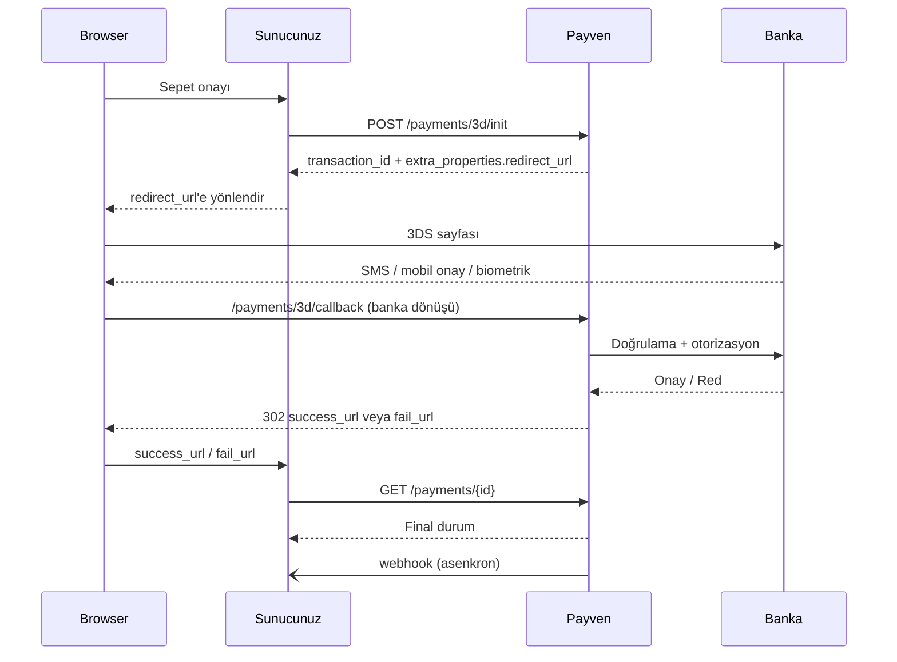
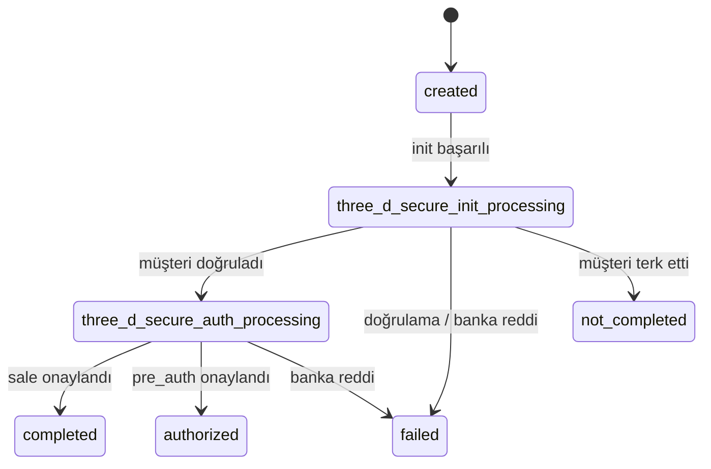

3D Secure, kart sahibinin işlemi onaylamasını isteyen ek bir güvenlik katmanıdır. Başarılı 3DS doğrulaması durumunda **chargeback sorumluluğu bankaya geçer**. Tüketici e-ticaret işlemlerinde **şiddetle önerilir**.

## Akış (özet)



## 1. Adım — 3DS Init

```http
POST /api/v1/payments/3d/init
```

Gerekli yetki `CanManageTransactions`; işletme kapsamı [Non-3D](/sanal-pos/payments/non-3d#endpoint) ile aynıdır (`X-Merchant-Id` / `X-External-Merchant-Id`).

```bash
curl -X POST https://vpos.payven.com.tr/api/v1/payments/3d/init \
  -H "Authorization: Bearer $PAYVEN_TOKEN" \
  -H "Idempotency-Key: order-1001-payment" \
  -H "Content-Type: application/json" \
  -d '{
    "external_id":    "ORDER-1001",
    "amount":         { "amount": 15000, "currency": "TRY" },
    "installment":    1,
    "operation_type": "sale",
    "card": {
      "holder_name":  "Test Kullanici",
      "number":       "4546711234567894",
      "expire_month": "12",
      "expire_year":  "2030",
      "cvv":          "000"
    },
    "success_url": "https://example.com/odeme/basarili",
    "fail_url":    "https://example.com/odeme/basarisiz",
    "buyer": {
      "id":         "cust-001",
      "email":      "musteri@example.com",
      "ip_address": "85.105.10.10"
    }
  }'
```

İstek gövdesi [Non-3D](/sanal-pos/payments/non-3d) ile aynı alanları taşır (`external_id` zorunlu, `installment` 1–12, `connector_config_id`, `buyer`, adresler, `basket_items`, `splits[]`). Farklar:

| Alan | Tip | Zorunluluk | Açıklama |
|---|---|---|---|
| `success_url` | url | Önerilir | İşlem **başarılı** sonuçlanınca müşterinin 302 ile yönlendirileceği adres; mutlak `http`/`https` olmalı |
| `fail_url` | url | Önerilir | İşlem **başarısız** sonuçlanınca (banka reddi, 3DS hatası, zaman aşımı) yönlendirileceği adres; mutlak `http`/`https` olmalı |
| `three_d_flow` | enum | Opsiyonel | `standard`, `pay`, `hosted`. Verilmezse işletme politikasındaki tercih, o da yoksa `standard` kullanılır. Banka kendi modeline göre uyarlayabilir; sonucu `secure_type` alanından görürsünüz |
| `operation_type` | enum | Opsiyonel | `sale` (varsayılan) veya `pre_auth` |

<Note>
Bankanın dönüş adresi **her zaman Payven'in** `/payments/3d/callback` ucudur; sizden callback adresi istenmez ve değiştirilemez. `success_url` / `fail_url` verilmezse müşteriye minimal bir sonuç sayfası gösterilir; sonucu webhook ve `GET /payments/{id}` ile alırsınız. İşletmeniz için bir alan adı izin listesi tanımlıysa bu adreslerin sunucu adı listede olmalıdır, aksi halde `422 PV_INVALID_CALLBACK_URL` döner.
</Note>

### Yanıt

```http
HTTP/1.1 200 OK
Content-Type: application/json
```

```json
{
  "transaction_id": "8e3f5c12-9a7b-4c8d-bc4e-2c963f66afa6",
  "status":         "three_d_secure_init_processing",
  "is_success":     true,
  "extra_properties": {
    "connector_code": "ornek_vpos",
    "processed_at":   "2026-05-03T12:34:57.123+03:00",
    "redirect_url":   "https://vpos.payven.com.tr/api/v1/payments/3d/redirect/4f0c...e91a"
  }
}
```

`extra_properties.redirect_url` adresine müşteriyi **HTTP 302** ile (veya tarayıcıda `window.location.href`) yönlendirin. Adres Payven'de barındırılır, kart verisi yanıtta dönmez ve yaklaşık 10 dakika geçerlidir; süresi dolmuş adres `404` verir, yeni bir ödeme başlatın. Bazı bankalarda yanıta bankanın otomatik gönderilen formu (`html_content`, `form_data`) de eklenir; `redirect_url` yeterlidir.

<Warning>
`redirect_url` içeriğini ve `extra_properties` alanlarını loglamayın; ödeme kimliğiniz `transaction_id`'dir.
</Warning>

## 2. Adım — 3DS sayfasında doğrulama

Müşteri bankanın 3DS sayfasında SMS, mobil uygulama veya biometrik onay sağlar. Bu adım Payven kapsamı dışındadır.

## 3. Adım — Banka dönüşü

Banka sonucu Payven'e bildirir (`/payments/3d/callback`, kısa takma ad `/3dsc`). Payven doğrulamayı yapar, gerekirse bankaya otorizasyon gönderir ve işlemi son durumuna getirir. Bu adım otomatiktir; sizden bir işlem beklenmez.

## 4. Adım — success_url / fail_url

Payven müşteriyi sonuca göre `success_url` veya `fail_url` adresine 302 ile yönlendirir ve **snake_case** sorgu parametreleri ekler:

```
https://example.com/odeme/basarili?transaction_id=8e3f5c12-...&external_id=ORDER-1001&status=completed&is_verified=true
```

| Parametre | Anlam |
|---|---|
| `transaction_id` | Payven işlem kimliği |
| `external_id` | Init'te gönderdiğiniz sipariş kimliği |
| `status` | İşlem durumu (`completed`, `authorized`, `failed`...) |
| `is_verified` | Ödeme doğrulanıp tamamlandı mı (`true` / `false`) |
| `error_code` | Başarısızlıkta Payven hata kodu |
| `message` | Başarısızlıkta açıklama |

<Warning>
Bu parametreler tarayıcıdan geçtiği için **güvenilmez**dir. Final durumu mutlaka sunucu tarafında [GET /payments/{id}](/sanal-pos/inquiries/payment-detail) veya webhook ile doğrulayın.
</Warning>

Banka sonucu o anda teyit edilemezse (`THREEDS_VERIFY_UNAVAILABLE`) yönlendirme yapılmaz; müşteriye "Ödemeniz doğrulanıyor" sayfası gösterilir. İşlem kapanmaz — Payven bankaya yeniden sorar ve sonucu webhook ile bildirir. Bu durumu `fail_url` gibi ele almayın.

## 5. Adım — Sunucu tarafında final durum

```bash
curl https://vpos.payven.com.tr/api/v1/payments/8e3f5c12-9a7b-4c8d-bc4e-2c963f66afa6 \
  -H "Authorization: Bearer $PAYVEN_TOKEN"
```

```json
{
  "transaction_id":        "8e3f5c12-9a7b-4c8d-bc4e-2c963f66afa6",
  "status":                "completed",
  "is_success":            true,
  "amount":                15000,
  "total_customer_amount": 15000,
  "interest_amount":       0,
  "currency":              "TRY",
  "is3_d_secure":          true,
  "created":               "2026-05-03T12:34:56.789+03:00",
  "basket_id":             "BASKET-2026-001"
}
```

Bu yanıt `extra_properties` ve `provider_error_code` taşımaz; başarısız işlemde `error_code` / `message` son hatayı gösterir. Banka referansları ve ham kod için [Ödeme Detayı](/sanal-pos/inquiries/payment-detail) ve [İşlem Geçmişi](/sanal-pos/inquiries/payment-history) sayfalarına bakın.

## Durumlar



| `status` | Anlam |
|---|---|
| `three_d_secure_init_processing` | Init yapıldı; müşteri banka sayfasında ya da sonuç bekleniyor |
| `three_d_secure_auth_processing` | Doğrulama bitti, otorizasyon sürüyor |
| `completed` | `sale` tamamlandı |
| `authorized` | `pre_auth` — tutar bloke, [capture](/sanal-pos/payments/pre-auth-capture) bekliyor |
| `failed` | Bankanın aktif reddi (3DS doğrulaması reddi, yetersiz bakiye...) — `error_code` ve `provider_error_code` bakın |
| `not_completed` | Müşteri 3DS'i bitirmeden ayrıldı, para hareketi **yok**. Banka reddi değildir; süre dolunca Payven bankaya sorup işlemi bu duruma çeker |

Müşteri tarayıcıyı kapatırsa `success_url`/`fail_url` hiç çağrılmaz; bu yüzden webhook'a abone olun.

## Manuel tamamlama (ileri seviye)

Otomatik dönüş yetersiz kaldığında bir işlemi elle sonuçlandırmak için:

```http
POST /api/v1/payments/3d/complete
```

```json
{ "transaction_id": "8e3f5c12-9a7b-4c8d-bc4e-2c963f66afa6", "need_verification": true }
```

`need_verification` (varsayılan `true`) bankadan doğrulama sorgusu yapılıp yapılmayacağını belirler. Yetki `CanManageTransactions`. İşlem bu aşamaya uygun değilse `409 THREEDS_COMPLETE_NOT_ALLOWED`, banka tamamlamayı reddederse `422 THREEDS_COMPLETE_FAILED` döner.

## Hata senaryoları

| Senaryo | HTTP | `code` |
|---|---|---|
| `external_id` boş | `422` | `external_id_required` |
| Aynı `external_id` ile devam eden işlem | `409` | `PV_DUPLICATE_ORDER` |
| `success_url` / `fail_url` geçersiz ya da izin listesi dışı | `422` | `PV_INVALID_CALLBACK_URL` |
| Banka bu kart için 3DS başlatamadı | `422` | `PV_3DS_FAILED` / `PV_3DS_INIT_EXCEPTION` |
| 3DS doğrulaması bankaca reddedildi | `422` | `THREEDS_VERIFY_FAILED` |
| Banka yanıt vermedi, işlem doğrulanıyor | `504` | `THREEDS_VERIFY_UNAVAILABLE` |
| 3DS süre aşımı | `504` | `THREEDS_TIMEOUT` |
| Doğrulama sonrası banka otorizasyonu reddetti | `422` | Kanonik banka kodu (ör. `PV_INSUFFICIENT_FUNDS`) + `provider_error_code` |

Ayrıca [Non-3D](/sanal-pos/payments/non-3d#banka-reddi) sayfasındaki kart, CVV ve taksit doğrulama kodları burada da geçerlidir. Tüm kodlar: [Payven Hata Kodları](/sanal-pos/errors/payven-codes).

## Webhook olayları

`success_url`/`fail_url` yönlendirmesi müşteri tarayıcısına bağlıdır; sonucu kaçırmamak için webhook uç noktası tanımlayın ([Webhook Genel Bakış](/sanal-pos/webhooks/overview)):

| Olay | Ne zaman |
|---|---|
| `sanalpos.three_ds.completed` | 3DS doğrulaması başarıyla tamamlandı |
| `sanalpos.three_ds.failed` | 3DS doğrulaması başarısız |
| `sanalpos.payment.completed` / `sanalpos.payment.authorized` | Ödeme tamamlandı / provizyon alındı |
| `sanalpos.payment.failed` | Ödeme başarısız |
| `sanalpos.payment.not_completed` | Müşteri 3DS'i bitirmeden ayrıldı (banka reddi değil) |

Siparişi askıda bırakmamak için `sanalpos.payment.not_completed` olayına da abone olun. Liste: [Webhook Olayları](/sanal-pos/webhooks/events).

## Test ortamı

Test modundaki işletmede 3DS init bankaya gitmez; `redirect_url` bir 3DS simülatör sayfasına çıkar, sonuç yine gerçek akıştaki gibi `success_url` / `fail_url` yönlendirmesi ve webhook'larla gelir. Varsayılan sonuç başarıdır. Red ve zaman aşımı gibi senaryolar için Payven test kartlarını kullanın — bkz. [Sandbox](/sanal-pos/test/sandbox), [Test Kartları](/sanal-pos/test/test-cards).

## ECI / CAVV

Doğrulama ayrıntıları (`md_status`, `eci`, `cavv`, `xid`, `three_ds_server_trans_id`) işlem detayında ve [işlem geçmişinde](/sanal-pos/inquiries/payment-history) görünür; bankanın 3DS protokolü gereği frictionless / challenge kararını banka verir.

## Sonraki adımlar

<CardGroup cols={2}>
  <Card title="Pre-Auth → Capture" icon="lock-keyhole" href="/sanal-pos/payments/pre-auth-capture">
    3DS başarılı sonrası iki aşamalı çekim.
  </Card>
  <Card title="Hosted Checkout" icon="window-maximize" href="/sanal-pos/payments/hosted-checkout">
    PCI-DSS yükünü minimize eden Payven barındırmalı sayfa.
  </Card>
  <Card title="Webhook İmza Doğrulama" icon="shield-check" href="/sanal-pos/webhooks/signature">
    Asenkron olayları güvenle işleyin.
  </Card>
  <Card title="İade İşlemi" icon="rotate-left" href="/sanal-pos/payments/refund">
    Tam veya kısmi iade.
  </Card>
</CardGroup>
