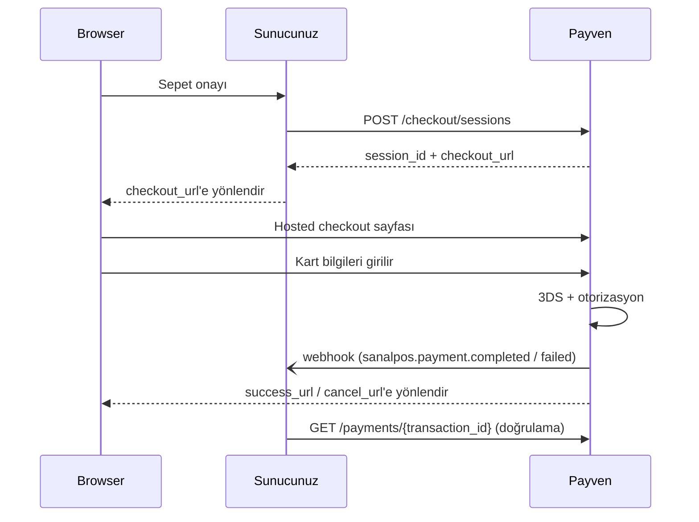

Hosted Checkout, müşterinin kart bilgilerini **Payven'in barındırdığı sayfada** girdiği akıştır. Sizin sunucularınız kart numarasına **hiç dokunmaz**, bu da PCI-DSS denetim kapsamınızı en alt seviyeye (SAQ-A) indirir.

## Ne zaman tercih etmeliyim?

<Check>**Hızlı entegrasyon** — kart formu, BIN lookup, taksit seçenekleri, Luhn kontrolü, 3DS yönlendirme, sonuç sayfası — hepsi Payven'de</Check>
<Check>**Düşük PCI yükü** — kart verisi sunucularınıza dokunmaz</Check>
<Check>**Mobil uyumlu** — Payven sayfası hazır responsive</Check>
<Check>**Tenant-default 3DS modu** — `payment_mode` verilmezse tenant politikasındaki `preferred_three_d_flow` (`standard` / `pay` / `hosted`) kullanılır</Check>

Aksi durumda [Direct API (Non-3D)](/sanal-pos/payments/non-3d) veya [Pay-by-Link](/sanal-pos/payments/pay-by-link) kullanın.

## Akış



## 1. Oturum oluşturun

```http
POST /api/v1/checkout/sessions
```

```bash
curl -X POST https://vpos.payven.com.tr/api/v1/checkout/sessions \
  -H "Authorization: Bearer $PAYVEN_TOKEN" \
  -H "Idempotency-Key: order-1001-checkout" \
  -H "Content-Type: application/json" \
  -d '{
    "merchant_name":  "Acme Mağaza",
    "amount":         15000,
    "currency":       "TRY",
    "description":    "Sipariş ödemesi",
    "external_id":    "ORDER-1001",
    "basket_id":      "BASKET-2026-001",
    "customer_email": "musteri@example.com",
    "customer_phone": "+905551234567",
    "payment_mode":   "three_d_secure",
    "allow_pre_auth": false,
    "success_url":    "https://example.com/odeme/sonuc?order=ORDER-1001",
    "cancel_url":     "https://example.com/odeme/iptal?order=ORDER-1001",
    "metadata": {
      "campaign_id": "summer-2026"
    }
  }'
```

| Alan | Tip | Zorunluluk | Açıklama |
|---|---|---|---|
| `amount` | int (kuruş) | **Zorunlu** | Toplam tutar, `0`'dan büyük. Düz sayıdır |
| `currency` | string | Opsiyonel | ISO-4217, boşsa `TRY` |
| `merchant_name` | string | Opsiyonel | Sayfada gösterilen isim; boşsa bayi kaydındaki ad |
| `external_id`, `basket_id`, `description` | string | Opsiyonel | Sipariş referansları. `external_id` webhook payload'ında geri gelir |
| `customer_email`, `customer_phone` | string | Opsiyonel | Müşteri bilgileri |
| `payment_mode` | enum | Opsiyonel | `non_3d` / `three_d_secure` / `three_d_pay` / `three_d_pay_hosting`. Boşsa tenant politikasından, o da yoksa `three_d_secure` |
| `allow_pre_auth` | bool | Opsiyonel | Sayfada "Ön provizyon" seçeneği gösterilsin mi (varsayılan `false`) |
| `installment`, `installment_amount` | int / int (kuruş) | Opsiyonel | Sabit taksit planı; verilirse sayfa taksit seçtirmez |
| `success_url`, `cancel_url` | url | Opsiyonel | Ödeme sonrası yönlendirme adresleri |
| `metadata` | object | Opsiyonel | Anahtar-değer çiftleri |

Pazaryeri payları (`splits`), fatura bilgisi (`invoice_details`) ve diğer alanlar için [Ödeme Oturumu](/sanal-pos/payments/checkout-sessions) sayfasına bakın.

<Note>
`payment_mode: "non_3d"` istenirse ve bayide Non-3D kapalıysa hata oturum açılırken değil, müşterinin ödeme adımında `422 PV_NON_3D_NOT_ALLOWED` olarak döner. Üretim bayilerinde Non-3D varsayılan olarak kapalıdır.
</Note>

### Yanıt (`201 Created`)

```json
{
  "session_id":         "8e3f5c129a7b4c8dbc4e2c963f66afa6",
  "checkout_url":       "https://vpos.payven.com.tr/s/Ab3kX9qZmn",
  "checkout_page_url":  "https://vpos.payven.com.tr/checkout/classic/?session=8e3f5c129a7b4c8dbc4e2c963f66afa6",
  "expires_at":         "2026-05-04T13:00:00.000+03:00",
  "opened_ttl_minutes": 30
}
```

| Alan | Açıklama |
|---|---|
| `session_id` | 128-bit rastgele oturum kimliği |
| `checkout_url` | Müşteriyi yönlendireceğiniz **kısa** URL; SMS/e-posta/QR ile paylaşmaya uygundur, açıldığında ödeme sayfasına 302 ile yönlenir. Kısa link üretilemezse `checkout_page_url` ile aynı değeri taşır |
| `checkout_page_url` | Ödeme sayfasının doğrudan (uzun) adresi |
| `expires_at` | Oturumun açılabileceği son an (varsayılan oluşturmadan **24 saat** sonra) |
| `opened_ttl_minutes` | Müşteri sayfayı açtıktan sonra ödemeyi tamamlama süresi (varsayılan 30 dk) |

## 2. Müşteriyi yönlendirin

```javascript
res.redirect(302, response.checkout_url);
```

veya client-side:

```javascript
window.location.href = response.checkout_url;
```

## 3. Müşteri Payven sayfasında ödeme yapar

- Kart numarası, son kullanma, CVV, isim girilir
- Otomatik BIN lookup → banka logosu, taksit seçenekleri
- Luhn kontrolü, kart markası doğrulaması
- Seçilen `payment_mode` üzerinden 3DS akışı
- Oturum başına en fazla **3 ödeme denemesi**; hak dolunca oturum `failed` olur

Test modundaki bayide ödeme bankaya gitmez, Payven simülatörüne düşer ([Sandbox](/sanal-pos/test/sandbox)).

## 4. `success_url` veya `cancel_url` üzerinden geri dönüş

Sonuç ekranında müşteriye "satıcıya dön" düğmesi gösterilir ve birkaç saniye içinde `success_url` (başarılı) ya da `cancel_url` (başarısız) adresine yönlendirilir. Yönlendirme adresi **olduğu gibi** kullanılır; Payven ek parametre eklemez. Siparişi eşleştirmek için kendi referansınızı adresin içine yazın (örn. `?order=ORDER-1001`).

<Warning>
Yönlendirme tarayıcıdan gelir ve **güvenilmez**: kullanıcı adresi elle açabilir. Siparişi yalnızca webhook ve sunucu tarafı sorgu ile onaylayın.
</Warning>

## 5. Sonucu doğrulayın

1. **Webhook (önerilen):** `sanalpos.payment.completed` veya `sanalpos.payment.failed`. Payload'da `transaction_id`, `external_id`, `basket_id`, `amount` bulunur. Bkz. [Webhook Olayları](/sanal-pos/webhooks/events).
2. **İşlem sorgusu:** webhook'taki `transaction_id` ile [`GET /api/v1/payments/{transaction_id}`](/sanal-pos/inquiries/payment-detail).

```bash
curl https://vpos.payven.com.tr/api/v1/payments/$transaction_id \
  -H "Authorization: Bearer $PAYVEN_TOKEN"
```

Yanıt yapısı: [Payment Objesi](/sanal-pos/payment-object).

<Warning>
`GET /checkout/sessions/{session_id}` müşteri sayfasının kullandığı, kimlik doğrulamasız bir uçtur ve çağrıldığında oturumu "açıldı" sayar. Tamamlanmış oturumda `409 PV_CHECKOUT_SESSION_CLOSED` döner. Sonuç takibi için bu ucu kullanmayın.
</Warning>

### Oturum durumları

| `status` | Anlam |
|---|---|
| `open` | Ödeme alınabilir |
| `completed` | Ödeme tamamlandı |
| `failed` | Deneme hakkı doldu veya 3D reddedildi; yeni oturum açın |

Süresi dolan oturum ayrı durum taşımaz, okunamaz hale gelir. Ayrıntı: [Ödeme Oturumu](/sanal-pos/payments/checkout-sessions).

## Görünüm özelleştirme

Sayfa şablonu (`classic`, `dark`, `livecard`, `minimal`, `spotlight`) ve marka teması (logo, renk, destek bilgileri, satış koşulları) panelden bayi veya tenant bazında ayarlanır; oturum açıldığında sabitlenir. Ayrıntı: [Ödeme Oturumu](/sanal-pos/payments/checkout-sessions). White-label alan adı için [satış ekibinize](/resources/support) ulaşın.

## Makbuz

Ödeme sonrası müşteriye makbuz sayfadan sunulur; sunucu tarafında makbuz almak için [Makbuz](/sanal-pos/payments/receipts) sayfasına bakın.

## Webhook olayları

| Olay | Açıklama |
|---|---|
| `sanalpos.payment.completed` | Ödeme tamamlandı |
| `sanalpos.payment.failed` | Ödeme başarısız |
| `sanalpos.payment.not_completed` | Müşteri 3DS'i bitirmeden ayrıldı (banka reddi değil) |
| `sanalpos.three_ds.completed` / `sanalpos.three_ds.failed` | 3DS akışlı modlarda ek olarak yayınlanır |
| `sanalpos.payment.authorized` | Ön provizyon yetkilendirildi |

Bkz. [Webhook Olayları](/sanal-pos/webhooks/events).

## Yaygın hatalar

| HTTP | `code` | Anlam |
|---|---|---|
| `400` | `merchant_context_missing` | Hiçbir bayi bilgisi gönderilmedi |
| `404` | `PV_CHECKOUT_SESSION_NOT_FOUND` | `session_id` geçersiz |
| `409` | `PV_CHECKOUT_SESSION_EXPIRED` | Oturum süresi dolmuş |
| `409` | `PV_CHECKOUT_SESSION_CLOSED` | Oturum tamamlanmış |
| `409` | `PV_CHECKOUT_MAX_ATTEMPTS_EXCEEDED` | Deneme hakkı dolmuş |
| `422` | `PV_NON_3D_NOT_ALLOWED` | Bayide Non-3D kapalı (ödeme adımında) |
| `422` | `validation_failed` | Geçersiz alan (örn. `amount` `0`'dan küçük) |

Hata yanıtı `problem+json` zarfındadır (`code`, `message`, `category`, `param`). Tüm oturum hataları: [Ödeme Oturumu](/sanal-pos/payments/checkout-sessions).

## Sonraki adımlar

<CardGroup cols={2}>
  <Card title="Ödeme Oturumu" icon="window" href="/sanal-pos/payments/checkout-sessions">
    Oturum alanları, ömrü, şablon ve tema.
  </Card>
  <Card title="Pay-by-Link" icon="link" href="/sanal-pos/payments/pay-by-link">
    Yeniden kullanılabilir ödeme linkleri ve banka linki.
  </Card>
  <Card title="Webhook entegrasyonu" icon="bell" href="/sanal-pos/webhooks/overview">
    Asenkron sonuçları gerçek zamanlı yakalayın.
  </Card>
  <Card title="Makbuz" icon="receipt" href="/sanal-pos/payments/receipts">
    Ödeme ve iade makbuzu.
  </Card>
</CardGroup>
