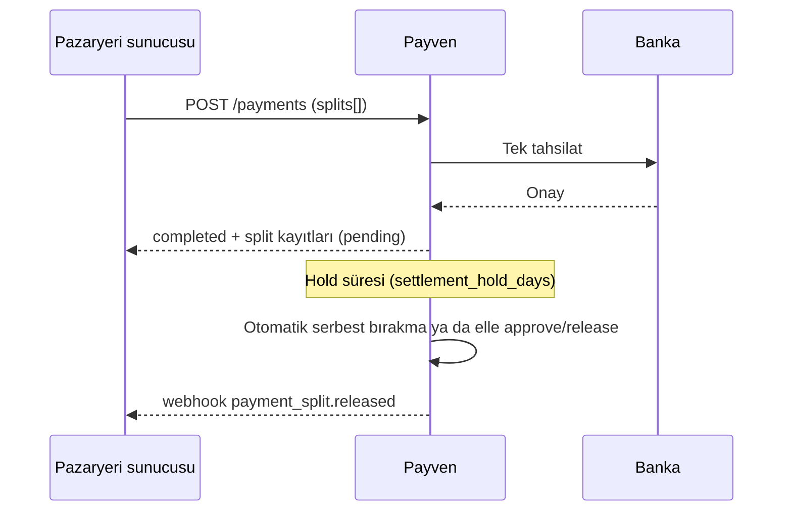

Marketplace modelinde pazaryeri (**ana bayi**) müşteriden tek bir ödeme alır ve tutarı birden fazla **alt bayiye** (satıcıya) böler. Her pay bir **split** kaydıdır; bayinin belirlediği süre boyunca emanette kalır, ardından alt bayiye serbest bırakılır. Ana bayi her paydan komisyon kesebilir.

<Note>
Marketplace, Cüzdan modülünün kurulu olduğu ortamlarda çalışır; ortamda kapalıysa uçlar ve `splits[]` içeren ödemeler `503 marketplace_disabled` döner. `sanalpos.marketplace` alt özelliği şirket için kapalıysa uçlar `403` döner. Alt bayiler Identity'de `marketplace_role = sub_merchant` ve ana bayi bağlantısıyla oluşturulur; alt bayi olayları: `sanalpos.submerchant.*` ([Webhook Olay Kataloğu](/sanal-pos/webhooks/events#marketplace-olayları)).
</Note>

## Akış



## 1. Marketplace profili

Komisyon ve bekleme davranışı profilde tanımlanır. **Split gönderilen her alt bayinin profili zorunludur** (yoksa `422 sub_merchant_profile_missing`); profil, alt bayinin `merchant_id`'si üzerine yazılır. Bekleme süresi ve otomatik serbest bırakma ana bayinin profilinden okunur; ana bayinin profili yoksa varsayılan bekleme süresi 7 gündür.

```http
GET /api/v1/merchants/{merchant_id}/marketplace-profile    # Profil yoksa 204
PUT /api/v1/merchants/{merchant_id}/marketplace-profile    # Oluştur / güncelle
```

Okuma `CanViewMarketplaceProfile`, yazma `CanManageMarketplaceProfile` (varsayılan: `tenant-admin`, `merchant-admin`).

```bash
curl -X PUT https://vpos.payven.com.tr/api/v1/merchants/$MERCHANT_ID/marketplace-profile \
  -H "Authorization: Bearer $PAYVEN_TOKEN" \
  -H "Content-Type: application/json" \
  -d '{
    "settlement_hold_days":  7,
    "auto_release_enabled":  true,
    "commission_rate_pct":   8.5
  }'
```

| Alan | Tip | Açıklama |
|---|---|---|
| `settlement_hold_days` | int | Emanette bekleme süresi (gün), 0–90; boşsa varsayılan 7 |
| `auto_release_enabled` | bool | `true` ise hold süresi dolunca otomatik serbest bırakılır (varsayılan `true`) |
| `commission_rate_pct` | decimal | Yüzde komisyon, 0–100 |
| `commission_rate_fixed` | long (kuruş) | Sabit komisyon, `>= 0` |

`commission_rate_pct` ve `commission_rate_fixed` aynı anda dolu olamaz. Yanıt (`200`): `id`, `merchant_id`, bu alanlar, `created`, `last_modified`.

## 2. Split'li ödeme

Bölme, ödeme isteğindeki `splits[]` dizisiyle yapılır ([Non-3D](/sanal-pos/payments/non-3d) ve [3D Secure](/sanal-pos/payments/3d-secure) başlangıç istekleri). Split kayıtları ödeme **başarıyla tamamlandığında** oluşur.

```json
{
  "external_id": "ORDER-5521",
  "amount": { "amount": 25000, "currency": "TRY" },
  "card": { "...": "..." },
  "splits": [
    { "sub_merchant_id": "6d1c9a52-...", "amount": 15000 },
    { "sub_merchant_id": "a40b77e1-...", "amount": 10000, "commission_rate_pct": 5 }
  ]
}
```

| Alan | Açıklama |
|---|---|
| `sub_merchant_id` | Alt bayinin Payven kimliği (UUID). Ana bayiye bağlı, aktif ve onaylı olmalı |
| `amount` | Alt bayiye giden brüt pay (kuruş, komisyon dahil), `> 0` |
| `commission_rate_pct` | Bu split için yüzde komisyon (0–100); profildeki oranı ezer |
| `commission_fixed` | Bu split için sabit komisyon (kuruş); `commission_rate_pct` ile birlikte gönderilemez |

Kurallar:

- `sum(splits[].amount)` ödeme tutarını aşamaz; alt bayi ile ana bayi aynı olamaz.
- Komisyon önceliği: istek değeri → profil değeri → komisyon yok.
- `net_amount = amount − parent_commission`.
- Split oluşturma hatası ödemeyi **geri almaz**: kart çekilmiştir. Oluşturulamayan split'ler "yetim" listesine düşer (aşağıya bakın).

## 3. Split nesnesi ve durumları

```bash
curl "https://vpos.payven.com.tr/api/v1/marketplace/splits?status=pending&page=1&page_size=20" \
  -H "Authorization: Bearer $PAYVEN_TOKEN" \
  -H "X-Merchant-Id: $MERCHANT_ID"
```

```json
{
  "id": "0b3f6a21-8c47-4d95-a1e2-7f5c9d3b8e60",
  "transaction_id": "8e3f5c12-9a7b-4c8d-bc4e-2c963f66afa6",
  "parent_merchant_id": "3fa85f64-5717-4562-b3fc-2c963f66afa6",
  "sub_merchant_id": "6d1c9a52-0e84-4b7f-9c31-a5d8e2f10b47",
  "sub_merchant_name": "Örnek Satıcı Ltd.",
  "amount": 15000,
  "parent_commission": 1275,
  "net_amount": 13725,
  "currency": "TRY",
  "applied_commission_rate_pct": 8.5,
  "applied_commission_fixed": null,
  "applied_commission_source": "profile",
  "approval_status": "pending",
  "approval_note": null,
  "approved_at": null,
  "auto_release_at": "2026-10-23T12:00:00.000+03:00",
  "released_at": null,
  "refunded_at": null,
  "refunded_net_amount": 0,
  "created": "2026-10-16T12:00:00.000+03:00",
  "tx_amount": 25000,
  "tx_external_id": "ORDER-5521",
  "tx_status": "completed"
}
```

Liste filtreleri: `transaction_id`, `sub_merchant_id`, `parent_merchant_id`, `status`, `start_date`, `end_date`, `search_term`, `page`, `page_size`. `GET .../export` CSV, `GET .../stats` durum bazlı sayaçlar verir.

### `approval_status`

| Değer | Anlam |
|---|---|
| `pending` | Oluştu; hold süresi işliyor |
| `approved` | Onaylandı |
| `held` | Emanete alındı (not zorunlu); otomatik serbest bırakmaya girmez |
| `released` | Alt bayiye serbest bırakıldı (terminal) |
| `refunded` | Tam iade edildi (terminal) |

Serbest bırakma, `auto_release_at` geldiğinde ve ödeme `completed` ise `pending`/`approved` split'ler için otomatik yapılır (profilde `auto_release_enabled` açıksa). `held` olanlar yalnız elle serbest bırakılır. `released`/`refunded` terminal durumlardır; terminal durumdan `approve`/`hold` ile çıkılamaz. Ödemenin **kısmi iadesi** split'lere orantılı yansır (`refunded_net_amount` artar); pay tamamen iade edilince durum `refunded` olur.

## 4. Yaşam döngüsü uçları

Hepsi `204` döner; kayıt yoksa (ya da kapsamınız dışındaysa) `404`.

| Uç | Gövde | İzin (varsayılan roller) | Webhook |
|---|---|---|---|
| `POST /marketplace/splits/{id}/approve` | `{ "note": "..." }` (opsiyonel) | `CanApproveSplits` (tenant-admin, merchant-admin) | `payment_split.approved` |
| `POST /marketplace/splits/{id}/hold` | `{ "note": "..." }` — **zorunlu** | `CanHoldSplits` (tenant-admin, merchant-admin) | `payment_split.held` |
| `POST /marketplace/splits/{id}/release` | — | `CanReleaseSplits` (**yalnız tenant-admin**) | `payment_split.released` |
| `POST /marketplace/splits/{id}/refund` | — | `CanRefundSplits` (tenant-admin, merchant-admin) | `payment_split.refunded` |

Toplu uçlar tek çağrıda en çok **200** split işler:

```bash
curl -X POST https://vpos.payven.com.tr/api/v1/marketplace/splits/bulk/hold \
  -H "Authorization: Bearer $PAYVEN_TOKEN" \
  -H "X-Merchant-Id: $MERCHANT_ID" \
  -H "Content-Type: application/json" \
  -d '{ "ids": ["0b3f6a21-...", "c92d4e10-..."], "note": "Teslimat doğrulanıyor" }'
```

`POST /marketplace/splits/bulk/{approve|hold|release|refund}` gövdesi `{ "ids": [...] }` (`approve` ve `hold` için `note`; `hold`'da zorunlu). Yanıt her zaman `200`'dür ve kısmi başarıyı bildirir:

```json
{
  "succeeded": ["0b3f6a21-..."],
  "failed": [ { "id": "c92d4e10-...", "code": "not_found", "message": "Split bulunamadı veya kapsam dışında." } ]
}
```

`ids` boşsa `422 validation_failed`.

## 5. Yetim split'ler

Ödeme tamamlandı ama split kayıtları yazılamadıysa işlem "yetim" listesine düşer:

```http
GET  /api/v1/marketplace/splits/orphan                         # Liste
POST /api/v1/marketplace/splits/orphan/{transaction_id}/retry  # Yeniden dağıt (CanApproveSplits)
```

Yeniden deneme başarılıysa `200` ve sonuç döner; işlem yoksa `404 transaction_not_found`, split'ler zaten varsa ya da daha önce kurtarıldıysa `409` (`splits_already_exist` / `already_recovered`), diğer red nedenlerinde `422`. Yanıt gövdesinde `code` ve `message` bulunur.

## Webhook olayları

| Olay | Tetikleyici |
|---|---|
| `sanalpos.payment_split.created` | Split oluştu |
| `sanalpos.payment_split.approved` | Onaylandı |
| `sanalpos.payment_split.held` | Emanete alındı |
| `sanalpos.payment_split.released` | Alt bayiye serbest bırakıldı |
| `sanalpos.payment_split.refunded` | Tam iade |
| `sanalpos.payment_split.partially_refunded` | Kısmi iade |
| `sanalpos.payment_split.auto_release_scheduled` | Otomatik serbest bırakma zamanlandı |

Split olayları **alt bayinin** kapsamına yönlendirilir; ana bayi tüm bayi kapsamında abone olduğunda hepsini alır. Gövde: `split_id`, `transaction_id`, `parent_merchant_id`, `sub_merchant_id`, `amount`, `parent_commission`, `net_amount`, `currency`, `approval_status`, `auto_release_at`, `occurred_at`.
