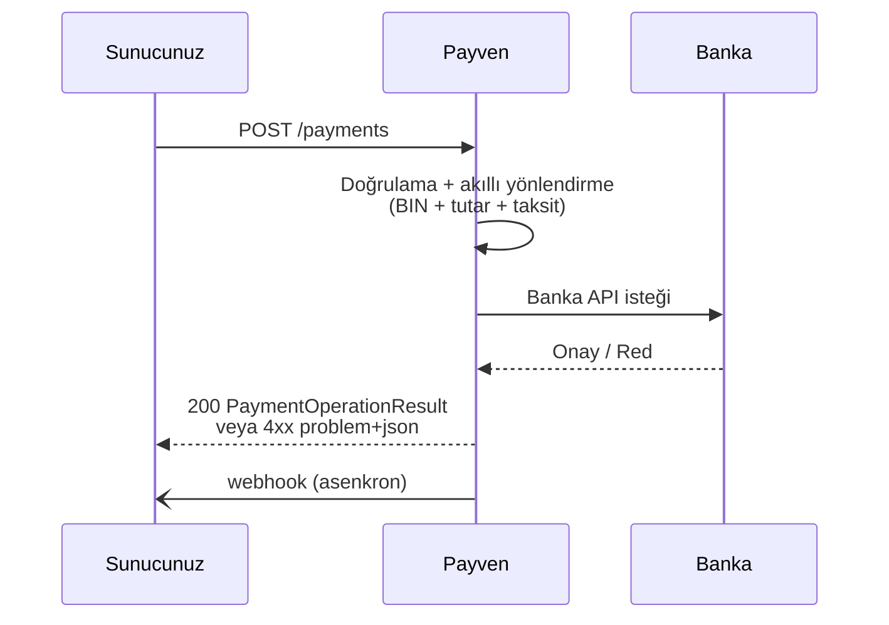
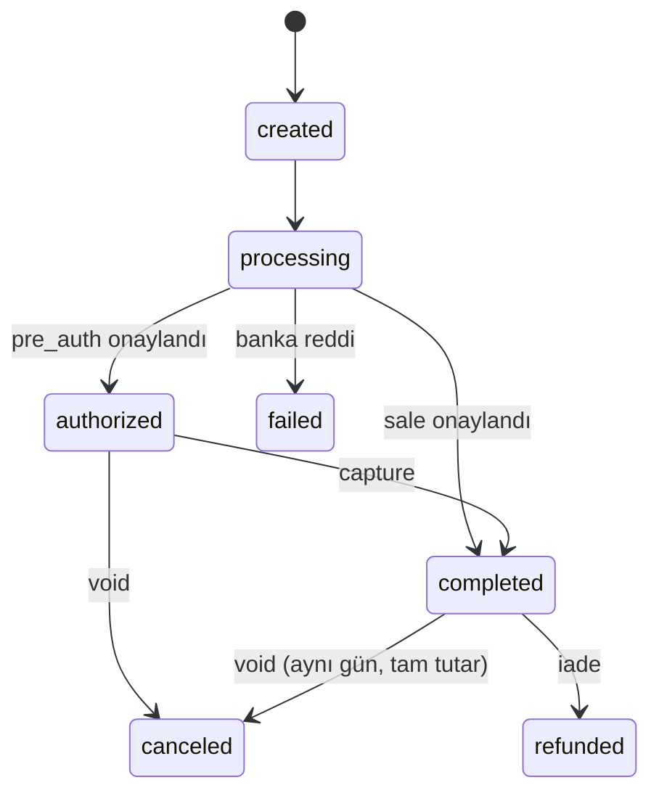

Non-3D ödeme en basit ödeme akışıdır. Tek bir API isteğiyle ödeme tamamlanır — kart bilgileri Payven'e iletilir, akıllı yönlendirme motoru uygun bankayı seçer, banka onayı alınır ve sonuç dönülür.

<Warning>
**Risk:** Non-3D işlemlerde kart sahibi doğrulaması yapılmadığı için **chargeback (ters ibraz) sorumluluğu** sizdedir. Tüketici ödemelerinde [3D Secure](/sanal-pos/payments/3d-secure) önerilir. Non-3D, kapalı devre B2B akışları, abonelik yenilemeleri (CIT/MIT) veya düşük risk segmentleri için uygundur.
</Warning>

## Endpoint

```http
POST /api/v1/payments
```

Gerekli yetki `CanManageTransactions`. İstek bir işletme adına yapılır: işletme kapsamlı API anahtarı bayiyi kendiliğinden taşır; şirket (tenant) düzeyindeki kimliklerde `X-Merchant-Id` (veya `X-External-Merchant-Id`) başlığı zorunludur. Pasif ya da onaysız işletme ödeme alamaz (`merchant_inactive` / `merchant_not_approved`, `422`).

## Akış



## İstek

```bash
curl -X POST https://vpos.payven.com.tr/api/v1/payments \
  -H "Authorization: Bearer $PAYVEN_TOKEN" \
  -H "Idempotency-Key: order-1001-payment" \
  -H "Content-Type: application/json" \
  -d '{
    "external_id":    "ORDER-1001",
    "basket_id":      "BASKET-2026-001",
    "amount":         { "amount": 15000, "currency": "TRY" },
    "installment":    1,
    "operation_type": "sale",
    "card": {
      "holder_name":  "Test Kullanici",
      "number":       "4546711234567894",
      "expire_month": "12",
      "expire_year":  "2030",
      "cvv":          "000"
    },
    "buyer": {
      "id":         "cust-001",
      "name":       "Test",
      "surname":    "Kullanici",
      "email":      "musteri@example.com",
      "phone":      "+905551112233",
      "ip_address": "85.105.10.10"
    },
    "billing_address": {
      "contact_name": "Test Kullanici",
      "city":         "Istanbul",
      "country":      "TR",
      "address":      "Maslak Mh. ...",
      "postal_code":  "34485"
    },
    "description": "Sipariş ödemesi"
  }'
```

<CodeGroup>
```javascript Node.js
const response = await fetch("https://vpos.payven.com.tr/api/v1/payments", {
  method: "POST",
  headers: {
    Authorization: `Bearer ${accessToken}`,
    "Idempotency-Key": `order-${order.id}-payment`,
    "Content-Type": "application/json",
  },
  body: JSON.stringify({
    external_id: order.id,
    amount: { amount: 15000, currency: "TRY" },
    installment: 1,
    operation_type: "sale",
    card: {
      holder_name:  "Test Kullanici",
      number:       "4546711234567894",
      expire_month: "12",
      expire_year:  "2030",
      cvv:          "000",
    },
    buyer: {
      id:         order.customerId,
      email:      order.email,
      ip_address: req.ip,
    },
  }),
});
const result = await response.json();
```

```python Python
import httpx, os

response = httpx.post(
    "https://vpos.payven.com.tr/api/v1/payments",
    headers={
        "Authorization":   f"Bearer {access_token}",
        "Idempotency-Key": f"order-{order.id}-payment",
    },
    json={
        "external_id":    order.id,
        "amount":         {"amount": 15000, "currency": "TRY"},
        "installment":    1,
        "operation_type": "sale",
        "card": {
            "holder_name":  "Test Kullanici",
            "number":       "4546711234567894",
            "expire_month": "12",
            "expire_year":  "2030",
            "cvv":          "000",
        },
        "buyer": {
            "id":         order.customer_id,
            "email":      order.email,
            "ip_address": request.client.host,
        },
    },
)
result = response.json()
```

```csharp C#
var payload = new
{
    external_id    = order.Id,
    amount         = new { amount = 15000L, currency = "TRY" },
    installment    = 1,
    operation_type = "sale",
    card = new
    {
        holder_name  = "Test Kullanici",
        number       = "4546711234567894",
        expire_month = "12",
        expire_year  = "2030",
        cvv          = "000"
    },
    buyer = new
    {
        id         = order.CustomerId,
        email      = order.Email,
        ip_address = httpContext.Connection.RemoteIpAddress?.ToString()
    }
};

var request = new HttpRequestMessage(HttpMethod.Post, "/api/v1/payments")
{
    Content = JsonContent.Create(payload)
};
request.Headers.Authorization = new AuthenticationHeaderValue("Bearer", accessToken);
request.Headers.Add("Idempotency-Key", $"order-{order.Id}-payment");

var response = await client.SendAsync(request);
var result = await response.Content.ReadFromJsonAsync<PaymentOperationResult>();
```

```go Go
payload := map[string]any{
    "external_id":    order.ID,
    "amount":         map[string]any{"amount": 15000, "currency": "TRY"},
    "installment":    1,
    "operation_type": "sale",
    "card": map[string]string{
        "holder_name":  "Test Kullanici",
        "number":       "4546711234567894",
        "expire_month": "12",
        "expire_year":  "2030",
        "cvv":          "000",
    },
    "buyer": map[string]any{
        "id":         order.CustomerID,
        "email":      order.Email,
        "ip_address": clientIP,
    },
}

body, _ := json.Marshal(payload)
req, _ := http.NewRequest("POST", baseURL+"/api/v1/payments", bytes.NewReader(body))
req.Header.Set("Authorization", "Bearer "+accessToken)
req.Header.Set("Idempotency-Key", fmt.Sprintf("order-%s-payment", order.ID))
req.Header.Set("Content-Type", "application/json")
resp, _ := http.DefaultClient.Do(req)
```

```php PHP
$payload = [
    "external_id"    => $order->id,
    "amount"         => ["amount" => 15000, "currency" => "TRY"],
    "installment"    => 1,
    "operation_type" => "sale",
    "card" => [
        "holder_name"  => "Test Kullanici",
        "number"       => "4546711234567894",
        "expire_month" => "12",
        "expire_year"  => "2030",
        "cvv"          => "000",
    ],
    "buyer" => [
        "id"         => $order->customer_id,
        "email"      => $order->email,
        "ip_address" => $_SERVER["REMOTE_ADDR"],
    ],
];

$ch = curl_init("https://vpos.payven.com.tr/api/v1/payments");
curl_setopt_array($ch, [
    CURLOPT_RETURNTRANSFER => true,
    CURLOPT_POST           => true,
    CURLOPT_HTTPHEADER => [
        "Authorization: Bearer $accessToken",
        "Idempotency-Key: order-{$order->id}-payment",
        "Content-Type: application/json",
    ],
    CURLOPT_POSTFIELDS => json_encode($payload),
]);
$response = json_decode(curl_exec($ch), true);
```
</CodeGroup>

## İstek alanları

| Alan | Tip | Zorunluluk | Açıklama |
|---|---|---|---|
| `external_id` | string | **Zorunlu** | Sipariş kimliğiniz; ödemenin idempotency anahtarıdır (aşağıya bakın). Boşsa `422 external_id_required`. |
| `basket_id` | string | Opsiyonel | Sepet kimliği (raporlama için) |
| `amount.amount` | int (kuruş) | Zorunlu | Müşteriden çekilecek nihai toplam, kuruş cinsinden tam sayı; `0`'dan büyük olmalı (taksitte vade farkı dahil) |

| `amount.currency` | string | Opsiyonel | ISO-4217 büyük harf; boşsa `TRY`. Şu an yalnız `TRY` işlem görür — bkz. [Tutarlar](/documentation/concepts/amounts) |
| `installment` | int | Opsiyonel | Taksit sayısı, `1`–`12` (varsayılan `1` = peşin). Bkz. [Taksit](/sanal-pos/payments/installment) |
| `connector_config_id` | uuid | Opsiyonel | [Taksit teklifinden](/sanal-pos/payments/installment) gelen banka kimliği; verilirse yönlendirme atlanır ve ödeme o bankadan geçer |
| `operation_type` | enum | Opsiyonel | `sale` (varsayılan, anında çekim) veya `pre_auth` (ön provizyon; sonra `/capture`) |
| `card.holder_name` | string | Zorunlu | Kart üzerindeki isim |
| `card.number` | string | Zorunlu | Kart numarası (Luhn geçerli olmalı) |
| `card.expire_month` | string | Zorunlu | İki hane (`01`–`12`) |
| `card.expire_year` | string | Zorunlu | İki veya dört hane (`30` / `2030`) |
| `card.cvv` | string | Koşullu | 3–4 haneli rakam. Zorunluluğu işletmenizin ödeme politikasına bağlıdır (`PV_CVV_REQUIRED`); gönderilirse biçimi doğrulanır |
| `buyer.id`, `name`, `surname`, `email`, `phone` | string | Önerilir | Müşteri bilgileri. `email` geçerli e-posta olmalı |
| `buyer.ip_address` | string | Önerilir | Müşterinin IPv4/IPv6 adresi (fraud için kritik) |
| `buyer.identity_number` | string | Opsiyonel | TC kimlik no (bazı bankalar yüksek tutarda ister) |
| `billing_address`, `shipping_address` | object | Opsiyonel | Gönderilirse `city` ve `address` zorunlu; ayrıca `contact_name`, `country`, `postal_code` |
| `basket_items[]` | array | Opsiyonel | `name` (boş olamaz), `price` (> 0), `quantity` (> 0); gönderilirse en az bir kalem |
| `description` | string | Opsiyonel | İşlem açıklaması |
| `splits[]` | array | Opsiyonel | Marketplace alt bayi dağılımı. Toplamı `amount`'u aşamaz; alt bayiler aktif, onaylı ve üst bayiye bağlı olmalıdır. İstek banka çağrısından önce doğrulanır |
| `extra_properties` | object | Opsiyonel | Bankaya özgü ek alanlar (ileri seviye) |

Gerekli başlıklar: `Authorization: Bearer <token>` (veya API anahtarı), `Content-Type: application/json`. `Idempotency-Key` önerilir — bkz. [Idempotency](/documentation/concepts/idempotency).

### external_id ve tekrar gönderim

`external_id` işletme başına tekil bir sipariş anahtarıdır. Aynı değerle gelen ikinci istek yeni çekim yapmaz:

| Mevcut işlemin durumu | Yanıt |
|---|---|
| `completed`, `authorized`, `refunded`, `canceled` | Mevcut sonuç aynen döner (`200`) |
| `failed` / `not_completed` | Mevcut başarısız sonuç döner; yeni deneme için **yeni bir `external_id`** kullanın |
| Devam eden (`created`, `processing`, 3DS veya iade/iptal/çekim işleniyor) | `409 PV_DUPLICATE_ORDER` + mevcut `transaction_id` |
| Başarılı ama farklı tutar / para birimi | `422 PV_ORDER_AMOUNT_MISMATCH` |

## Başarılı yanıt

```http
HTTP/1.1 200 OK
Content-Type: application/json
X-Correlation-Id: 9f1c8e76-2a3b-4f12-9c8d-12cb24a8a8a8
```

```json
{
  "transaction_id":        "8e3f5c12-9a7b-4c8d-bc4e-2c963f66afa6",
  "status":                "completed",
  "is_success":            true,
  "amount":                15000,
  "total_customer_amount": 15000,
  "interest_amount":       0,
  "currency":              "TRY",
  "extra_properties": {
    "processed_at":            "2026-05-03T12:34:58.123+03:00",
    "receipt_id":              "RCPT-20260503-0001",
    "external_id":             "ORDER-1001",
    "provider_transaction_id": "9f3d2b8e-...",
    "auth_code":               "123456",
    "host_reference":          "PAYVEN-REF-789"
  }
}
```

| Alan | Açıklama |
|---|---|
| `status` | `sale` için `completed`, `pre_auth` için `authorized` |
| `amount` / `total_customer_amount` | Müşteriden çekilen toplam tutar (kuruş) — gönderdiğiniz nihai tutar |
| `interest_amount` | Payven ödemede vade farkı hesaplamaz; `0` döner. Taksitli satışta vade farklı toplamı [teklif ucundan](/sanal-pos/payments/installment) alıp `amount` olarak gönderin |

Tam alan referansı: [Payment Objesi](/sanal-pos/payment-object). Sonradan [GET /payments/{id}](/sanal-pos/inquiries/payment-detail) ile sorgulayabilirsiniz.

## Durumlar



Non-3D istek senkron sonuçlanır; başarılı yanıtta `status` zaten `completed` ya da `authorized`'dır. Banka cevap vermezse sonuç belirsiz kalabilir (`504 PV_BANK_RESULT_UNKNOWN`): **aynı siparişi yeniden denemeyin**, işlem doğrulanır ve sonuç webhook ile bildirilir.

## Banka reddi

Banka reddinde yanıt `application/problem+json` döner (durum kodu hata kataloğundan gelir, genellikle `422`). `code` Payven'in kanonik kodudur (ör. `PV_INSUFFICIENT_FUNDS`; eşleşme yoksa `PV_PAYMENT_FAILED`), bankanın ham kodu `provider_error_code`'dadır; oluşan işlem kaydı `transaction_id` ile bildirilir ve `failed` durumundadır.

```json
{
  "type":                "https://docs.payven.com.tr/errors/pv_payment_failed",
  "title":               "Ödeme işlemi başarısız oldu.",
  "status":              422,
  "code":                "PV_PAYMENT_FAILED",
  "message":             "Ödeme işlemi başarısız oldu.",
  "category":            "provider_error",
  "provider_error_code": "51",
  "transaction_id":      "8e3f5c12-9a7b-4c8d-bc4e-2c963f66afa6"
}
```

Kodlar: [Payven Hata Kodları](/sanal-pos/errors/payven-codes), banka kodları: [Banka Yanıt Kodları](/sanal-pos/errors/bank-codes). Zarf yapısı: [Hata Yönetimi](/documentation/concepts/errors#hata-yanit-formati).

Banka çağrısından önce yakalanan başlıca durumlar:

| HTTP | `code` | Anlam |
|---|---|---|
| `422` | `external_id_required` | `external_id` boş |
| `422` | `validation_failed` | Alan biçimi geçersiz (`errors[]` ve `param` ilk alanı gösterir) |
| `422` | `PV_NON_3D_NOT_ALLOWED` | İşletmenizde Non-3D ödeme kapalı — [3D Secure](/sanal-pos/payments/3d-secure) kullanın |
| `422` | `PV_CVV_REQUIRED` / `PV_INVALID_CVV` | CVV zorunlu ya da geçersiz |
| `422` | `PV_INVALID_CARD_NUMBER` / `PV_INVALID_CARD_EXPIRY` / `PV_CARD_EXPIRED` | Kart numarası (Luhn) ya da son kullanma tarihi geçersiz |
| `422` | `PV_INSTALLMENT_NOT_ALLOWED` | Taksit bu işletme / kart (borç, ön ödemeli) için uygun değil |
| `422` | `merchant_limit_exceeded` | İşlem işletmenin tanımlı limitini aşıyor |
| `409` | `PV_DUPLICATE_ORDER` | Aynı `external_id` ile devam eden işlem var |
| `422` | `PV_ORDER_AMOUNT_MISMATCH` | Aynı `external_id` farklı tutarla kullanılmış |

```json
{
  "type":     "https://docs.payven.com.tr/errors/validation_failed",
  "title":    "Validasyon hatası",
  "status":   422,
  "code":     "validation_failed",
  "category": "invalid_request_error",
  "param":    "card.expire_month",
  "errors": [
    { "field": "card.expire_month", "message": "ExpireMonth 01-12 aralığında olmalıdır." }
  ]
}
```

## Webhook olayları

| Olay | Ne zaman |
|---|---|
| `sanalpos.payment.completed` | `sale` başarıyla tamamlandı |
| `sanalpos.payment.authorized` | `pre_auth` ile tutar bloke edildi |
| `sanalpos.payment.failed` | Ödeme başarısız (tüm bankalar denendikten sonra tek kez) |

Alt bayi dağılımı varsa `sanalpos.payment_split.*` olayları ayrıca oluşur. Liste: [Webhook Olayları](/sanal-pos/webhooks/events).

## Test ortamı

Test modundaki işletmenin Non-3D isteği bankaya gitmez; gerçek bir işlem kaydı yazılır, yaşam döngüsü ve webhook'lar canlıdaki gibi çalışır. Varsayılan sonuç **başarıdır** (`completed`). Red, yetersiz bakiye, zaman aşımı gibi senaryolar için Payven test kartlarını kullanın — bkz. [Sandbox](/sanal-pos/test/sandbox) ve [Test Kartları](/sanal-pos/test/test-cards).

## Sonraki adımlar

<CardGroup cols={2}>
  <Card title="3D Secure'a geçin" icon="shield-check" href="/sanal-pos/payments/3d-secure">
    Tüketici işlemlerinde chargeback riskini azaltın.
  </Card>
  <Card title="İade işlemi" icon="rotate-left" href="/sanal-pos/payments/refund">
    Tam veya kısmi iade nasıl yapılır?
  </Card>
  <Card title="Webhook entegre edin" icon="bell" href="/sanal-pos/webhooks/overview">
    Asenkron sonuçları gerçek zamanlı alın.
  </Card>
  <Card title="Akıllı yönlendirme" icon="route" href="/sanal-pos/routing/overview">
    Birden fazla bankaya nasıl yönlendirilir?
  </Card>
</CardGroup>
