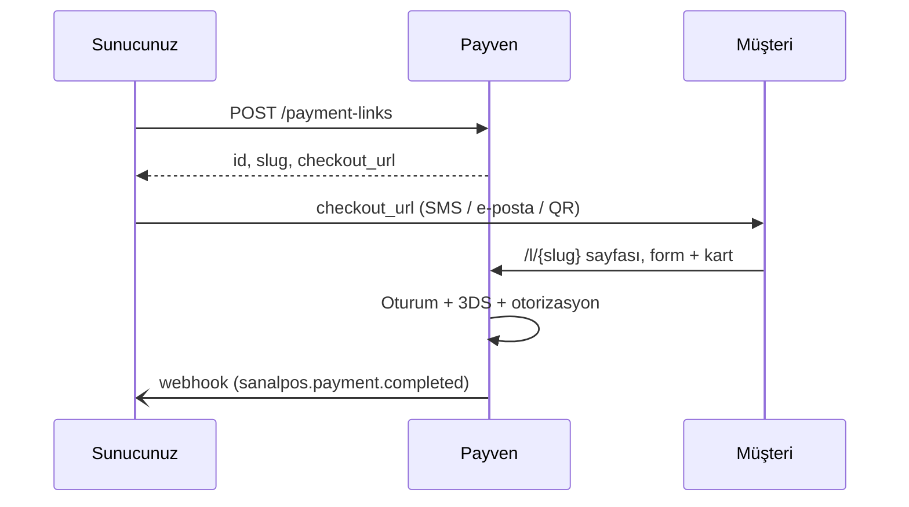
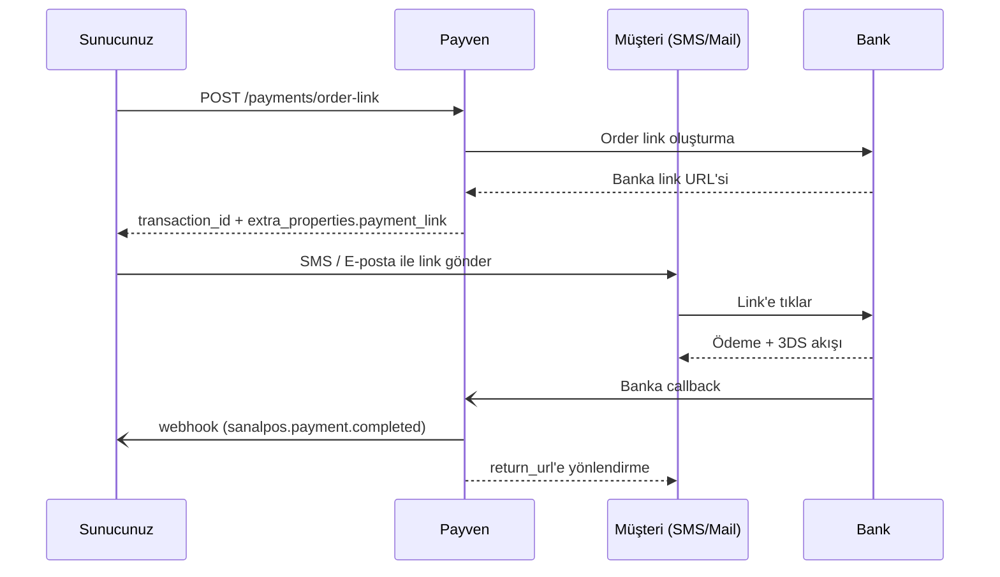

Pay-by-Link, kart bilgisi toplamadan müşteriye bir ödeme adresi göndermenizi sağlar. İki yöntem vardır:

| | Ödeme linki (`/payment-links`) | Banka linki (`/payments/order-link`) |
|---|---|---|
| Sayfayı barındıran | **Payven** (hosted checkout) | **Banka** |
| Kullanım | Yeniden kullanılabilir, sabit veya müşterinin seçtiği tutar, ürünlü satış, abonelik | Tek işlem için tek link |
| Bağlantı | Kalıcı adres: `{host}/l/{slug}` | Bankanın verdiği adres |
| Gereksinim | Alt özellik `payment-links` | Bankanın link desteği |

## Ödeme linki

Link bir kez tanımlanır; müşteri her açışında Payven bir [ödeme oturumu](/sanal-pos/payments/checkout-sessions) başlatır. Çağrı merkezi, sosyal medya, e-posta, QR ve abonelik tahsilatı için uygundur.



### Link oluşturma

```http
POST /api/v1/payment-links
```

Yetki: `CanManagePaymentLinks` (varsayılan roller: `tenant-admin`, `tenant-user`, `merchant-admin`, `merchant-cashier`). Bayi kapsamı `X-Merchant-Id` / `X-External-Merchant-Id` başlığından gelir. Yanıt `201 Created`.

```bash
curl -X POST https://vpos.payven.com.tr/api/v1/payment-links \
  -H "Authorization: Bearer $PAYVEN_TOKEN" \
  -H "Content-Type: application/json" \
  -d '{
    "title":        "Aidat Ödemesi",
    "description":  "Mayıs 2026 aidatı",
    "amount_mode":  "fixed",
    "fixed_amount": 150000,
    "currency":     "TRY",
    "collect_email": true,
    "collect_phone": true,
    "max_uses":     1,
    "expires_at":   "2026-06-01T23:59:00+03:00",
    "success_url":  "https://example.com/tesekkurler",
    "custom_fields": [
      { "key": "daire_no", "label": "Daire No", "type": "text", "required": true, "max_length": 10 }
    ],
    "metadata": { "donem": "2026-05" }
  }'
```

| Alan | Tip | Zorunluluk | Açıklama |
|---|---|---|---|
| `title` | string | **Zorunlu** | En fazla 200 karakter |
| `description` | string | Opsiyonel | En fazla 2000 karakter |
| `slug` | string | Opsiyonel | Adres kodu (3-32 karakter: `a-z`, `0-9`, `-`, `_`); boşsa 10 karakterlik rastgele kod. Kullanımdaysa hata |
| `amount_mode` | enum | Opsiyonel | `fixed` (varsayılan), `customer_chooses`, `line_items` |
| `fixed_amount` | int (kuruş) | `fixed` ise zorunlu | `0`'dan büyük |
| `min_amount`, `max_amount`, `suggested_amounts` | int (kuruş) | `customer_chooses` için | `min_amount` ≤ `max_amount`; önerilen tutarlar `0`'dan büyük |
| `items` | object[] | `line_items` ise zorunlu | `product_id`, `max_quantity`, `quantity_adjustable`; en fazla 20 ürün. Bkz. ürün kataloğu (`/products`) |
| `shipping_rates` | object[] | Opsiyonel | `display_name`, `amount`, `free_over_subtotal`, `delivery_estimate` |
| `currency` | string | Opsiyonel | ISO-4217, varsayılan `TRY` |
| `allowed_installments` | int[] | Opsiyonel | Her biri 1-12; tek değer sabit taksit anlamına gelir |
| `installments_disabled` | bool | Opsiyonel | Taksidi kapatır; sabit taksitle birlikte verilemez |
| `payment_mode` | enum | Opsiyonel | `non_3d`, `three_d_secure`, `three_d_pay`, `three_d_pay_hosting`; boşsa tenant politikası |
| `allow_pre_auth` | bool | Opsiyonel | Ön provizyon seçeneği |
| `collect_email` (varsayılan `true`), `collect_phone`, `collect_shipping_address`, `collect_billing_address`, `collect_invoice_details` | bool | Opsiyonel | Müşteriden toplanacak bilgiler |
| `require_terms_acceptance`, `terms_url`, `allow_promotion_codes` | bool / url / bool | Opsiyonel | Satış koşulu onayı ve indirim kodu alanı |
| `custom_fields` | object[] | Opsiyonel | Müşteriden alınacak ek alanlar: `key`, `label`, `type` (`text` / `number` / `dropdown`), `required`, `max_length`, `options`, `help_text`. Sabit bilgileri `metadata` ile gönderin |
| `card_commission_type`, `card_commission_rate`, `card_commission_fixed_amount` | enum / decimal / int | Opsiyonel | Kart komisyonunu müşteriye yansıtır (`percentage` / `fixed`); yalnız ürün satışında (`line_items`) |
| `experience` | enum | Opsiyonel | `classic` (tek ödeme sayfası) veya `shop` (mağaza deneyimi) |
| `suppressed_capabilities` | string[] | Opsiyonel | Bu link için kapatılacak otomasyon kodları (örn. fatura kesimi); bilinmeyen kod reddedilir |
| `expires_at` | tarih | Opsiyonel | Gelecekte olmalı; `+03:00` kullanın |
| `max_uses` | int | Opsiyonel | `0`'dan büyük; dolunca link ödeme kabul etmez |
| `splits` | object[] | Opsiyonel | Pazaryeri payları (`sub_merchant_id`, `amount`, komisyon) |
| `recurring` | object | Opsiyonel | Abonelik: `period` (`daily` / `weekly` / `monthly` / `yearly`), `interval`, `count`. Yalnız sabit tutarlı, ürünsüz, paysız linkte |
| `success_url`, `cancel_url`, `confirmation_message` | string | Opsiyonel | Ödeme sonrası yönlendirme ve teşekkür mesajı |
| `metadata` | object | Opsiyonel | Anahtar-değer |

Yanıt `PaymentLinkDto`'dur: gönderdiğiniz alanlara ek olarak `id`, `slug`, `current_uses`, `is_active`, `is_storefront`, `created`, `last_modified` ve **`checkout_url`** (`{host}/l/{slug}`) içerir. Müşteriye `checkout_url`'i iletin; Payven mail/SMS göndermez.

### Yönetim uçları

| Uç | Açıklama |
|---|---|
| `GET /payment-links` | Liste (sayfalı). Filtreler: `is_active`, `amount_mode`, `experience`, `start_date`, `end_date`, `derived_status` (`active`, `expired`, `used_up`, `canceled`) |
| `GET /payment-links/{id}` | Detay |
| `PUT /payment-links/{id}` | Yapılandırmayı **tümden değiştirir** (gövde oluşturma ile aynı); gönderilmeyen alan varsayılana döner |
| `POST /payment-links/{id}/activate` | Linki yeniden açar. Kullanım sınırı veya süre aşılmışsa `409` |
| `POST /payment-links/{id}/deactivate` | Linki kapatır; yeni ödeme alınmaz |
| `DELETE /payment-links/{id}` | Linki arşivler, slug yeniden kullanılabilir |
| `GET /payment-links/{id}/summary` | `view_count`, `checkout_start_count`, `payment_count`, `gross_amount`, `failed_count`, `not_completed_count`, `last_payment_at` |
| `GET /payment-links/export` · `/export/schema` | Dışa aktarma |

Okuma uçları `CanViewPaymentLinks` ister. Linkten yapılan ödemeleri `GET /transactions?payment_link_id={id}` ile listeleyebilirsiniz. Mağaza (`/payment-links/storefront*`) uçları panel ayarıdır.

### Müşteri tarafı

Müşteri `/l/{slug}` adresini açar; sayfa kimlik doğrulamasız `checkout/links/{slug}` uçlarını kullanır (link bilgisi, satış koşulları, sepet fiyat önizlemesi, `sessions` ile ödeme oturumu başlatma). Her ödeme denemesi bir [ödeme oturumudur](/sanal-pos/payments/checkout-sessions), aynı ömür ve deneme kurallarıyla.

### Durumlar

`is_active=false`, süresi dolmuş (`expires_at`) veya kullanım sınırı dolmuş (`current_uses >= max_uses`) link ödeme kabul etmez; müşteri `409 PV_CHECKOUT_PAYMENT_LINK_UNAVAILABLE` görür. Stokta olmayan ürünlü linkte `409 PV_CHECKOUT_OUT_OF_STOCK`.

### Hatalar

| HTTP | `code` | Anlam |
|---|---|---|
| `422` | `validation_failed` | Alan kuralı ihlali (tutar modu, tarih geçmişte, taksit aralığı, ürün sayısı...) |
| `422` | `PV_PAYMENT_LINK_RECURRING_NOT_ALLOWED` | Abonelik yalnız sabit tutarlı, ürünsüz, paysız linkte |
| `422` | `PV_PAYMENT_LINK_COMMISSION_REQUIRES_PRODUCTS` | Kart komisyonu yalnız ürün satışında |
| `409` | `PV_PAYMENT_LINK_STOREFRONT_MANAGED` | Mağaza linki bu uçlarla değiştirilmez |
| `409` | `invalid_state` | Slug kullanımda, link açılamıyor |
| `404` | `resource_not_found` | Link yok |

### Webhook olayları

| Olay | Açıklama |
|---|---|
| `sanalpos.payment.completed` / `sanalpos.payment.failed` / `sanalpos.payment.not_completed` | Linkten başlayan ödemenin sonucu. Payload'da `payment_link_id` yoktur; `transaction_id` ile işlemi okuyup `GET /transactions?payment_link_id={id}` ile linke bağlayın |
| `sanalpos.payment_link.exhausted` | `max_uses` dolduğunda |
| `sanalpos.subscription.*` | Aboneli linklerde taksit tahsilatları |

Bkz. [Webhook Olayları](/sanal-pos/webhooks/events).

### Test

Test modundaki bayinin linki de çalışır; ödeme Payven simülatörüne düşer. Bkz. [Sandbox](/sanal-pos/test/sandbox).

---

## Banka linki (order link)

Bazı bankalar ödeme sayfasını kendisi barındırır. Bu durumda Payven bankadan **tek kullanımlık link** ister, siz müşteriye iletirsiniz. Müşteri ödemeyi bankanın güvenli sayfasında yapar.

### Akış



### İstek

```http
POST /api/v1/payments/order-link
```

Yetki: `CanManageTransactions`; pasif veya onaysız bayi için `422 merchant_inactive` / `merchant_not_approved`.

```bash
curl -X POST https://vpos.payven.com.tr/api/v1/payments/order-link \
  -H "Authorization: Bearer $PAYVEN_TOKEN" \
  -H "Idempotency-Key: order-1001-link" \
  -H "Content-Type: application/json" \
  -d '{
    "external_id":    "ORDER-1001",
    "amount":         15000,
    "currency":       "TRY",
    "installment":    1,
    "description":    "Sipariş #1001 ödemesi",
    "customer_email": "musteri@example.com",
    "customer_phone": "+905551234567",
    "return_url":     "https://example.com/odeme/sonuc"
  }'
```

| Alan | Tip | Zorunluluk | Açıklama |
|---|---|---|---|
| `amount` | int (kuruş) | **Zorunlu** | `0`'dan büyük. Düz sayıdır |
| `currency` | string | Opsiyonel | ISO-4217, varsayılan `TRY` |
| `installment` | int | Opsiyonel | Sabit taksit, varsayılan `1` |
| `external_id` | string | Önerilir | Sipariş kimliğiniz |
| `description` | string | Opsiyonel | Ödeme açıklaması |
| `customer_email`, `customer_phone` | string | Opsiyonel | Müşteri bilgisi |
| `return_url` | url | Opsiyonel | Ödeme sonrası müşterinin yönlendirileceği adres (http/https). Boşsa `callback_url` kullanılır |
| `callback_url` | url | Opsiyonel | `return_url` yoksa dönüş adresi olarak kullanılır. Bankaya iletilmez; banka sonucu Payven'e bildirir |
| `extra_properties` | object | Opsiyonel | Ek anahtar-değer çiftleri |

### Yanıt

```json
{
  "transaction_id": "8e3f5c12-9a7b-4c8d-bc4e-2c963f66afa6",
  "status":         "processing",
  "is_success":     true,
  "extra_properties": {
    "payment_link": "https://hosted.bank.example.com/pay/abc123def456",
    "processed_at": "2026-05-03T13:00:00.1230000+00:00",
    "expires_at":   "2026-05-04T13:00:00.0000000+00:00"
  }
}
```

| `extra_properties` alanı | Açıklama |
|---|---|
| `payment_link` | Müşteriye gönderilecek tam URL |
| `processed_at` | Linkin oluşturulduğu an |
| `expires_at` | Linkin geçerlilik süresi (banka belirler, çoğunlukla 24 saat); bankanın bildirmediği durumda boş |

`status: "processing"`: link oluştu, müşteri ödeyene kadar bu durumda kalır; sonuç `completed` / `failed` olarak güncellenir. Son durumu [`GET /payments/{transaction_id}`](/sanal-pos/inquiries/payment-detail) ile okuyun.

### Müşteriye iletme

Payven otomatik mail/SMS göndermez; `payment_link` adresini kendi kanalınızdan iletin (SMS, e-posta, WhatsApp, QR).

### Banka linki hataları

| HTTP | `code` | Anlam |
|---|---|---|
| `422` | `validation_failed` | Tutar `0` veya geçersiz URL |
| `422` | `ORDER_LINK_FAILED` | Banka link üretemedi. Bayide yönlendirme kuralıyla birden çok banka varsa sırayla denenir; hepsi başarısızsa bu hata döner (`provider_error_code` banka kodunu taşır) |
| `422` | `merchant_limit_exceeded` | Bayi hacim limiti aşılır |

Linki iptal eden bir uç yoktur; link süresi dolana kadar geçerlidir.

### Webhook olayları

| Olay | Açıklama |
|---|---|
| `sanalpos.payment.completed` | Müşteri linkten ödemeyi tamamladı |
| `sanalpos.payment.failed` | Banka ödemeyi reddetti |
| `sanalpos.three_ds.completed` / `sanalpos.three_ds.failed` | 3DS sonucu |

### Sandbox

Test modundaki bayide link bankaya değil Payven simülatörüne açılır; kayıt gerçek yazılır, bankaya gidilmez.

### Konnektör desteği

Banka linki yalnızca link (order link) operasyonunu destekleyen bankalarda çalışır. Desteklenen bankalar tenant'a göre değişir; Payven yapılandırılmış ve desteği olan bankalardan birini seçer. Destek yoksa istek `ORDER_LINK_FAILED` ile döner.
