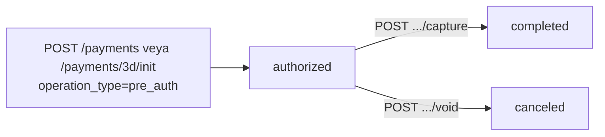

Ön provizyon (Pre-Authorization), kart üzerindeki tutarı **rezerve eder** ama henüz çekmez. Daha sonra `capture` ile rezervasyonu tutara çevirirsiniz veya `void` ile iptal edersiniz.

## Tipik senaryolar

- **Otel rezervasyonu** — Konuk geldiğinde net tutar belli olur, blokaj alıp check-out'ta capture.
- **Araç kiralama** — Hasar / yakıt değerlendirmesi sonrası net tutar çekilir.
- **E-ticaret kargo** — Kargo tutarı sonradan eklenebilir; net tutarda capture.
- **Marketplace** — Stok onayı sonrası capture; stok yoksa void.

## Akış



Capture sonrası işlem `completed` olur ve normal bir satış gibi mutabakata girer — bkz. [Mutabakat Yaşam Döngüsü](/sanal-pos/reconciliation/lifecycle).

## 1. Ön provizyon (Pre-Auth)

[Non-3D](/sanal-pos/payments/non-3d) (`POST /payments`) veya [3D Secure](/sanal-pos/payments/3d-secure) (`POST /payments/3d/init`) akışıyla başlatılır — tek fark gövdede `operation_type: "pre_auth"` olmasıdır. `external_id` zorunludur.

```bash
curl -X POST https://vpos.payven.com.tr/api/v1/payments/3d/init \
  -H "Authorization: Bearer $PAYVEN_TOKEN" \
  -H "Idempotency-Key: hotel-1001-preauth" \
  -H "Content-Type: application/json" \
  -d '{
    "external_id":    "HOTEL-1001",
    "amount":         { "amount": 50000, "currency": "TRY" },
    "installment":    1,
    "operation_type": "pre_auth",
    "card": {
      "holder_name":  "Test Kullanici",
      "number":       "4546711234567894",
      "expire_month": "12",
      "expire_year":  "2030",
      "cvv":          "000"
    },
    "success_url": "https://example.com/odeme/basarili",
    "fail_url":    "https://example.com/odeme/basarisiz"
  }'
```

3DS adımları [3D Secure](/sanal-pos/payments/3d-secure) ile aynıdır; sonuç `completed` yerine `authorized` olur.

### Başarılı sonuç

Non-3D yanıtında (3DS akışında sonuç `GET /api/v1/payments/{transaction_id}` ile alınır):

```json
{
  "transaction_id":        "8e3f5c12-9a7b-4c8d-bc4e-2c963f66afa6",
  "status":                "authorized",
  "is_success":            true,
  "amount":                50000,
  "total_customer_amount": 50000,
  "interest_amount":       0,
  "currency":              "TRY",
  "extra_properties": {
    "processed_at":   "2026-05-03T12:34:58.123+03:00",
    "auth_code":      "123456",
    "host_reference": "PAYVEN-PA-789"
  }
}
```

`status: "authorized"` → tutar bloke edildi ama henüz çekilmedi. Olay: `sanalpos.payment.authorized`.

## 2. Çekim (Capture)

```http
POST /api/v1/payments/{transaction_id}/capture
```

Gerekli yetki `CanManageTransactions`. Gövde bir JSON nesnesi olmalıdır (tam tutar için boş `{}` yeterli); gövdesiz ya da bozuk JSON `400 invalid_request_body` döner.

```bash
curl -X POST https://vpos.payven.com.tr/api/v1/payments/8e3f5c12-9a7b-4c8d-bc4e-2c963f66afa6/capture \
  -H "Authorization: Bearer $PAYVEN_TOKEN" \
  -H "Idempotency-Key: hotel-1001-capture" \
  -H "Content-Type: application/json" \
  -d '{
    "amount": { "amount": 47500, "currency": "TRY" },
    "reason": "Check-out tutarı"
  }'
```

| Alan | Tip | Zorunluluk | Açıklama |
|---|---|---|---|
| `amount.amount` | int (kuruş) | Opsiyonel | Çekilecek tutar. Boş veya `0` ise **kalan tüm rezerve tutar** çekilir; verilirse `0`'dan büyük olmalı |
| `amount.currency` | string | Opsiyonel | Boşsa işlemin para birimi; işlemin para birimiyle aynı olmalı |
| `reason` | string | Opsiyonel | Çekim sebebi (en fazla 500 karakter) |
| `extra_properties` | object | Opsiyonel | Bankaya özgü ek alanlar |

### Başarılı yanıt

```json
{
  "transaction_id": "8e3f5c12-9a7b-4c8d-bc4e-2c963f66afa6",
  "status":         "completed",
  "is_success":     true,
  "extra_properties": {
    "capture_id":             "b7d1a3c0-5e2f-4a11-9d0c-31f6a8e2c4b9",
    "processed_at":           "2026-05-03T18:00:01.234+03:00",
    "captured_amount":        "475.00",
    "provider_transaction_id":"9f3d2b8e-...",
    "capture_transaction_id": "CAP-9f3d2b8e",
    "receipt_id":             "RCPT-4472",
    "host_reference":         "PAYVEN-CAP-790"
  }
}
```

<Note>
`extra_properties.captured_amount` **TL cinsinden ondalık metindir** (`"475.00"`), kuruş değildir. İşlemin güncel tutarını `GET /payments/{id}` ile kuruş olarak okuyabilirsiniz.
</Note>

### Kısmi çekim kuralları

<Check>Çekim tutarı kalan rezerve tutarı aşamaz; aşan istek `409 CAPTURE_NOT_ALLOWED` ile reddedilir.</Check>
<Check>Capture yalnız `authorized` durumundaki işlemde yapılır. Başarılı capture işlemi `completed` yapar; **bir ön provizyon için tek çekim** yapılır. Kalan tutar işleme dahil edilmez (işlemin net tutarı çekilen kadardır).</Check>
<Check>Rezervasyonun banka tarafında ne kadar süre tutulacağı bankaya bağlıdır; bekleyen provizyonları zamanında çekin. Banka çekimi reddederse `422 CAPTURE_FAILED` ve bankanın ham kodu `provider_error_code` ile döner.</Check>

## 3. İptal (Void)

Çekim yapmadan rezervasyonu serbest bırakmak için [iptal](/sanal-pos/payments/void) edin. İptal, işlemin oluşturulduğu **Türkiye takvim günü** içinde yapılabilir; sonrasında yalnızca capture ya da iade yolu kalır:

```bash
curl -X POST https://vpos.payven.com.tr/api/v1/payments/8e3f5c12-.../void \
  -H "Authorization: Bearer $PAYVEN_TOKEN" \
  -H "Idempotency-Key: hotel-1001-void" \
  -H "Content-Type: application/json" \
  -d '{}'
```

## Hata yanıtları

| HTTP | `code` | Anlam |
|---|---|---|
| `404` | `PV_TRANSACTION_NOT_FOUND` | İşlem bulunamadı |
| `400` | `invalid_request_body` | Gövde okunamadı |
| `409` | `CAPTURE_NOT_ALLOWED` | İşlem `authorized` değil (zaten çekilmiş, iptal edilmiş, `sale`) ya da tutar kalan rezerveyi aşıyor |
| `409` | `PV_BANK_RESULT_PENDING` | İşlemde sonucu doğrulanmayı bekleyen başka bir banka işlemi var |
| `422` | `CAPTURE_CURRENCY_MISMATCH` | Para birimi işlemle aynı değil |
| `422` | `NO_REMAINING_AMOUNT` | Çekilecek kalan tutar yok |
| `422` | `CAPTURE_NOT_SUPPORTED` | İşlemin geçtiği banka capture desteklemiyor |
| `422` | `CAPTURE_FAILED` / `CAPTURE_EXCEPTION` | Banka çekimi reddetti (`provider_error_code` bankanın ham kodu) |
| `504` | `PV_BANK_RESULT_UNKNOWN` | Banka sonucu bildirmedi; işlem doğrulanıyor — yeniden denemeyin, sonuç kesinleşince bildirilir |

Hata yanıtı RFC 9457 problem+json formatındadır. Detay: [Hata Yönetimi](/documentation/concepts/errors).

## Mutabakat etkisi

| Aşama | Mutabakat hareketi |
|---|---|
| Pre-Auth | Mutabakata **dahil değil** — yalnızca blokaj |
| Capture | Çekilen tutar mutabakata girer |
| Void (capture'dan önce) | Mutabakatta hareket görünmez |

## Webhook olayları

| Olay | Açıklama |
|---|---|
| `sanalpos.payment.authorized` | Pre-Auth başarıyla alındı |
| `sanalpos.capture.completed` | Capture başarıyla tamamlandı |
| `sanalpos.void.completed` | Pre-Auth iptal edildi (capture'dan önce) |

Detay: [Webhook Olayları](/sanal-pos/webhooks/events).

## Test ortamı

Test modunda ön provizyon ve çekim bankaya gitmeden simüle edilir; durum geçişleri ve webhook'lar canlıdaki gibi çalışır. Ön provizyon yaptığınız simüle işlemin capture ve void çağrıları da simüle edilir.
