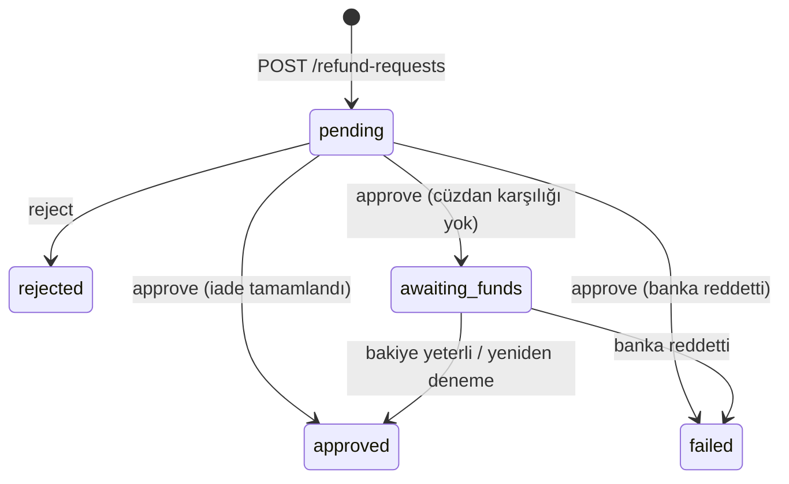

Doğrudan iade yetkisi (`CanRefundDirectly`) varsayılan olarak yalnızca `tenant-admin` rolündedir. Diğer roller **iade talebi** açar; farklı bir kullanıcı **onaylayınca** Payven iadeyi otomatik yürütür ([İade](/sanal-pos/payments/refund) ile aynı akış).

## Akış



| `status` | Anlam |
|---|---|
| `pending` | Onay bekliyor |
| `approved` | Onaylandı, iade bankada tamamlandı |
| `rejected` | Reddedildi (red notu zorunlu) |
| `failed` | Onaylandı ama banka iadeyi reddetti; `refund_error_code` / `refund_error_message` dolar |
| `awaiting_funds` | Onaylandı; bayinin cüzdan bakiyesi yetersiz olduğundan bankaya **gidilmedi**. Bakiye yeterli olunca otomatik denenir |

## 4 göz kuralı

Talebi açan kullanıcı kendi talebini **onaylayamaz** (`422 validation_failed`, `param: requested_by`). Kural tenant ödeme politikasındaki `RequireSeparateApprover` ayarına bağlıdır (varsayılan açık) ve bayi seviyesinde kapatılabilir. Servis hesabı (sistem çağıranı) kuraldan muaftır. `awaiting_funds` durumundaki yeniden denemelerde onay tekrar sorulmaz.

## Yetkiler

| Uç | Politika | Varsayılan roller |
|---|---|---|
| Talep aç / listele | `CanRequestRefund` | `tenant-admin`, `tenant-user`, `merchant-admin`, `merchant-user` |
| Onayla / reddet | `CanApproveRefund` | aynı roller |

Bu izinleri taşıyan rolle alınmış token (API anahtarı dahil) ile çağrılabilir. Bayi kapsamı `X-Merchant-Id` / `X-External-Merchant-Id` başlığından gelir; gövdede `merchant_id` gönderilmez.

## Talep aç

```http
POST /api/v1/refund-requests
```

```json
{
  "transaction_id": "8e3f5c12-9a7b-4c8d-bc4e-2c963f66afa6",
  "amount": 5000,
  "currency": "TRY",
  "reason": "Müşteri iade talebi",
  "reason_code": "customer_request"
}
```

| Alan | Tip | Zorunluluk | Açıklama |
|---|---|---|---|
| `transaction_id` | uuid | **Zorunlu** | `completed` durumdaki işlem. Ön provizyonlu işlemde önce capture edin |
| `amount` | int (kuruş) | **Zorunlu** | `0`'dan büyük; işlemin kalan iade edilebilir tutarını (`net_amount`) aşamaz |
| `reason` | string | **Zorunlu** | En fazla 500 karakter |
| `currency` | string | Opsiyonel | Boşsa işlemin para birimi |
| `reason_code` | enum | Opsiyonel | `customer_request`, `out_of_stock`, `duplicate_charge`, `product_defect`, `fraud`, `wrong_amount`, `other` |

Yanıt `201 Created`; gövde yeni talebin `id` değeridir (uuid). Bir işlemde aynı anda yalnızca **bir açık talep** (`pending` veya `awaiting_funds`) olabilir.

## Onayla / reddet

```http
POST /api/v1/refund-requests/{id}/approve
POST /api/v1/refund-requests/{id}/reject
```

| Uç | Gövde | Yanıt |
|---|---|---|
| `approve` | `{ "note": "..." }` (opsiyonel, en fazla 500) | `200` + güncel talep. İade onay anında yürütülür; `status` sonucu söyler |
| `reject` | `{ "note": "..." }` (**zorunlu**, en fazla 500) | `200` + talep `id` |

Onay sonucu `approved`, `failed` veya `awaiting_funds` olabilir; `failed` ve `awaiting_funds` HTTP hatası değil `200` ile döner, `status` alanına bakın. Yalnız `pending` talepler (ve `awaiting_funds` için yeniden deneme) işlenir; diğerleri `409 invalid_state`, olmayan talep `404 resource_not_found` alır.

## Talep nesnesi ve liste

```http
GET /api/v1/refund-requests?status=pending&transaction_id=...&from_date=...&to_date=...&page=1&page_size=20
```

```json
{
  "id": "0b1e8a3e-6c8b-4c43-8e53-1a2f9d1f5c11",
  "transaction_id": "8e3f5c12-9a7b-4c8d-bc4e-2c963f66afa6",
  "merchant_id": "…",
  "requested_by": "…",
  "requested_at": "2026-05-03T12:00:00+03:00",
  "reason": "Müşteri iade talebi",
  "reason_code": "customer_request",
  "amount": 5000,
  "currency": "TRY",
  "status": "pending",
  "reviewed_by": null,
  "reviewed_at": null,
  "review_note": null,
  "refund_error_code": null,
  "refund_error_message": null,
  "transaction": { "id": "…", "amount": 15000, "currency": "TRY", "status": "completed", "masked_card_number": "540061******0006" }
}
```

Filtreler: `status`, `transaction_id`, `from_date`, `to_date` (tarihlerde `+03:00` kullanın). Liste sayfalıdır; `/export` ve `/export/schema` uçları dışa aktarmayı sağlar.

## Bakiye bekleyen iade

Tenant'ta `sanalpos.refunds:wallet_funded` açıksa iade bankaya gitmeden önce bayinin cüzdan karşılığına (bakiye + kredi limiti) bakılır. Karşılık yoksa talep `awaiting_funds` olur, `refund_error_code = PV_REFUND_AWAITING_FUNDS` taşır ve **bankaya gidilmez**. Yeni satış veya bakiye yüklemesiyle karşılık oluşunca iade otomatik yeniden denenir; sonuç talebin `approved` durumu ve `refund.completed` webhook'uyla görünür. Doğrudan iade ucu da aynı kapıya takılır ve `202` ile talep açar ([İade](/sanal-pos/payments/refund)).

## Hatalar

| HTTP | `code` | Anlam |
|---|---|---|
| `404` | `resource_not_found` | İşlem veya talep bulunamadı |
| `409` | `invalid_state` | İşlem iade edilebilir durumda değil, tutar kalan tutarı aşıyor, açık talep zaten var veya talep zaten işlenmiş |
| `422` | `validation_failed` | Zorunlu alan eksik; 4 göz kuralı ihlali |

## Webhook olayları

Talep durumu için ayrı olay yoktur. İade bankada tamamlanınca `sanalpos.refund.completed`, banka reddederse `sanalpos.refund.failed` gelir. Bkz. [Webhook Olayları](/sanal-pos/webhooks/events).

## Test

Test modundaki bayide iade simüle edilir ve cüzdan kapısına takılmaz. Bkz. [Sandbox](/sanal-pos/test/sandbox).
