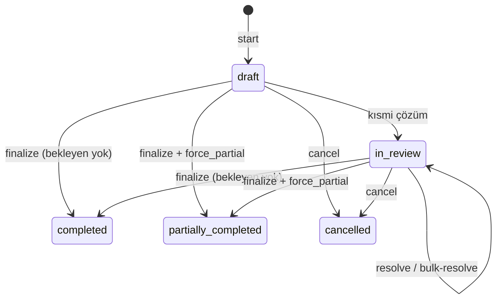

Bu sayfa bir mutabakat oturumunun aşamalarını ve API çağrılarını anlatır. Başlatma gövdesi, yanıt şeması ve enum değerleri: [Mutabakat Genel Bakış](/sanal-pos/reconciliation/overview).



## 1. Başlatma

`POST /reconciliations/start` banka satırlarını Payven işlemleriyle eşleştirir ve `201` ile özet + satırları döner (bkz. [genel bakış](/sanal-pos/reconciliation/overview#mutabakat-başlatma)). Mutabakat otomatik başlamaz; banka ekstresini hazırladığınızda siz başlatırsınız. `bank_transactions` boş gönderilirse yalnız Payven tarafı özetlenir ve bankada karşılığı olmayan her işlem `orphan_db` görünür.

## 2. İnceleme

Yalnız karar bekleyen satırları sayfalı çekin:

```bash
curl "https://vpos.payven.com.tr/api/v1/reconciliations/$ID/details?only_pending=true&discrepancy=amount_mismatch&page=1&page_size=50" \
  -H "Authorization: Bearer $PAYVEN_TOKEN"
```

Filtreler: `discrepancy`, `detail_status`, `only_pending`, `page`, `page_size`. Yanıt `PaginatedList` biçimindedir (`items`, `page`, `total_pages`, `total_count`, `has_previous_page`, `has_next_page`).

## 3. Tutarsızlıkları çözme

### Tek satır

```bash
curl -X POST "https://vpos.payven.com.tr/api/v1/reconciliations/$ID/details/$DETAIL_ID/resolve" \
  -H "Authorization: Bearer $PAYVEN_TOKEN" \
  -H "Idempotency-Key: resolve-9f3d2b8e" \
  -H "Content-Type: application/json" \
  -d '{
    "action":  "accept_bank",
    "remarks": "Banka tutarı doğru kabul edildi"
  }'
```

| Alan | Zorunluluk | Açıklama |
|---|---|---|
| `action` | Zorunlu | Aşağıdaki tabloya bakın |
| `adjusted_amount` | `adjust_amount` için zorunlu | Yeni tutar (kuruş), `>= 0` |
| `applied_status` | `force_status` için zorunlu | Yeni işlem durumu ([Payment Status](/sanal-pos/payment-object#status-degerleri)) |
| `remarks` | Opsiyonel | En çok 512 karakter; denetim izine yazılır |

| `action` | Etki |
|---|---|
| `accept_bank` | Banka doğru kabul edilir; **Payven işleminin tutarı ve durumu banka satırına göre güncellenir** (banka `voided`/`refunded` diyorsa işlem `canceled` olur) |
| `accept_db` | Payven doğru kabul edilir; satır çözüldü işaretlenir, işleme dokunulmaz |
| `mark_matched` | İki kayıt elle eşleşmiş sayılır; işleme dokunulmaz |
| `adjust_amount` | İşlemin net tutarı `adjusted_amount` olur |
| `force_status` | İşlemin durumu `applied_status` olur |
| `ignore` | Satır yok sayılır (`detail_status: ignored`) |

<Warning>
`accept_bank`, `adjust_amount` ve `force_status` Payven işlem kaydını değiştirir ve cüzdan/hakediş tarafına yansıyan olaylar üretebilir (örneğin `canceled` geçişi iptal olayı yayınlar). Önce `accept_db` / `mark_matched` ile gözden geçirmeniz önerilir.
</Warning>

Yanıt (`200`) güncel satırdır (`detail_status: resolved`, `resolution_action`, `resolved_at`, `resolved_by`).

### Toplu çözüm

Her satır kendi kararını taşır:

```bash
curl -X POST "https://vpos.payven.com.tr/api/v1/reconciliations/$ID/details/bulk-resolve" \
  -H "Authorization: Bearer $PAYVEN_TOKEN" \
  -H "Idempotency-Key: bulk-resolve-2026-10-15" \
  -H "Content-Type: application/json" \
  -d '{
    "items": [
      { "detail_id": "9f3d2b8e-1c4a-4e7b-8a52-6d0f93b1c7e2", "action": "accept_bank" },
      { "detail_id": "b12a77c0-3d9e-4f68-a0e5-5c7d4e8f9a13", "action": "adjust_amount", "adjusted_amount": 14750, "remarks": "Komisyon kesintisi" }
    ]
  }'
```

```json
{ "processed": 2, "failed": 0, "details": [ ... ], "errors": [] }
```

Başarısız satırlar `errors[]` içinde `detail_id` + `message` ile döner; diğer satırlar uygulanır.

## 4. Kapatma (finalize)

```bash
curl -X POST "https://vpos.payven.com.tr/api/v1/reconciliations/$ID/finalize" \
  -H "Authorization: Bearer $PAYVEN_TOKEN" \
  -H "Content-Type: application/json" \
  -d '{ "notes": "15 Ekim mutabakatı tamamlandı", "force_partial": false }'
```

- Bekleyen uyuşmazlık varken `force_partial: false` ile kapatma reddedilir; ya hepsini çözün ya da `force_partial: true` gönderin.
- `force_partial: true`: bekleyen satırlar `ignored` olur, `overall_status` `partially_completed` olur.
- Aksi halde `overall_status: completed`; `finalized_at` ve `finalized_by` dolar.
- Kapatma işlem kayıtlarını **değiştirmez**; işlemler yalnız çözüm adımlarında (`accept_bank`, `adjust_amount`, `force_status`) değişir.

## 5. İptal

```bash
curl -X POST "https://vpos.payven.com.tr/api/v1/reconciliations/$ID/cancel" \
  -H "Authorization: Bearer $PAYVEN_TOKEN" \
  -H "Content-Type: application/json" \
  -d '{ "reason": "Yanlış banka konfigürasyonu seçildi" }'
```

`completed` olmuş bir mutabakat iptal edilemez. İptal, mutabakatı `cancelled` yapar; **daha önce uygulanmış çözümler geri alınmaz**.

## Geriye dönük inceleme

```bash
curl "https://vpos.payven.com.tr/api/v1/reconciliations?start_date=2026-10-01T00:00:00%2B03:00&end_date=2026-10-31T23:59:59%2B03:00&overall_status=completed&page=1&page_size=50" \
  -H "Authorization: Bearer $PAYVEN_TOKEN"
```

Hata zarfı [`PayvenProblemDetails`](/sanal-pos/errors/overview) biçimindedir.
