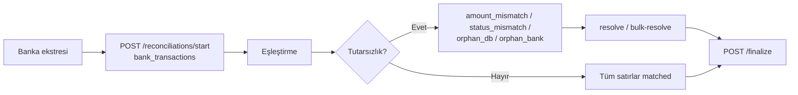

Mutabakat, bir dönemdeki ödeme hareketlerinin **banka kayıtlarıyla eşleştirilmesi** sürecidir. Siz banka satırlarını gönderirsiniz; Payven eşleştirir, tutarsızlıkları (eksik kayıt, tutar farkı, durum farkı) listeler ve karar vermenizi bekler. Kararlarınız işlem kaydına yansır.

<Note>
Mutabakat uçları `sanalpos.reconciliation` alt özelliği açık olan şirketlerde çalışır. Okuma için `CanViewReconciliations`, başlatma/çözme/kapatma için `CanManageReconciliations` izni gerekir; varsayılan olarak yönetim izni `tenant-admin` ve `merchant-admin` rollerindedir.
</Note>

## Kapsam ve dönem

| Alan | Değerler |
|---|---|
| `scope` | `connector` (bir banka konfigürasyonunun hareketleri) veya `merchant` (bir bayinin tüm bankalardaki hareketleri) |
| `period` | `daily`, `monthly`, `yearly`, `custom` |
| `period_start` | Günlük/aylık/yıllık için dönem başlangıcı, `custom` için başlangıç |
| `period_end` | Yalnız `custom` için zorunlu ve `period_start`'tan büyük; diğer dönemlerde otomatik hesaplanır |

Tarihleri `+03:00` ofsetiyle gönderin. Dönem, işlemlerin oluşturulma zamanına (`created`) göre taranır.

## Uçlar

```http
POST   /api/v1/reconciliations/start                              # Başlat — 201, özet + satırlar
GET    /api/v1/reconciliations                                    # Liste (sayfalı)
GET    /api/v1/reconciliations/export                             # CSV (scope=page|all)
GET    /api/v1/reconciliations/export/schema                      # Dışa aktarma kolon şeması
GET    /api/v1/reconciliations/{id}                               # Özet + tüm satırlar + net özet
GET    /api/v1/reconciliations/{id}/details                       # Satırlar (sayfalı, filtreli)
POST   /api/v1/reconciliations/{id}/details/{detail_id}/resolve   # Tek satırı çöz
POST   /api/v1/reconciliations/{id}/details/bulk-resolve          # Toplu çöz
POST   /api/v1/reconciliations/{id}/finalize                      # Kapat
POST   /api/v1/reconciliations/{id}/cancel                        # İptal et
```

Liste filtreleri: `scope`, `connector_config_id`, `merchant_id`, `bank_code`, `period`, `overall_status`, `start_date`, `end_date`, `page`, `page_size`.

## Süreç



## Mutabakat başlatma

```bash
curl -X POST https://vpos.payven.com.tr/api/v1/reconciliations/start \
  -H "Authorization: Bearer $PAYVEN_TOKEN" \
  -H "Idempotency-Key: recon-garanti-2026-10-15" \
  -H "Content-Type: application/json" \
  -d '{
    "scope":               "connector",
    "connector_config_id": "5b2e7c10-4f11-4b7a-9d3e-0a8c1f6d2e44",
    "period":              "daily",
    "period_start":        "2026-10-15T00:00:00+03:00",
    "bank_transactions": [
      {
        "bank_transaction_id": "GAR-AUTH-789-001",
        "amount":              15000,
        "status":              "approved",
        "transaction_date":    "2026-10-15T12:34:58+03:00",
        "auth_code":           "123456"
      }
    ]
  }'
```

| Alan | Tip | Zorunluluk | Açıklama |
|---|---|---|---|
| `scope` | enum | Zorunlu | `connector` veya `merchant` |
| `connector_config_id` | UUID | `scope=connector` | Banka konfigürasyonu |
| `merchant_id` | UUID | `scope=merchant` | Bayi |
| `period` | enum | Zorunlu | `daily`, `monthly`, `yearly`, `custom` |
| `period_start` | datetime | Zorunlu | Dönem başlangıcı |
| `period_end` | datetime | `period=custom` | Dönem sonu |
| `bank_transactions[]` | array | Opsiyonel | En çok **100.000** satır. Boşsa yalnız Payven tarafı özetlenir |

### `bank_transactions[]` satırı

| Alan | Zorunluluk | Açıklama |
|---|---|---|
| `bank_transaction_id` | Zorunlu | En çok 100 karakter; bankadaki işlem referansı |
| `amount` | Zorunlu | Tutar (kuruş), `>= 0` |
| `status` | Zorunlu | En çok 30 karakter. Büyük/küçük harf duyarsız: `approved`/`completed`/`success`/`captured`/`authorized` = başarılı; `declined`/`failed`/`error`/`rejected` = başarısız; `refunded`/`voided`/`canceled`/`reversed` = geri alınmış; `pending`/`processing` = bekliyor |
| `transaction_date` | Opsiyonel | Banka tarafı işlem zamanı |
| `merchant_external_id` | Opsiyonel | Bayi bazlı eşleştirmede yardımcı |
| `auth_code` | Opsiyonel | Yedek eşleştirme anahtarı |

### Eşleştirme sırası

Her Payven işlemi için banka satırı, ilk bulunan anahtarla eşleştirilir: (1) `provider_transaction_id`, (2) `host_reference` (RRN), (3) Payven işlem `id`'si, (4) `external_id`, (5) `auth_code`. İlk dört anahtar banka satırının `bank_transaction_id` alanıyla, sonuncusu `auth_code` alanıyla karşılaştırılır.

## Yanıt

```json
{
  "id":                      "8e3f5c12-9a7b-4c8d-bc4e-2c963f66afa6",
  "scope":                   "connector",
  "connector_config_id":     "5b2e7c10-4f11-4b7a-9d3e-0a8c1f6d2e44",
  "connector_config_name":   "Örnek VPOS",
  "merchant_id":             null,
  "bank_code":               "00062",
  "period":                  "daily",
  "period_start":            "2026-10-15T00:00:00.000+03:00",
  "period_end":              "2026-10-16T00:00:00.000+03:00",
  "reconciliation_date":     "2026-10-15",
  "total_db_transactions":   1247,
  "total_bank_transactions": 1245,
  "matched_count":           1240,
  "amount_mismatch_count":   2,
  "status_mismatch_count":   1,
  "orphan_db_count":         5,
  "orphan_bank_count":       3,
  "resolved_count":          0,
  "ignored_count":           0,
  "total_db_amount":         18705000,
  "total_bank_amount":       18675000,
  "overall_status":          "draft",
  "finalized_at":            null,
  "finalized_by":            null,
  "notes":                   null,
  "created":                 "2026-10-16T03:00:00.000+03:00",
  "details": [
    {
      "id":                  "9f3d2b8e-1c4a-4e7b-8a52-6d0f93b1c7e2",
      "reconciliation_id":   "8e3f5c12-9a7b-4c8d-bc4e-2c963f66afa6",
      "transaction_id":      "0c6e1a44-52b8-4d0e-a3f7-9b1d82e45c10",
      "bank_transaction_id": "GAR-AUTH-789-001",
      "db_amount":           15000,
      "bank_amount":         14990,
      "db_status":           "completed",
      "bank_status":         "approved",
      "discrepancy":         "amount_mismatch",
      "detail_status":       "pending",
      "resolution_action":   "none",
      "adjusted_amount":     null,
      "applied_status":      null,
      "resolved_at":         null,
      "resolved_by":         null,
      "remarks":             null
    }
  ],
  "summary": { "pending_count": 11, "net_reconciled_count": 1240, "initial_difference": -30000, "residual_difference": -30000 }
}
```

`summary`, çözüm kararlarını kovalara ayırır (`accepted_bank`, `accepted_db`, `marked_matched`, `adjusted`, `forced_status`, `ignored`; her biri `count`, `db_amount`, `bank_amount`) ve bekleyen ile net mutabık kalemleri toplar. Karar verdikçe yeniden hesaplanır.

## `overall_status`

| Değer | Anlam |
|---|---|
| `draft` | Başlatıldı, çözüm bekleniyor |
| `in_review` | Kısmen çözüldü, bekleyen satırlar var |
| `completed` | Tüm uyuşmazlıklar çözüldü ya da yok sayıldı; kapatıldı |
| `partially_completed` | `force_partial` ile kapatıldı; bekleyenler `ignored` oldu |
| `cancelled` | İptal edildi |

## `discrepancy`

| Değer | Anlam |
|---|---|
| `matched` | İki tarafta var, tutar ve durum uyumlu |
| `amount_mismatch` | İki tarafta var, tutar farklı |
| `status_mismatch` | İki tarafta var, tutar aynı, durum farklı (örn. Payven `completed`, banka `voided`) |
| `orphan_db` | Yalnız Payven'de var |
| `orphan_bank` | Yalnız bankada var |

## `detail_status`

| Değer | Anlam |
|---|---|
| `pending` | Karar bekliyor |
| `resolved` | Çözüldü |
| `ignored` | Yok sayıldı |
| `auto_matched` | Otomatik eşleşti (örnek amaçlı) |

Çözüm ve kapatma adımları: [Mutabakat Yaşam Döngüsü](/sanal-pos/reconciliation/lifecycle). Hakediş raporları için: [Hakediş Kayıtları](/sanal-pos/reporting/settlements).
