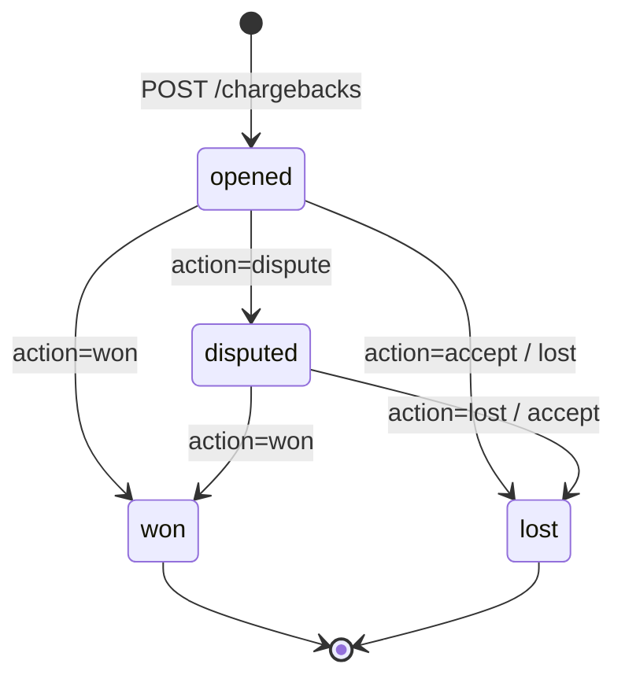

Chargeback, kart sahibinin bankasına başvurarak işlemi reddetmesi durumunda **bankanın size karşı açtığı geri alma talebidir**. Payven'de ters ibraz **kayıt ve durum takibi** olarak yürür: banka bildirimini kayda geçirir, itirazınızı ve sonucu işlersiniz. Bankaya kanıt evrakı iletimi Payven dışında, banka süreçlerinizle yapılır.

## Para etkisi

- Kayıt açıldığında (`opened`) ters ibraz tutarı bayinin bakiyesinden **düşülür**.
- İtiraz **lehinize** sonuçlanırsa (`won`) düşülen tutar bayiye geri verilir.
- Aleyhinize sonuçlanırsa ya da kabul ederseniz (`lost`) düşüm kalıcı olur.

## Uçlar

```http
GET    /api/v1/chargebacks                  # Liste (sayfalı)
GET    /api/v1/chargebacks/{id}             # Detay
GET    /api/v1/chargebacks/export           # CSV (scope=page|all)
GET    /api/v1/chargebacks/export/schema    # Dışa aktarma kolon şeması
POST   /api/v1/chargebacks                  # Ters ibraz kaydı aç — 201 { "id": "..." }
PUT    /api/v1/chargebacks/{id}/status      # Durumu ilerlet — 204
```

Okuma `CanViewTransactions`, yazma `CanManageTransactions` izni ister. Bayi kapsamı `X-Merchant-Id` / `X-External-Merchant-Id` başlığından uygulanır.

## Liste

Filtreler: `status`, `transaction_id`, `start_date`, `end_date` (`+03:00`), `page`, `page_size`.

```bash
curl "https://vpos.payven.com.tr/api/v1/chargebacks?status=opened&page=1&page_size=20" \
  -H "Authorization: Bearer $PAYVEN_TOKEN" \
  -H "X-Merchant-Id: $MERCHANT_ID"
```

```json
{
  "items": [
    {
      "id":                 "9f3d2b8e-1c4a-4e7b-8a52-6d0f93b1c7e2",
      "transaction_id":     "8e3f5c12-9a7b-4c8d-bc4e-2c963f66afa6",
      "amount":             15000,
      "currency":           "TRY",
      "reason":             "İşlem yetkisiz",
      "reason_code":        "4837",
      "bank_reference_no":  "CB-GAR-789",
      "status":             "opened",
      "response_deadline":  "2026-10-22T23:59:59.000+03:00",
      "resolved_at":        null,
      "merchant_response":  null,
      "notes":              null,
      "created":            "2026-10-15T10:30:00.000+03:00",
      "merchant_name":      "Örnek Ticaret A.Ş.",
      "masked_card_number": "454671******7894",
      "transaction_amount": 15000
    }
  ],
  "page": 1,
  "total_pages": 1,
  "total_count": 1,
  "has_previous_page": false,
  "has_next_page": false
}
```

## Durum makinesi



| `status` | Anlam |
|---|---|
| `opened` | Banka itirazı bildirdi; tutar bakiyeden düşüldü |
| `disputed` | Bayi itiraz etti, banka kararı bekleniyor (terminal değil) |
| `won` | İtiraz bayi lehine sonuçlandı; tutar geri verilir (terminal) |
| `lost` | İtiraz aleyhe sonuçlandı ya da bayi kabul etti; düşüm kalıcı (terminal) |

<Warning>
`won` ve `lost` **geri alınamaz**: karar para hareketi üretir. Sonuçlanmış kaydı değiştirmeye çalışmak hata döner. Hatalı karar, manuel bakiye düzeltmesiyle destek üzerinden giderilir.
</Warning>

## Kayıt açma

Banka bildirimini (e-posta, banka portalı) Payven'e kaydedin. `transaction_id` mevcut bir işleme ait olmalıdır; kayıt işlemin test/canlı moduyla açılır.

```bash
curl -X POST https://vpos.payven.com.tr/api/v1/chargebacks \
  -H "Authorization: Bearer $PAYVEN_TOKEN" \
  -H "X-Merchant-Id: $MERCHANT_ID" \
  -H "Idempotency-Key: cb-bank-ref-789" \
  -H "Content-Type: application/json" \
  -d '{
    "transaction_id":    "8e3f5c12-9a7b-4c8d-bc4e-2c963f66afa6",
    "amount":            15000,
    "currency":          "TRY",
    "reason":            "İşlem yetkisiz",
    "reason_code":       "4837",
    "bank_reference_no": "CB-GAR-789",
    "response_deadline": "2026-10-22T23:59:59+03:00"
  }'
```

| Alan | Zorunluluk | Açıklama |
|---|---|---|
| `transaction_id` | Zorunlu | İtiraz edilen işlem |
| `amount` | Zorunlu | Ters ibraz tutarı (kuruş) |
| `currency` | Opsiyonel | ISO-4217 büyük harf; boşsa `TRY` |
| `reason` | Zorunlu | Banka gerekçesi (metin) |
| `reason_code` | Opsiyonel | Şema neden kodu |
| `bank_reference_no` | Opsiyonel | Bankanın dosya numarası |
| `response_deadline` | Opsiyonel | İtiraz için son gün (`+03:00`) |
| `notes` | Opsiyonel | Kalıcı not |

Yanıt `201`: `{ "id": "..." }`. Kayıt `sanalpos.chargeback.opened` webhook'unu yayınlar.

## Durumu ilerletme

```bash
curl -X PUT https://vpos.payven.com.tr/api/v1/chargebacks/$ID/status \
  -H "Authorization: Bearer $PAYVEN_TOKEN" \
  -H "X-Merchant-Id: $MERCHANT_ID" \
  -H "Content-Type: application/json" \
  -d '{
    "action":            "dispute",
    "merchant_response": "Teslimat kanıtı banka portalına yüklendi (REF: ABC-123)",
    "notes":             "Banka portal evrak no: 2026-10-789"
  }'
```

| `action` | Etki |
|---|---|
| `dispute` | `disputed`; `merchant_response` itiraz içeriğini saklar |
| `accept` | Ters ibrazı kabul eder → `lost` |
| `won` | Lehe sonuç → `won`, tutar geri verilir |
| `lost` | Aleyhe sonuç → `lost` |

`won` / `lost` geçişi `sanalpos.chargeback.resolved` webhook'unu yayınlar. Eksik ya da tanınmayan `action` hata döner (kayıt bulunamadı anlamına gelmez).

## Webhook olayları

| Olay | Tetikleyici |
|---|---|
| `sanalpos.chargeback.opened` | Ters ibraz kaydı açıldı |
| `sanalpos.chargeback.resolved` | İtiraz sonuçlandı (`status` = `won` / `lost`) |

Gövde alanları: `chargeback_id`, `transaction_id`, `amount`, `currency`, `status`, `reason`, `reason_code`, `external_id`, `bank_reference_no`, `response_deadline`, `occurred_at` — bkz. [Webhook Olay Kataloğu](/sanal-pos/webhooks/events).

## Süre ve önleme

Bankalar genellikle birkaç gün içinde yanıt bekler (`response_deadline`); süre geçerse itiraz çoğu zaman müşteri lehine sonuçlanır. Başarılı 3D Secure doğrulaması, teslim kanıtı saklama ve hızlı iade politikası ters ibraz riskini azaltır.
